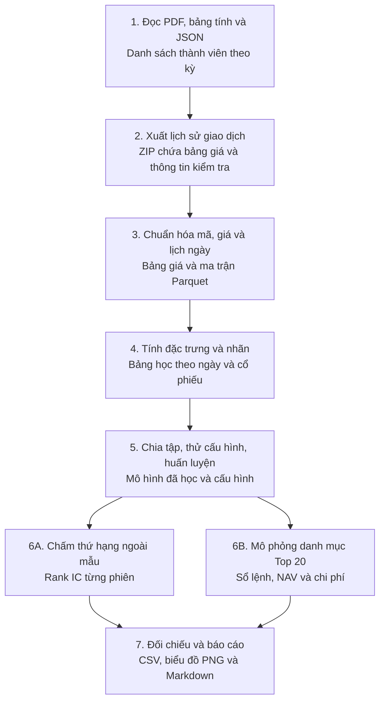

# V1 từ đầu — Từng file và từng công cụ làm gì?

Dành cho người mới học Python, dữ liệu chứng khoán và học máy. Cậu có thể dùng tài liệu này làm trang mở đầu, rồi đọc chương chi tiết ở cuối mỗi chặng. Các ví dụ số nhỏ bên dưới là ví dụ để học. Số liệu của dự án được ghi rõ là kết quả v1.

## 0. Trước khi mở file

Một **pipeline** là chuỗi công đoạn có đầu vào và đầu ra. Ví dụ, bước tải giá tạo file để bước làm sạch đọc. Bước làm sạch tạo bảng để bước huấn luyện đọc. **Script** là tệp mã Python `.py` chạy một công việc. **Thư viện** là bộ công cụ mà script gọi để đọc bảng, tính toán hoặc vẽ hình. **Định dạng** quy định dữ liệu được lưu thế nào trong file. **Artifact** là đầu ra đã lưu, như bảng giá, mô hình, sổ lệnh hoặc hình.



**Câu hỏi của bài:** Cuối phiên hôm nay, với những gì đã biết, mình có thể xếp hạng cổ phiếu theo lợi suất của phiên kế tiếp không? Vì dự báo cho quá khứ, mình cần danh sách cổ phiếu đã thuộc rổ tại từng thời điểm. Áp danh sách hiện tại về lịch sử có thể bỏ mất mã đã rời rổ hoặc hủy niêm yết. Đó là **survivorship bias**, tức thiên lệch sống sót. Dùng dữ liệu chỉ xuất hiện sau thời điểm dự báo là **look-ahead bias**, tức thiên lệch nhìn trước. Hai vấn đề này quyết định cách mình dựng dữ liệu và chia tập.

## 1. Tài liệu nguồn → danh sách Russell 1000 theo kỳ

- **PDF** giữ bố cục trang. `pypdf` lấy phần chữ trong trang. Code vẫn phải nhận diện mã và kiểm tra lỗi như mã bị cắt dòng.
- **CSV** lưu bảng dưới dạng chữ với các cột phân cách bằng dấu phẩy. **JSON** lưu dữ liệu dạng danh sách và cặp khóa–giá trị. Ví dụ giả lập `{"2020": ["AAPL", "MSFT"]}` có khóa năm và danh sách hai mã. Python có sẵn thư viện `json` để đọc và ghi.
- **`.xls`** thường là đuôi bảng tính Excel cũ. Có một chi tiết dễ nhầm trong repo. Hai file nguồn mang đuôi này được parser hiện hành đọc như văn bản có thẻ **XML** như `ss:Row`, tức thẻ đánh dấu một dòng. Code dùng **regex**, tức mẫu tìm chuỗi, để lấy các ô. `xlrd` có trong danh sách thư viện dành cho Excel cũ, còn nhánh này thực tế đọc bằng `open()` và `re`.

**Đầu ra** là danh sách mã theo năm trong `russell1000_pit_by_year.json`. **Point-in-Time (PIT)** nghĩa là theo thời điểm lịch sử. V1 dùng chu kỳ xấp xỉ 01/07 đến 30/06 năm sau. Nguồn snapshot, tức ảnh chụp danh sách tại một thời điểm, và ngày còn thiếu cần được ghi riêng. Danh sách này cho biết ai được xét trong rổ. Dữ liệu giá được lấy ở bước kế tiếp. [Parser danh sách](../../scripts/01_pipeline/01_parse_all_universe.py) · [Chương dữ liệu](v1_data.md)

## 2. QuantConnect → ZIP → Parquet

**QuantConnect** là môi trường nghiên cứu và lấy dữ liệu giá mà dự án dùng. Script xuất gọi thư viện của môi trường đó để lấy **OHLCV** gồm giá mở cửa, cao nhất, thấp nhất, đóng cửa và khối lượng. Giá của một mã trong một phiên thường gọi là một **bar**, tức nến giá. Một **batch** là một lô xuất. Dự án chia thành 10 lô để tải và kiểm tra.

**ZIP** là gói nén chứa nhiều file. Python dùng `zipfile` để mở gói và đọc bảng giá cùng các bảng kiểm tra tình trạng tải và định danh. Trong script xuất, `zlib` dùng để nén hoặc giải nén dữ liệu nhúng, còn `base64` chuyển byte thành chữ để nhúng hoặc tạo liên kết tải. `base64` là cách mã hóa biểu diễn dữ liệu, không phải thuật toán nén.

**Vì sao chuyển CSV sang Parquet?** CSV tiện mở bằng mắt, nhưng ngày tháng và số được biểu diễn dưới dạng chữ. **Parquet** là định dạng bảng lưu theo cột, giữ kiểu dữ liệu và hỗ trợ nén. Kho v1 có hàng triệu dòng. Nếu chỉ cần ngày, mã và giá đóng cửa, chương trình có thể yêu cầu đọc ba cột đó. Script ghép lô ghi kho và các tệp theo năm bằng **Snappy**, một cách nén. Một số bước kho đã chuẩn hóa dùng **Zstandard**, ghi là `zstd`. Hai tên đó mô tả cách nén, còn định dạng tệp vẫn là Parquet.

**PyArrow** là thư viện Python của **Apache Arrow**, một cách tổ chức dữ liệu dạng cột trong bộ nhớ. Khi gọi `pd.read_parquet(..., engine="pyarrow")`, `pandas` cung cấp hàm và trả về bảng Python, còn PyArrow hiểu cách đọc file Parquet. Trong bộ nạp ma trận, `pyarrow.parquet.ParquetFile` còn được dùng để đọc **schema**, tức cấu trúc tên cột và kiểu dữ liệu. Bộ nạp xác định cột ngày rồi truyền điều kiện lọc vào hàm đọc. Kỹ thuật chuyển điều kiện xuống bộ đọc gọi là **filter pushdown**. Nó cho phép bỏ qua phần dữ liệu mà bộ đọc xác định được là ngoài phạm vi. [Script ghép ZIP](../../scripts/01_pipeline/03_process_10_batches_to_parquet.py) · [Bộ nạp ma trận](../../src/data/matrix_loader.py)

## 3. Bảng giá → dữ liệu đã kiểm tra → ma trận ngày × mã

**pandas** làm việc với `DataFrame`, tức bảng có tên cột và nhãn dòng. Dự án dùng nó để lọc ngày, ghép bảng theo khóa và đổi từ bảng dài sang ma trận. **Khóa** là thông tin xác định dòng. Ví dụ, cặp ngày và định danh chứng khoán chỉ tới đúng một nến. **Pivot** là đổi cách bày bảng. Ba dòng có cột ngày, mã, giá được chuyển thành các ô có ngày trên trục dọc và mã trên trục ngang.

**NumPy** làm việc với `ndarray`, tức mảng nhiều chiều. Ví dụ, mảng giá hôm qua là `[100, 50]` và hôm nay là `[105, 48]`. Chia từng phần tử tương ứng rồi trừ 1 cho kết quả `[0.05, -0.04]`. NumPy hỗ trợ làm phép tính cho cả mảng. pandas hữu ích khi mình cần giữ tên cột, nhãn ngày hoặc ghép các bảng theo mã. **NaN** biểu diễn ô thiếu hoặc chưa tính được. Nếu phiên trước thiếu giá, tự điền lợi suất bằng 0 sẽ gán cho ô đó ý nghĩa giá đứng yên.

Trước khi tính, mình cần đúng **canonical SID**, tức định danh chuẩn của chứng khoán trong dự án. Mã hiển thị có thể đổi theo thời gian. Một mã từng dùng cũng có thể được dùng lại cho chứng khoán khác. Mình còn xử lý **corporate actions**, tức sự kiện doanh nghiệp ảnh hưởng đến cách đọc giá. Ví dụ, chia tách 2:1 có thể đổi một cổ phiếu giá 100 thành hai cổ phiếu giá 50. So 50 với 100 trực tiếp sẽ tạo ra cú giảm giả.

**Mask** là mặt nạ `True` hoặc `False` trên cùng lưới ngày × mã. Mặt nạ chất lượng giữ nến sạch để tính lịch sử. Mặt nạ thành viên quyết định mã nào thuộc phạm vi tại ngày phát dự báo. Mặt nạ nhãn xác định ô nào có kết quả tương lai để chấm. Tách các mặt nạ giúp dùng lịch sử sạch trước ngày gia nhập và tránh lấy tình trạng nhãn tương lai để lọc đầu vào hôm nay.

**EDA** là khảo sát dữ liệu để hiểu phân phối, phần thiếu và điểm bất thường. Ví dụ, thấy một lợi suất +100% thì truy ngược mã, ngày, giá thô và sự kiện. Một điểm cực đoan có thể là biến động thật hoặc lỗi. Đầu ra của bước này là bảng và hình đối chiếu để giải thích quyết định xử lý. [Cách dựng ma trận và mặt nạ](../reports/data_pipeline/step4_matrices_masks_report.md) · [Báo cáo EDA](../reports/data_pipeline/step6_eda_report.md)

## 4. Ma trận → đặc trưng, nhãn và bảng học

**Feature** là đặc trưng tính từ dữ liệu đã biết, ví dụ lợi suất 5 phiên. **Rolling window** là cửa sổ trượt. Mỗi phiên cửa sổ dịch thêm một bước để tính lại chỉ báo. **Warm-up** là đoạn lịch sử cần tích lũy trước khi công thức có đủ đầu vào. **Pilot** là chạy thử phạm vi nhỏ để kiểm tra công thức và các trường hợp thiếu dữ liệu trước khi tạo cả kho. **Feature store** trong repo là tập các file đặc trưng đã tính và thông tin mô tả chúng.

**Nhãn** là đáp án mô hình dùng khi học. Ví dụ ba mã có lợi suất phiên sau −2%, +1%, +3% thì thứ hạng quy về thang 0–1 là 0, 0,5, 1. V1 lưu cả `target_rank` để học và `target_return` để đối chiếu lợi suất thực tế. Bảng `baseline_dataset_v1.parquet` có 17 cột, gồm ngày, định danh, 13 đặc trưng và hai cột đích. Một dòng ứng với một cặp ngày–chứng khoán.

```python
# Ví dụ chỉ đọc ba cột từ bảng v1, chạy từ thư mục gốc repo
import pandas as pd

sample = pd.read_parquet(
    "data/processed/baseline_dataset_v1.parquet",
    columns=["date", "canonical_sid", "ret_5d"],
    filters=[("date", ">=", pd.Timestamp("2023-12-28"))],
    engine="pyarrow",
)
print(sample.head())
```

`.head()` lấy vài dòng đầu để xem. `filters` ở đây giới hạn phạm vi đọc theo ngày. [Đặc tả bảng học](../specifications/baseline_dataset_v1.md) · [13 công thức và cách kiểm tra](v1_features_models.md)

## 5. Bảng học → thử cấu hình → mô hình đã học

**Train** là tập huấn luyện. **Validation** là tập kiểm thực dùng để so cấu hình. **Development** là giai đoạn dùng để làm hai việc đó. **Walk-forward** chia nhiều lượt theo thứ tự thời gian. Mỗi lượt học từ phần sớm hơn rồi đánh giá ở phần sau. **Purge** là loại mẫu có nhãn chạm sang tập kế tiếp. Ví dụ, nếu nhãn của phiên cuối Train cần giá đóng cửa của phiên đầu Validation thì mẫu đó bị loại khỏi Train.

**YAML** là văn bản cấu hình theo khóa, giá trị và thụt đầu dòng. **PyYAML** là thư viện đọc và ghi nó. Lịch walk-forward lưu ngày, tên các đặc trưng và quy tắc từng lượt. **Grid search** là thử một danh sách cấu hình đã xác định. **Siêu tham số** là nút chỉnh do người làm chọn trước lần fit, ví dụ mức phạt của Ridge hoặc số lá tối đa của GBDT.

**scikit-learn** là thư viện huấn luyện trong v1. Lần fit cuối đi như sau:

1. `pandas.read_parquet()` đọc các cột cần từ bảng Development.
2. `.to_numpy(dtype=np.float32)` đổi sang mảng NumPy. `X` gồm 13 cột đầu vào. `y` gồm các giá trị `target_rank`. `float32` dùng 32 bit cho mỗi số thực, giúp giảm bộ nhớ.
3. **Ridge** dùng `StandardScaler` để chuẩn hóa theo trung bình và độ lệch chuẩn học từ Train, rồi học hệ số tuyến tính. **Phạt L2** cộng thêm chi phí cho hệ số lớn. `alpha=1` là mức phạt. **GBDT** học một chuỗi cây quyết định để giảm sai số của các dự báo trước đó. Bản v1 dùng `HistGradientBoostingRegressor` tối đa 7 lá, tức tối đa 7 vùng đầu ra mỗi cây, và đưa đặc trưng vào trực tiếp.
4. `.fit(X, y)` là lệnh học. **Refit** là học lại cấu hình đã chọn trên toàn bộ Development đủ điều kiện. **Model freeze** là giữ nguyên tham số trong giai đoạn chấm ngoài mẫu.
5. **joblib** ghi đối tượng đã học ra file `.joblib`. Khi cần dự báo, nạp lại bằng `joblib.load()` rồi gọi `.predict(X_moi)`. File Ridge lưu cả bộ chuẩn hóa đã fit và Ridge. **Manifest** là tệp mô tả đi kèm, ghi thứ tự cột, mốc dữ liệu và tham số để lần chạy sau nạp đúng.

**Alpha signal** trong bài là điểm dùng để xếp hạng. Ridge và GBDT tạo điểm bằng mô hình đã học. `ret_20d` tạo điểm trực tiếp từ công thức lợi suất 20 phiên và làm đối chứng. Mức phạt `alpha=1` của Ridge và tỷ trọng tối đa 5% NAV/mã trong danh mục là hai đại lượng khác. [Lịch chia tập](../specifications/walk_forward_schedule_v1.md) · [Script fit cuối](../../scripts/01_pipeline/25_refit_final_models_development.py)

## 6. Mô hình → hai cách đánh giá

**6A. Dự báo ngoài mẫu.** **OOS** là *out-of-sample*, tức phần dữ liệu dành để đánh giá sau khi chốt mô hình. Code nạp mô hình, tính lại đặc trưng bằng dữ liệu tới hết ngày tín hiệu, rồi lưu điểm dự báo. **SciPy** là thư viện tính toán khoa học. V1 dùng `scipy.stats.spearmanr` để đo tương quan giữa hai dãy thứ hạng theo ngày và `ttest_1samp` để so Mean IC với 0. **Rank IC** đo mức độ thứ hạng dự báo và thứ hạng thực tế đi cùng nhau, có thang −1 đến +1. Ridge đạt 0,023050 trung bình qua 624 phiên OOS chính. Con số đó là tương quan thứ hạng, khác tỷ lệ đoán đúng. [Kế hoạch OOS](../specifications/oos_evaluation_plan_v1.md) · [Chương đánh giá](v1_evaluation.md)

**6B. Mô phỏng giao dịch.** **Backtest** là dùng dữ liệu lịch sử để mô phỏng lệnh theo quy tắc. Bộ mô phỏng Python của dự án lấy Top 20 từ điểm cuối ngày, đặt mua phiên sau ở giá mở cửa và mô phỏng bán ở giá đóng cửa. **Sổ lệnh** ghi từng giao dịch hoặc lần hủy. **Sổ cái** ghi tiền mặt, vị thế và **NAV**, tức giá trị tài sản danh mục, mỗi phiên. **bps** là điểm cơ bản. 1 bps bằng 0,01 điểm phần trăm, nên 20 bps là 0,20% mỗi vòng mua–bán. **Turnover** là mức danh mục được giao dịch lại. Mua sáng bán chiều lặp hằng ngày khiến phí tích lũy nhanh. V1 ghi nhận Ridge +34,93% ở 0 bps và −61,19% ở mức giả định 20 bps. Dự báo chấm **Close-to-Close**, còn mô phỏng giao dịch **Open-to-Close**. [Đặc tả mô phỏng](../specifications/backtest_plan_v1.md) · [Báo cáo sổ lệnh](../reports/baseline/oos_backtest_primary_report.md)

## 7. Kết quả → kiểm tra, hình và báo cáo

- **pytest** tìm và chạy các bài kiểm thử Python. Bài kiểm thử tổng hợp dùng dữ liệu nhỏ tạo sẵn để kiểm tra một hành vi. Bài **integration** kiểm tra các phần làm việc cùng nhau và có thể cần file cục bộ. **CI** là kiểm tra tự động khi code thay đổi. **Git** lưu lịch sử phiên bản, còn **GitHub Actions** chạy quy trình CI theo cấu hình. [Hướng dẫn kiểm thử](../testing.md) · [Kết quả rà soát v1](v1_review.md)
- **Matplotlib** vẽ từ CSV hoặc bảng trong bộ nhớ. **PNG** là file ảnh đã vẽ. **Markdown** là văn bản dùng cho README và báo cáo. Dùng Preview để thấy tiêu đề, hình và công thức. **Mermaid** mô tả sơ đồ bằng chữ và được trình xem hỗ trợ chuyển thành hình. **Jupyter Notebook** lưu mã và lời giải thích theo từng ô trong file `.ipynb`. Notebook đi kèm để đọc lại luồng nghiên cứu. Script `.py` là nơi xem các công đoạn thực thi. [Script vẽ hình](../../scripts/01_pipeline/33_generate_report_figures.py) · [Notebook đọc lại dự án](../../notebooks/01_research_walkthrough.ipynb)
- **`requirements.txt`** ghi các thư viện môi trường dự án, gồm cả thư viện cho thí nghiệm hoặc ứng dụng khác. **`requirements-ci.txt`** là danh sách gọn hơn cho kiểm tra tự động. Muốn biết một thư viện có thực sự chạy trong v1, đối chiếu script và đầu ra. Ví dụ, XGBoost, LightGBM và PyTorch có trong danh sách môi trường, còn hai mô hình v1 đã lưu được huấn luyện bằng scikit-learn. [Danh sách thư viện](../../requirements.txt) · [Danh sách cho CI](../../requirements-ci.txt)

## Tự kiểm tra trước khi đọc báo cáo

1. Nếu có một file Parquet, vai trò của Parquet, PyArrow, pandas và NumPy khác nhau ở đâu?
2. Từ một dòng giá gốc, làm sao biết đúng mã, đúng ngày, giá sạch và mã thuộc rổ tại ngày dự báo?
3. Vì sao `X` dùng lịch sử tới hôm nay còn `y` dùng kết quả phiên sau? Vì sao lúc dự báo chỉ truyền `X`?
4. Cấu hình YAML, file mô hình joblib, bảng dự báo và sổ lệnh lần lượt lưu gì?
5. Vì sao Rank IC dương và danh mục lỗ sau phí có thể cùng đúng?

Sau khi đọc, mở [báo cáo thực nghiệm v1](../reports/baseline/comprehensive_course_project_report.md) để lần theo bảng kết quả và bốn hình. Mỗi khi gặp một số, thử tìm lại nó trong bảng hoặc sổ cái nguồn.
