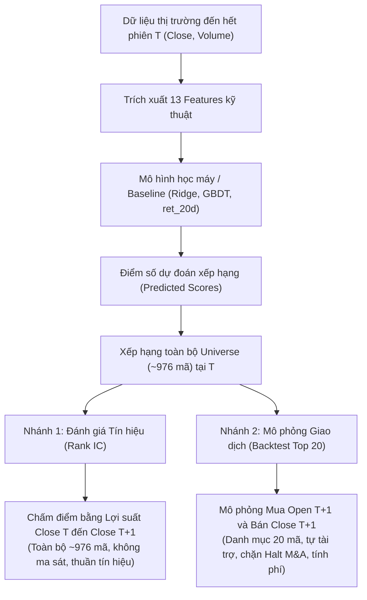
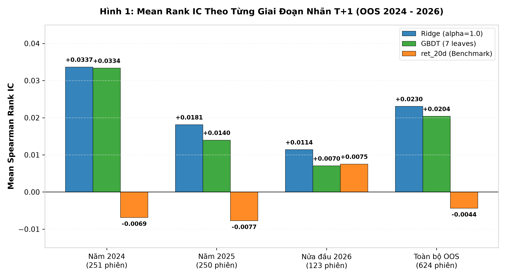
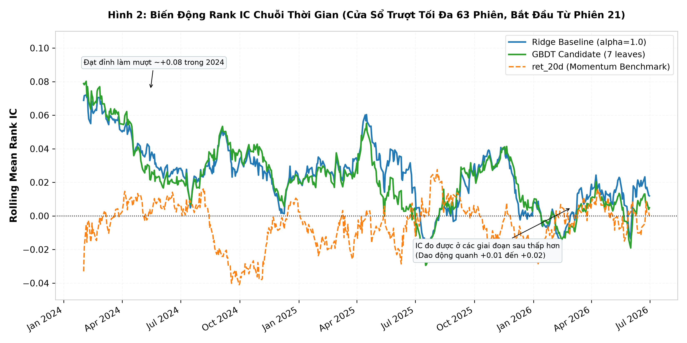
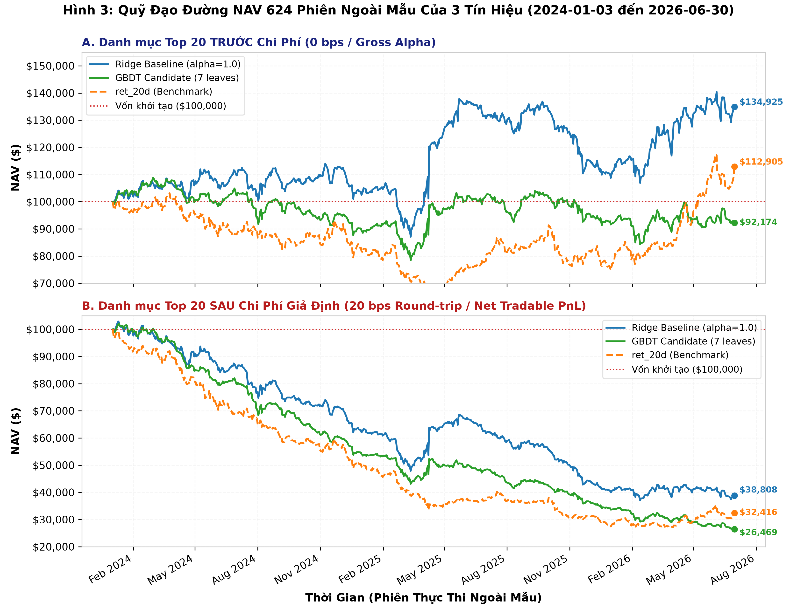
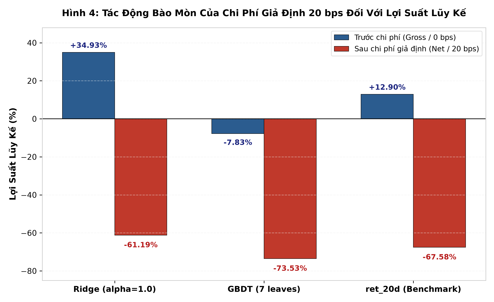

# BÁO CÁO KẾT QUẢ THỰC NGHIỆM NGOÀI MẪU TOÀN DIỆN (COMPREHENSIVE OOS EXPERIMENTAL RESULTS REPORT)
## Đánh Giá Tín Hiệu Dự Báo Xếp Hạng Lợi Suất & Backtest Minh Họa Danh Mục Top 20 (624 Phiên: 2024-01-03 đến 2026-06-30)

> **Thông tin văn bản & Dữ liệu nguồn:**
> - **Mã tài liệu:** `docs/reports/baseline/comprehensive_experimental_results_report.md`
> - **Phạm vi đánh giá chính (Primary Scope):** 624 phiên giao dịch ngoài mẫu (ngày nhãn thực thi $T+1$ từ 2024-01-03 đến 2026-06-30).
> - **Tập dữ liệu nguồn đã đối chiếu:**
>   - Bảng chuỗi IC hàng ngày ngoài mẫu: [`outputs/reports/oos_daily_ic_2024_2026.csv`](../../../outputs/reports/oos_daily_ic_2024_2026.csv) (bộ lọc `is_primary_strict_t1 == True`, $N = 624$).
>   - Bảng tổng hợp hiệu năng 6 kịch bản: [`outputs/reports/backtest_primary_scope/performance_summary_all_scenarios.csv`](../../../outputs/reports/backtest_primary_scope/performance_summary_all_scenarios.csv)
>   - Danh mục 18 sự kiện đình chỉ niêm yết: [`outputs/reports/backtest_primary_scope/reconciliation_open_positions.csv`](../../../outputs/reports/backtest_primary_scope/reconciliation_open_positions.csv)
>   - Sổ lệnh & Sổ cái chi tiết: [`outputs/reports/backtest_primary_scope/`](../../../outputs/reports/backtest_primary_scope/)
> - **Script tái hiện biểu đồ:** [`scripts/01_pipeline/33_generate_report_figures.py`](../../../scripts/01_pipeline/33_generate_report_figures.py)

---

## 1. Bài Toán Và Phương Pháp Đánh Giá

### 1.1. Mô tả bài toán xếp hạng định lượng
Nghiên cứu tập trung giải quyết bài toán cốt lõi trong đầu tư định lượng: **Dự báo thứ tự xếp hạng tương đối về tỷ suất sinh lời của cổ phiếu cho phiên giao dịch kế tiếp ($T \rightarrow T+1$)**. 

Khác với bài toán hồi quy giá trị tuyệt đối (vốn nhạy cảm với các cú sốc vĩ mô toàn thị trường), bài toán xếp hạng cross-sectional hướng đến việc tìm ra những cổ phiếu có khả năng sinh lời vượt trội hơn các cổ phiếu khác trong cùng một ngày giao dịch, bất kể thị trường chung tăng hay giảm.

* **Không gian cổ phiếu (Universe):** Toàn bộ các mã cổ phiếu thanh khoản cao thuộc rổ chỉ số Russell 1000 có dữ liệu giao dịch hợp lệ tại phiên $T$ ($\approx 976$ cổ phiếu mỗi phiên sau khi loại trừ các mã rỗng, mã ngừng niêm yết hoặc thiếu thanh khoản).
* **Đặc trưng đầu vào (Feature Set):** Bộ 13 đặc trưng kỹ thuật Close và Volume chuẩn hóa không rò rỉ tương lai (bao gồm các chỉ báo động lượng qua nhiều khung thời gian, tỷ số giá so với đường trung bình động MA, khoảng cách biến động cực trị, độ lệch chuẩn giá và động lượng khối lượng giao dịch).
* **Mô hình định lượng và Cơ chế chuẩn hóa thang đo:**
  1. **Ridge Baseline ($\alpha=1.0$):** Mô hình hồi quy tuyến tính có hiệu chỉnh L2 (`Ridge` của thư viện `scikit-learn`). Do thuật toán hồi quy tuyến tính nhạy cảm với thang đo của các đặc trưng đầu vào có đơn vị khác nhau, mô hình này kết hợp tiền xử lý chuẩn hóa bằng `StandardScaler` (fit trên tập huấn luyện và transform trên tập kiểm thử).
  2. **GBDT Candidate (7 leaves):** Mô hình cây quyết định tăng cường độ dốc dạng histogram (`HistGradientBoostingRegressor` của thư viện `scikit-learn`) với số nút lá tối đa được chặn ở 7 (`max_leaf_nodes=7`) nhằm kiểm soát độ phức tạp trên chuỗi dữ liệu tài chính có tỷ lệ tín hiệu trên nhiễu (Signal-to-Noise Ratio) thấp. Do các thuật toán cây quyết định bất biến với các phép biến đổi đơn điệu về thang đo và tự động phân chia ngưỡng trên từng đặc trưng, **bước chuẩn hóa đặc trưng (StandardScaler) chỉ được áp dụng cho Ridge, còn GBDT nhận trực tiếp các đặc trưng thô mà không qua chuẩn hóa thang đo**.
  3. **ret_20d (Momentum Benchmark):** Tín hiệu động lượng lịch sử 20 phiên trước ($P_T^{\text{close}} / P_{T-20}^{\text{close}} - 1$), đại diện cho chiến lược bám theo xu hướng truyền thống không sử dụng học máy.

### 1.2. Ranh giới đóng băng mô hình (Model Freezing)
Để đảm bảo tính khách quan tuyệt đối và ngăn ngừa hiện tượng rò rỉ dữ liệu (Data Leakage) hoặc nhìn thấy trước tương lai (Look-ahead Bias):
- Cả hai mô hình Ridge và GBDT đều được **huấn luyện (fit) duy nhất một lần trên toàn bộ tập dữ liệu Phát triển (Development: 2000–2023)**.
- **Toàn bộ trọng số mô hình và siêu tham số được đóng băng nguyên trạng** trong suốt 624 phiên ngoài mẫu (OOS) chính từ 2024-01-03 đến 2026-06-30. Tuyệt đối không tái huấn luyện (refit định kỳ) và không tinh chỉnh bất kỳ tham số nào dựa trên kết quả quan sát ngoài mẫu.

### 1.3. Sơ đồ quy trình và Phân tách hai nhánh đánh giá
Quy trình từ dữ liệu thị trường đến đánh giá kết quả được thể hiện qua sơ đồ dưới đây:

Hai nhánh đánh giá được phân định rạch ròi về mặt toán học và tài chính:

1. **Nhánh 1: Đánh giá Chất lượng Tín hiệu Toàn Universe (Rank IC)**:
   - **Mục tiêu:** Đo lường độ chuẩn xác về năng lực xếp thứ tự tương đối của mô hình trên toàn bộ không gian cổ phiếu hợp lệ.
   - **Chân trời lợi suất:** Chấm điểm dựa trên lợi suất thực tế Close-to-Close:
     $$R_{i, T \rightarrow T+1}^{\text{close}} = \frac{P_{i, T+1}^{\text{close}}}{P_{i, T}^{\text{close}}} - 1$$
   - **Đặc điểm:** Không giả định bất kỳ quy tắc giao dịch, giới hạn vị thế hay chi phí thực thi nào; đây là thước đo chất lượng thông tin thuần túy của mô hình toán.

2. **Nhánh 2: Mô phỏng Giao dịch Danh mục Top 20 (Backtest Khả Thi)**:
   - **Mục tiêu:** Đánh giá tính khả thi kinh tế khi đưa tín hiệu dự đoán vào một chiến lược giao dịch thực tế hàng ngày.
   - **Quy tắc chọn mã:** Chọn đúng 20 cổ phiếu có điểm dự đoán cao nhất tại thời điểm $T$.
   - **Thời điểm khớp lệnh:** Khớp lệnh mua tại giá **Open phiên kế tiếp ($T+1$)** và thanh lý toàn bộ tại giá **Close phiên $T+1$** (chiến lược nắm giữ trong ngày Open-to-Close, không lưu vị thế qua đêm).
   - **Quản trị vốn:** Vốn ban đầu 100.000 USD; phân bổ ngân sách tối đa 5% NAV/mã; cơ chế tự tài trợ (chi phí mua trừ trực tiếp trong hạn mức tiền mặt).
   - **Xử lý sự kiện doanh nghiệp:** Tích hợp bộ lọc 18 sự kiện ngừng giao dịch trước Open (Halt/Suspension/M&A) từ hồ sơ SEC Form 8-K Item 3.01 và thông cáo sở giao dịch. Lệnh mua đối với mã bị dừng giao dịch bị hủy ngay tại Open (`CANCELLED_BUY`), bảo toàn 100% tiền mặt, ghi nhận phí và trượt giá bằng 0, và không đôn mã thay thế để chống thiên lệch sống sót.

---

## 2. Kết Quả Chính Trả Lời Đề Bài Nghiên Cứu

### 2.1. Bản chất toán học của Spearman Rank IC và Mean Rank IC
Trong tài chính định lượng, việc đánh giá mô hình học máy dự báo lợi suất không dùng sai số bình phương trung bình (MSE) hay hệ số xác định ($R^2$) thông thường, mà sử dụng **Hệ số tương quan hạng Spearman (Spearman Rank Information Coefficient - Rank IC)**:

* **Rank IC đo lường điều gì?**
  Rank IC đo lường mức độ đồng điệu về mặt thứ bậc giữa điểm số dự báo của mô hình và tỷ suất sinh lời thực tế của cổ phiếu. Thay vì quan tâm giá trị dự báo tuyệt đối là bao nhiêu, Rank IC trả lời câu hỏi: *Mô hình có xếp cổ phiếu tăng giá tốt hơn lên vị trí cao hơn cổ phiếu giảm giá hay không?*
* **Cách tính theo từng phiên $t$:**
  Với $N_t \approx 976$ cổ phiếu hợp lệ tại phiên $t$:
  1. Gán thứ hạng $\text{rank}(\hat{y}_{i, t}) \in [1, N_t]$ cho vector điểm số dự báo của mô hình.
  2. Gán thứ hạng $\text{rank}(y_{i, t}) \in [1, N_t]$ cho vector lợi suất thực tế Close $T \rightarrow$ Close $T+1$.
  3. Tính hệ số tương quan Pearson giữa hai vector thứ hạng này:
     $$\text{Rank IC}_t = 1 - \frac{6 \sum_{i=1}^{N_t} d_{i, t}^2}{N_t(N_t^2 - 1)}, \quad \text{với } d_{i, t} = \text{rank}(\hat{y}_{i, t}) - \text{rank}(y_{i, t})$$
     Giá trị $\text{Rank IC}_t \in [-1, +1]$. Giá trị dương biểu thị mô hình phân loại thứ tự đúng hướng; giá trị âm biểu thị mô hình dự báo ngược xu hướng.
* **Mean Rank IC được tổng hợp thế nào?**
  Mean Rank IC ($\overline{\text{Rank IC}}$) là kỳ vọng toán học (trung bình số học) của toàn bộ chuỗi Rank IC qua $N = 624$ phiên giao dịch ngoài mẫu:
  $$\overline{\text{Rank IC}} = \frac{1}{624} \sum_{t=1}^{624} \text{Rank IC}_t$$
* **Ý nghĩa thực tế của con số Mean IC $\approx +0,02$:**
  Trong dự báo lợi suất chứng khoán tần suất ngày (daily horizon), thị trường có độ nhiễu cực lớn. Các quỹ định lượng hàng đầu thế giới thường coi một tín hiệu có $\overline{\text{Rank IC}} \ge +0,02$ với $t\text{-statistic} > 2,0$ là một alpha mạnh mẽ và có giá trị kinh tế cao.

### 2.2. Bảng kết quả tổng hợp trên 624 phiên ngoài mẫu chính
Số liệu được trích xuất trực tiếp từ tệp chuỗi IC đã đối chiếu [`oos_daily_ic_2024_2026.csv`](../../../outputs/reports/oos_daily_ic_2024_2026.csv) (bộ lọc `is_primary_strict_t1 == True`):

| Chỉ số Thống kê | Ridge Baseline ($\alpha=1.0$) | GBDT Candidate (7 leaves) | Benchmark `ret_20d` | Ý nghĩa Thống kê & Tài chính |
| :--- | :---: | :---: | :---: | :--- |
| **Số phiên ngoài mẫu ($N$)** | **624** | **624** | **624** | 2024-01-03 đến 2026-06-30 |
| **Mean Rank IC** | **+0,023050** | **+0,020403** | **-0,004393** | Năng lực xếp hạng thứ tự tương đối trung bình |
| **Độ lệch chuẩn IC ($\hat{\sigma}_{\text{IC}}$)** | 0,160771 | 0,148797 | 0,171297 | Mức độ biến động của tín hiệu qua các phiên |
| **$t$-statistic** | **+3,58** | **+3,43** | **-0,64** | Kiểm định Mean IC so với 0: $t = \frac{\overline{\text{IC}}}{\hat{\sigma} / \sqrt{624}}$ ($df=623$) |
| **$p$-value (2 phía)** | **0,00037** ($< 0,001$) | **0,00065** ($< 0,001$) | **0,522** ($> 0,5$) | Xác suất bác bỏ giả thuyết $H_0: \text{Mean IC} = 0$ |
| **Annualized IC IR** | **+2,28** | **+2,18** | **-0,41** | Tỷ số Information Ratio: $\text{IR} = \frac{\overline{\text{IC}}}{\hat{\sigma}} \times \sqrt{252}$ |
| **Tỷ lệ phiên dương (%)** | **56,4%** (352 phiên) | **56,2%** (351 phiên) | **48,7%** (304 phiên) | Tần suất xuất hiện alpha dự báo đúng hướng |

> [!NOTE]
> **Nhận định định lượng cốt lõi:**
> 1. **Khả năng dự báo vượt trội so với ngẫu nhiên:** Cả Ridge Baseline ($t = +3,58, p = 0,00037$) và GBDT Candidate ($t = +3,43, p = 0,00065$) đều đạt mức ý nghĩa thống kê vượt xa ngưỡng chuẩn $p < 0,001$ trong phép kiểm định Mean IC so với 0 ($H_0: \text{Mean IC} = 0$). Điều này chứng minh kỳ vọng Mean IC thực sự khác 0 và hai mô hình học máy thực sự học được tín hiệu dự báo từ 13 đặc trưng kỹ thuật, hoàn toàn không phải do biến động ngẫu nhiên.
> 2. **Benchmark Momentum không có ý nghĩa thống kê:** Tín hiệu động lượng cổ điển `ret_20d` đạt Mean IC âm (-0,004393) với $t = -0,64$ và $p = 0,522$ ($p > 0,5$), không có ý nghĩa thống kê so với 0 và có tỷ lệ phiên dương dưới 50% (48,7%), phản ánh tính chất không hiệu quả của chiến lược bám theo đà tăng quá khứ đơn lẻ.
> 3. **So sánh tương đối giữa hai mô hình học máy:** **Ridge có Mean Rank IC cao hơn GBDT trên 624 phiên OOS chính** (+0,023050 so với +0,020403). Mô hình tuyến tính đơn giản có hiệu chỉnh L2 đạt điểm trung bình quan sát được cao hơn, và hệ số thông tin hàng năm (Annualized IR: +2,28 vs +2,18) nhỉnh hơn mô hình phi tuyến GBDT.

### 2.3. Biến động Mean Rank IC theo từng giai đoạn (Nhóm theo ngày nhãn thực thi $T+1$)
Để kiểm tra tính bền vững của tín hiệu theo thời gian, chuỗi 624 phiên ngoài mẫu chính được nhóm theo năm của ngày nhãn thực thi $T+1$:

| Giai đoạn (Ngày nhãn thực thi $T+1$) | Số phiên ($N$) | Ridge ($\alpha=1.0$) | GBDT (7 leaves) | ret_20d (Benchmark) | Khoảng thời gian thực thi $T+1$ |
| :--- | :---: | :---: | :---: | :---: | :--- |
| **Năm 2024** | 251 | **+0,033652** | **+0,033359** | -0,006895 | 2024-01-03 đến 2024-12-31 |
| **Năm 2025** | 250 | **+0,018135** | **+0,013967** | -0,007747 | 2025-01-02 đến 2025-12-31 |
| **Nửa đầu 2026 (H1)** | 123 | **+0,011403** | **+0,007043** | +0,007528 | 2026-01-02 đến 2026-06-30 |
| **Toàn bộ OOS chính** | **624** | **+0,023050** | **+0,020403** | **-0,004393** | 2024-01-03 đến 2026-06-30 |

Dưới đây là biểu đồ cột đối chiếu trực quan theo từng giai đoạn:

*Hình 1: Mean Rank IC theo từng giai đoạn ngoài mẫu được nhóm theo ngày nhãn thực thi $T+1$ (Năm 2024: 251 phiên; Năm 2025: 250 phiên; Nửa đầu 2026: 123 phiên; Toàn bộ OOS chính: 624 phiên). Người đọc nên quan sát thấy cả hai mô hình học máy duy trì Mean IC dương ổn định qua từng năm và vượt trội so với benchmark động lượng. Đồng thời, biểu đồ làm nổi bật sự suy giảm dần của giá trị Mean IC đo được ở các giai đoạn sau so với năm đầu tiên.*

### 2.4. Phân tích chuỗi thời gian làm mượt (Rolling 63-day Rank IC)
Chuỗi Rank IC hàng ngày vốn chịu sự biến động nhiễu rất lớn giữa các phiên. Nhằm quan sát xu thế trung hạn của tín hiệu định lượng, ta áp dụng kỹ thuật làm mượt bằng đường trung bình động trượt:

*Hình 2: Chuỗi thời gian Rank IC của Ridge Baseline (xanh dương), GBDT Candidate (xanh lá) và ret_20d Benchmark (cam nét đứt). Đường biểu diễn sử dụng cửa sổ trượt trung bình với kích thước tối đa 63 phiên giao dịch (khoảng 1 quý) và bắt đầu vẽ từ phiên thứ 21 (khi tích lũy đủ số phiên tối thiểu min_periods = 21). Đây là phương pháp làm mượt kỹ thuật giúp quan sát xu hướng trung hạn. Người đọc nên chú ý: Tín hiệu đạt đỉnh mạnh nhất trong nửa đầu năm 2024 (đường làm mượt chạm mốc ~+0,08), sau đó giá trị đo được ở các giai đoạn sau thấp hơn giai đoạn đầu, dao động quanh vùng +0,01 đến +0,02.*

* **Ghi nhận thực nghiệm về sự suy giảm Mean IC theo thời gian:**
  - Số liệu đo lường thực tế qua 3 giai đoạn ngoài mẫu cho thấy giá trị Mean Rank IC đo được giảm dần theo thời gian ở cả hai mô hình:
    * Với **Ridge ($\alpha=1.0$)**: Mean IC đạt **+0,033652** trong năm 2024 (251 phiên), giảm xuống **+0,018135** trong năm 2025 (250 phiên), và tiếp tục giảm xuống **+0,011403** trong nửa đầu 2026 (123 phiên).
    * Với **GBDT (7 leaves)**: Mean IC đạt **+0,033359** trong năm 2024 (251 phiên), giảm xuống **+0,013967** trong năm 2025 (250 phiên), và giảm xuống **+0,007043** trong nửa đầu 2026 (123 phiên).
  - Dù biên độ dự báo ở các giai đoạn sau thấp hơn giai đoạn đầu trong phạm vi nghiên cứu 624 phiên, cả hai mô hình học máy vẫn duy trì được Mean IC dương trên từng năm độc lập, trái ngược với tín hiệu động lượng `ret_20d` liên tục âm trong 2 năm đầu (-0,00690 năm 2024 và -0,00775 năm 2025).

---

## 3. Backtest Minh Họa Danh Mục Top 20

### 3.1. Bảng tổng hợp hiệu năng 6 kịch bản chuẩn mực
Để kiểm tra xem năng lực xếp hạng (Rank IC) có thể chuyển hóa thành lợi nhuận khả thi hay không, ta tiến hành mô phỏng giao dịch danh mục Long-Only Top 20 trên 624 phiên ngoài mẫu, bắt đầu từ số vốn 100.000 USD. 

Số liệu được trích xuất chính xác từ [`performance_summary_all_scenarios.csv`](../../../outputs/reports/backtest_primary_scope/performance_summary_all_scenarios.csv) trên bản đối soát 18 sự kiện:

| Kịch bản Chi phí | Tín hiệu Mô hình | NAV Cuối kỳ ($) | Lợi suất Lũy kế (%) | CAGR (%) | Sharpe (Ann.) | Max Drawdown (%) | Tổng Phí ($) | Tổng Trượt giá ($) | Tổng Chi phí ($) |
| :--- | :--- | :---: | :---: | :---: | :---: | :---: | :---: | :---: | :---: |
| **0 bps (Gross Alpha)** | **Ridge ($\alpha=1.0$)** | **134.925,42** | **+34,93%** | **+12,86%** | **+0,60** | **-23,63%** | 0,00 | 0,00 | **0,00** |
| *(Không chi phí)* | **GBDT (7 leaves)** | **92.174,37** | **-7,83%** | -3,24% | -0,06 | -27,95% | 0,00 | 0,00 | **0,00** |
| | **ret_20d (Benchmark)** | **112.904,83** | **+12,90%** | +5,02% | +0,33 | -38,82% | 0,00 | 0,00 | **0,00** |
| **20 bps (Baseline)** | **Ridge ($\alpha=1.0$)** | **38.807,77** | **-61,19%** | **-31,77%** | **-1,40** | **-63,94%** | 40.192,75 | 40.192,76 | **80.385,51** |
| *(5 bps fee + 5 bps slip)* | **GBDT (7 leaves)** | **26.469,23** | **-73,53%** | -41,54% | -2,57 | -74,08% | 34.890,61 | 34.890,61 | **69.781,23** |
| | **ret_20d (Benchmark)** | **32.415,77** | **-67,58%** | -36,55% | -1,83 | -72,80% | 31.139,46 | 31.139,46 | **62.278,93** |

> [!IMPORTANT]
> **Ranh giới phương pháp luận của thử nghiệm:**
> - Toàn bộ mức chi phí **20 bps round-trip** (5 bps phí sàn + 5 bps trượt giá khi mua; 5 bps phí sàn + 5 bps trượt giá khi bán) là **chi phí giả định mô phỏng**, dùng để phản ánh điều kiện giao dịch tối thiểu của một nhà đầu tư tổ chức.
> - Quy tắc giao dịch Top 20 (mua Open, bán Close) được **thiết kế sau khi đã xem xét và đánh giá toàn diện kết quả Rank IC OOS**. Thử nghiệm này không nhằm mục đích tìm kiếm chiến lược giao dịch tối ưu hay tối đa hóa PnL, mà nhằm đo lường trực diện sự bào mòn của ma sát giao dịch hàng ngày đối với các tín hiệu học máy.

### 3.2. Quỹ đạo đường NAV 624 phiên (0 bps vs 20 bps)

*Hình 3: Quỹ đạo NAV 624 phiên ngoài mẫu (vốn ban đầu 100.000 USD) của 3 mô hình. Ô A (trên): Khi chưa tính chi phí (0 bps), Ridge tích lũy alpha gộp liên tục, kết thúc ở $134.925 USD (+34,93%). Ô B (dưới): Dưới chi phí giả định 20 bps round-trip, cả ba mô hình đều bị ma sát giao dịch bào mòn đơn điệu theo thời gian; tuy nhiên Ridge vẫn bảo toàn vốn tốt hơn GBDT (+12.338 USD) và ret_20d (+6.392 USD).*

### 3.3. Tác động bào mòn của chi phí giao dịch giả định

*Hình 4: So sánh trực quan lợi suất lũy kế Trước chi phí (cột xanh) và Sau chi phí giả định 20 bps (cột đỏ). Người đọc nên nhìn thấy rõ sự đảo chiều nghiêm trọng của Ridge từ mức sinh lời gộp +34,93% rớt xuống -61,19% do áp lực quay vòng danh mục 100% mỗi ngày.*

### 3.4. Vì sao Rank IC toàn Universe và Lợi suất Top 20 lại có sự phân kỳ?
Một phát hiện thực nghiệm then chốt trong báo cáo là sự khác biệt giữa năng lực xếp hạng toàn rổ và hiệu năng danh mục Top 20 (ngay cả ở kịch bản 0 bps chưa có ma sát):
- **Ridge Baseline:** Có Rank IC cao nhất (+0,023050) và chuyển hóa rất thành công thành lợi nhuận gộp **+34,93%**.
- **GBDT Candidate:** Dù có Rank IC dương rất mạnh (+0,020403, $t = +3,43, p = 0,00065$), nhưng danh mục Top 20 gộp lại thua lỗ **-7,83%**.

Hiện tượng này được giải thích bởi hai cơ chế tài chính định lượng cơ bản:

1. **Sự khác biệt giữa Toàn Universe và Đuôi phân phối cực đoan (Full Cross-Section vs. Extreme Tail):**
   - Rank IC tính toán trên toàn bộ $\approx 976$ cổ phiếu, phản ánh tính đơn điệu tương đối dọc theo toàn bộ phân phối (từ nhóm cổ phiếu yếu nhất ở decile 1 đến nhóm mạnh nhất ở decile 10). Mô hình có thể đạt Rank IC cao nhờ việc dự đoán rất chính xác nhóm cổ phiếu suy yếu (short side) hoặc nhóm trung bình.
   - Ngược lại, danh mục Top 20 chỉ chọn ra đúng 20 mã có điểm số cao nhất (tương đương nhóm $2\%$ trên cùng của phân phối). Tại vùng đuôi cực đoan này, mối quan hệ giữa điểm số và lợi suất có thể trở nên phi tuyến tính. Một mô hình phi tuyến phức tạp như GBDT có thể bị thu hút bởi các mã có đặc trưng cực trị nhưng lại có độ biến động cá biệt (idiosyncratic volatility) cao, dẫn đến việc nhóm 20 mã điểm cao nhất không tạo ra lợi suất gộp dương.

2. **Khác biệt về định nghĩa lợi suất mục tiêu (Close-to-Close vs. Open-to-Close) và Lợi suất qua đêm:**
   - Tín hiệu Rank IC được chấm điểm bằng **lợi suất Close-to-Close**:
     $$R_{i, T \rightarrow T+1}^{\text{close}} = \frac{P_{i, T+1}^{\text{close}}}{P_{i, T}^{\text{close}}} - 1$$
   - Trong khi đó, backtest mô phỏng danh mục thực thi vào lệnh mua tại Open và bán tại Close trong phiên $T+1$, đo lường **lợi suất Open-to-Close (intraday)**:
     $$R_{i, T+1}^{\text{intraday}} = \frac{P_{i, T+1}^{\text{close}}}{P_{i, T+1}^{\text{open}}} - 1$$
   - Về mặt toán học, hai chuỗi lợi suất này liên hệ với nhau qua **lợi suất qua đêm (Overnight Return)**:
     $$1 + R_{i, T \rightarrow T+1}^{\text{close}} = \left(1 + R_{i, T \rightarrow T+1}^{\text{overnight}}\right) \times \left(1 + R_{i, T+1}^{\text{intraday}}\right), \quad \text{với } R_{i, T \rightarrow T+1}^{\text{overnight}} = \frac{P_{i, T+1}^{\text{open}}}{P_{i, T}^{\text{close}}} - 1$$
   - Do có sự hiện diện của thành phần biến động giá qua đêm $R_{i, T \rightarrow T+1}^{\text{overnight}}$ giữa thời điểm chốt giá $T$ và mở cửa $T+1$, thứ hạng xếp theo lợi suất Close-to-Close không trùng khớp hoàn toàn với thứ hạng xếp theo lợi suất Open-to-Close trong phiên. Mô hình tối ưu hóa để dự báo thứ tự Close-to-Close, nhưng danh mục thực thi lại ghi nhận lợi suất Open-to-Close, tạo nên độ lệch cơ học tất yếu giữa hai thước đo.

### 3.5. Phân rã biến động NAV theo sổ cái thực tế
Bám sát số liệu được đo lường và hạch toán trong sổ cái 624 phiên:
- **Kịch bản 0 bps (Gross Alpha - chưa tính chi phí):**
  * Ridge Baseline ($\alpha=1.0$) đạt NAV cuối kỳ **134.925,42 USD** (lợi suất lũy kế **+34,93%**, CAGR **+12,86%**, Sharpe **+0,60**, Max Drawdown **-23,63%**).
  * GBDT Candidate (7 leaves) đạt NAV cuối kỳ **92.174,37 USD** (lợi suất lũy kế **-7,83%**, CAGR **-3,24%**, Sharpe **-0,06**, Max Drawdown **-27,95%**).
  * Benchmark `ret_20d` đạt NAV cuối kỳ **112.904,83 USD** (lợi suất lũy kế **+12,90%**, CAGR **+5,02%**, Sharpe **+0,33**, Max Drawdown **-38,82%**).
- **Kịch bản 20 bps (Net Tradable - chi phí giả định 20 bps round-trip):**
  * Ridge Baseline đạt NAV cuối kỳ **38.807,77 USD** (lợi suất lũy kế **-61,19%**, CAGR **-31,77%**, Sharpe **-1,40**, Max Drawdown **-63,94%**).
  * GBDT Candidate đạt NAV cuối kỳ **26.469,23 USD** (lợi suất lũy kế **-73,53%**, CAGR **-41,54%**, Sharpe **-2,57**, Max Drawdown **-74,08%**).
  * Benchmark `ret_20d` đạt NAV cuối kỳ **32.415,77 USD** (lợi suất lũy kế **-67,58%**, CAGR **-36,55%**, Sharpe **-1,83**, Max Drawdown **-72,80%**).
- **Phân rã chênh lệch NAV giữa 0 bps và 20 bps:**
  * Tổng chi phí giao dịch trực tiếp khấu trừ khỏi tài khoản ở kịch bản 20 bps qua 624 phiên là **80.385,51 USD** đối với Ridge (gồm 40.192,75 USD phí môi giới và 40.192,76 USD trượt giá), **69.781,23 USD** đối với GBDT và **62.278,93 USD** đối với ret_20d.
  * Riêng khoản chi phí trực tiếp này đã chiếm tới 62%–80% quy mô vốn ban đầu (100.000 USD).
  * Chênh lệch NAV cuối kỳ giữa 0 bps và 20 bps của Ridge là **-96.117,64 USD** ($38.807,77 - 134.925,42$). Khoản chênh lệch dôi dư thêm **-15.732,13 USD** so với chi phí trực tiếp (-80.385,51 USD) phản ánh chính xác hiệu ứng quy mô vốn tái đầu tư bị thu hẹp dần qua từng phiên (compounding & reinvestment drag) khi mỗi ngày danh mục đều bị trích trừ chi phí trên quy mô tài sản.

---

## 4. Kết Luận Và Giới Hạn Nghiên Cứu

### 4.1. Tóm tắt nghiên cứu (Dành cho phần Abstract)
> **Tóm tắt (Abstract):**  
> Nghiên cứu này đánh giá thực nghiệm khả năng dự báo thứ tự xếp hạng tỷ suất sinh lời hàng ngày của các mô hình học máy trên không gian cổ phiếu Russell 1000 ($\approx 976$ mã) trong 624 phiên ngoài mẫu (OOS) từ ngày 03/01/2024 đến 30/06/2026 (ngày nhãn thực thi $T+1$). Sử dụng 13 đặc trưng kỹ thuật Close và Volume, mô hình tuyến tính Ridge Regression ($\alpha=1.0$, kết hợp StandardScaler) và mô hình phi tuyến HistGradientBoostingRegressor của scikit-learn (GBDT 7 leaves, không qua scaler) được huấn luyện trên giai đoạn Phát triển (2000–2023) và đóng băng nguyên trạng trong OOS. Kết quả thực nghiệm cho thấy Ridge và GBDT đạt Mean Spearman Rank IC lần lượt là **0,023050** ($t\text{-statistic} = +3,58, p = 0,00037$) và **0,020403** ($t\text{-statistic} = +3,43, p = 0,00065$), kiểm định Mean IC so với 0 đạt mức ý nghĩa thống kê cao ($p < 0,001$) và vượt trội hoàn toàn so với benchmark động lượng quá khứ `ret_20d` (Mean IC: -0,004393; $t = -0,64, p = 0,522$). Trong mô phỏng danh mục Long-Only Top 20 (mua Open, bán Close), Ridge đạt tỷ suất lợi nhuận gộp +34,93% trước chi phí, trong khi GBDT đạt -7,83%. Tuy nhiên, dưới giả định chi phí giao dịch 20 bps mỗi vòng mua–bán, tần suất xoay vòng danh mục hàng ngày (turnover $\approx 100\%$) đã bào mòn toàn bộ lợi nhuận gộp, đưa NAV cuối kỳ của Ridge xuống -61,19% và GBDT xuống -73,53%. Nghiên cứu khẳng định rằng tín hiệu alpha dự báo hàng ngày thực sự tồn tại trong mô hình học máy tuyến tính, nhưng việc thương mại hóa khả thi bắt buộc phải đi kèm với các cơ chế kéo dài chu kỳ nắm giữ và kiểm soát vòng quay vốn.

### 4.2. Kết luận tổng thể (Dành cho phần Kết luận của Đồ án)
> **Kết luận (Conclusion):**  
> Dựa trên kết quả thực nghiệm 624 phiên ngoài mẫu chính, nghiên cứu rút ra ba kết luận cốt lõi:  
> 1. **Về năng lực xếp hạng tín hiệu (Signal Ranking Quality):** Cả mô hình tuyến tính Ridge Baseline và mô hình phi tuyến GBDT (`HistGradientBoostingRegressor`) đều duy trì được hệ số Rank IC dương ổn định trên dữ liệu ngoài mẫu. Thống kê $t\text{-statistic}$ (+3,58 cho Ridge và +3,43 cho GBDT) kiểm định giả thuyết Mean IC so với 0, khẳng định các mô hình có năng lực phân loại thứ bậc cổ phiếu với độ tin cậy vượt ngưỡng $p < 0,001$. Trên 624 phiên OOS chính, Ridge có Mean Rank IC quan sát được cao hơn GBDT (+0,023050 vs +0,020403). Ngược lại, tín hiệu động lượng quá khứ `ret_20d` không có ý nghĩa thống kê ($t = -0,64, p = 0,522$), cho thấy việc kết hợp đa đặc trưng kỹ thuật là điều kiện tiên quyết để nắm bắt alpha ngắn hạn.  
> 2. **Về khả năng chuyển hóa thành lợi nhuận gộp (Gross Tradable Alpha):** Năng lực xếp hạng trên toàn bộ Universe không tự động chuyển hóa thành lợi nhuận ở vùng đuôi danh mục Top 20. Ridge thể hiện sự nhất quán khi tạo ra lợi nhuận gộp +34,93% (CAGR +12,86%, Sharpe 0,60), chứng minh mối quan hệ tuyến tính ổn định lan tỏa tới cả nhóm cổ phiếu xếp hạng cao nhất. Trong khi đó, GBDT ghi nhận lợi nhuận gộp âm (-7,83%), cho thấy các mô hình phi tuyến phức tạp dễ bị nhiễu cục bộ tại các giá trị cực trị ở đuôi phân phối.  
> 3. **Về tính khả thi thực tế và tác động của ma sát (Net Tradable Feasibility):** Thử nghiệm backtest danh mục Top 20 đã phản ánh một chân lý kinh tế quan trọng: **Một tín hiệu đạt Rank IC dương có ý nghĩa thống kê cao vẫn có thể dẫn tới thua lỗ nặng trong mô phỏng giao dịch nếu chiến lược thực thi có tần suất tái cân bằng quá cao**. Ở mức chi phí giả định 20 bps round-trip, tổng chi phí trực tiếp lên tới hơn 80.000 USD (bằng 80% vốn gốc), kết hợp với hiệu ứng suy giảm vốn tái đầu tư (reinvestment drag), đã kéo tụt NAV của mọi mô hình. Do đó, định hướng nghiên cứu tiếp theo để đưa tín hiệu vào ứng dụng thực tế là mở rộng chân trời nắm giữ (từ 5 đến 20 phiên) hoặc áp dụng dải đệm tái cân bằng (Buffer Rebalancing) nhằm giảm thiểu triệt để số vòng quay danh mục.

### 4.3. Giới hạn nghiên cứu
Nhằm đảm bảo tính minh bạch và chuẩn mực học thuật, báo cáo ghi nhận hai giới hạn phương pháp luận sau:
1. **Ranh giới thời gian của Phạm vi Ngoài Mẫu Chính (Primary Scope):**
   Phạm vi đánh giá chính của đồ án kết thúc chặt chẽ tại phiên có nhãn thực thi $T+1$ là **30/06/2026** (tương ứng với ngày sinh tín hiệu $T$ là 29/06/2026), bao gồm đúng **624 phiên giao dịch**. Toàn bộ số liệu đối soát, kiểm định thống kê và sổ lệnh trong báo cáo này được neo giữ trên phạm vi 624 phiên này.
2. **Giới hạn của Giai đoạn Mở rộng (Extended Scope sau 30/06/2026):**
   Dữ liệu trong giai đoạn sau ngày 30/06/2026 chịu giới hạn về tính đại diện sống sót (survivorship bias) và thành phần danh mục, do chỉ dựa trên snapshot thành phần chỉ số Russell 1000 tại một thời điểm cố định mà không có dữ liệu tái cơ cấu chỉ số hàng năm (annual reconstitution). Do đó, giai đoạn mở rộng chỉ mang tính chất tham khảo kỹ thuật và không được sử dụng để đưa ra các kết luận khoa học chính thức của đồ án.

---

## 5. Danh Mục Biểu Đồ & Dữ Liệu Kèm Theo

1. **Tập tin biểu đồ độ phân giải cao:**
   - [`figures/fig1_mean_rank_ic_by_year.png`](figures/fig1_mean_rank_ic_by_year.png): Mean Rank IC theo giai đoạn nhãn $T+1$ (2024, 2025, H1 2026 và Toàn bộ OOS).
   - [`figures/fig2_rolling_rank_ic_63d.png`](figures/fig2_rolling_rank_ic_63d.png): Biến động chuỗi thời gian Rank IC (cửa sổ trượt tối đa 63 phiên, bắt đầu từ phiên 21).
   - [`figures/fig3_nav_trajectory_0bps_vs_20bps.png`](figures/fig3_nav_trajectory_0bps_vs_20bps.png): Quỹ đạo đường NAV 624 phiên (0 bps vs 20 bps).
   - [`figures/fig4_cumulative_returns_cost_impact.png`](figures/fig4_cumulative_returns_cost_impact.png): So sánh Lợi suất lũy kế Trước vs Sau chi phí giả định.
2. **Mã nguồn tái hiện biểu đồ:**
   - [`scripts/01_pipeline/33_generate_report_figures.py`](../../../scripts/01_pipeline/33_generate_report_figures.py): Script độc lập vẽ lại toàn bộ 4 biểu đồ từ các artifact CSV sẵn có.
3. **Dữ liệu nguồn đã nghiệm thu:**
   - [`outputs/reports/oos_daily_ic_2024_2026.csv`](../../../outputs/reports/oos_daily_ic_2024_2026.csv): Chuỗi IC hàng ngày ngoài mẫu 624 phiên.
   - [`outputs/reports/backtest_primary_scope/performance_summary_all_scenarios.csv`](../../../outputs/reports/backtest_primary_scope/performance_summary_all_scenarios.csv): Hiệu năng 6 kịch bản.
   - [`outputs/reports/backtest_primary_scope/reconciliation_open_positions.csv`](../../../outputs/reports/backtest_primary_scope/reconciliation_open_positions.csv): Bảng 18 sự kiện đình chỉ niêm yết.
