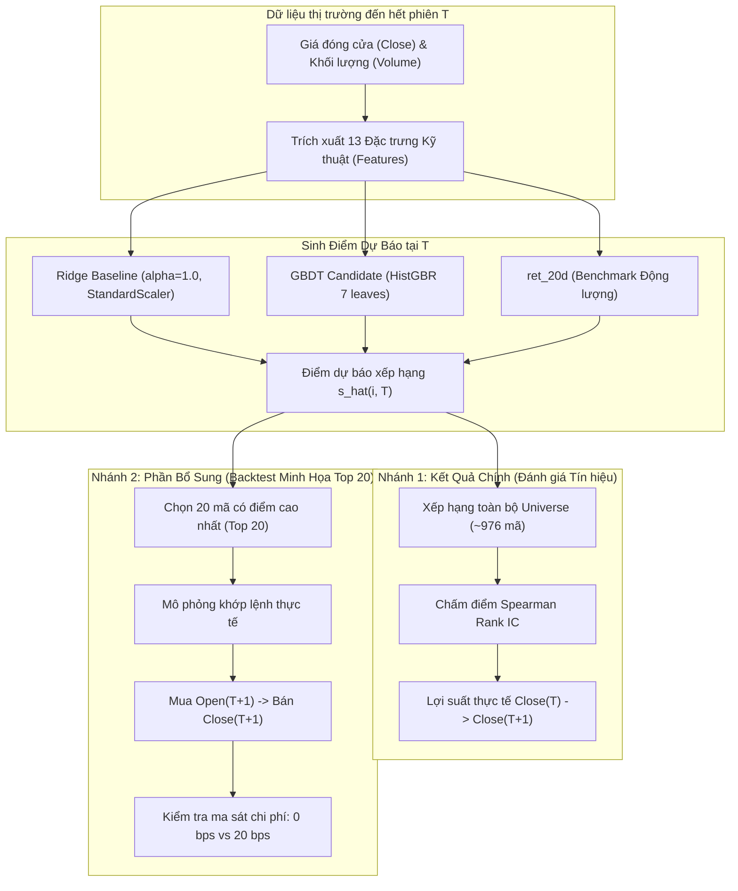
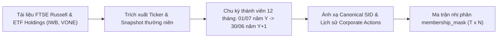
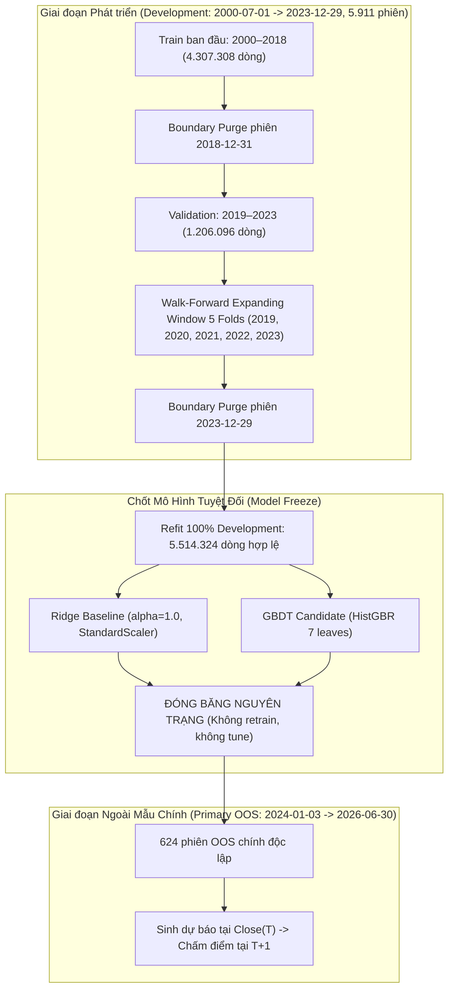
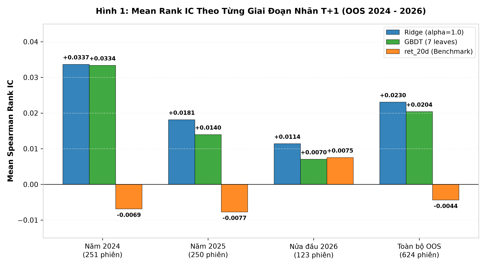
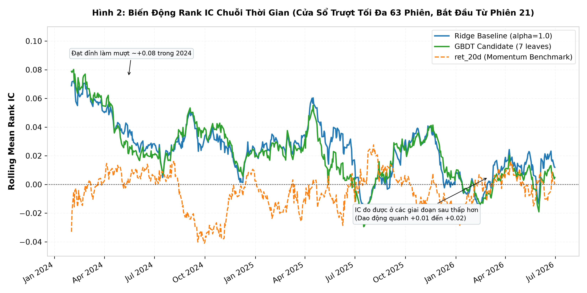
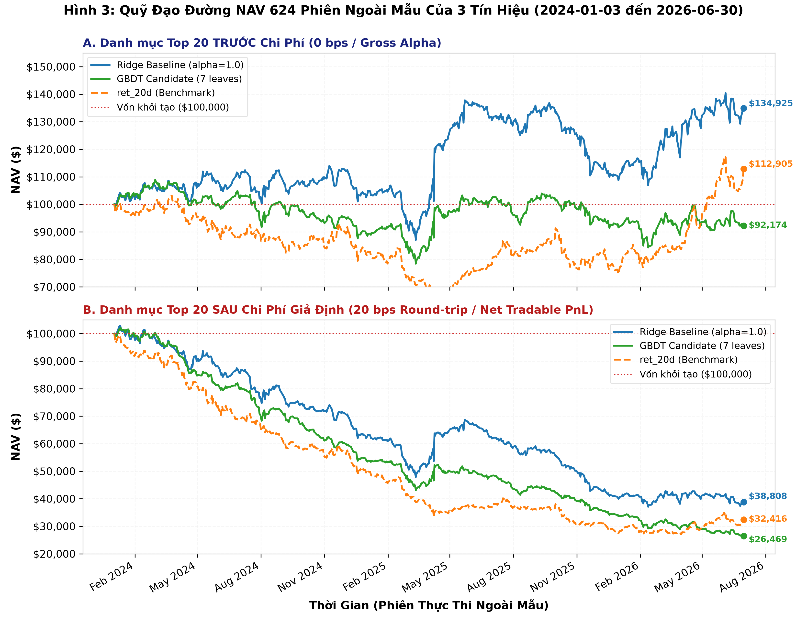
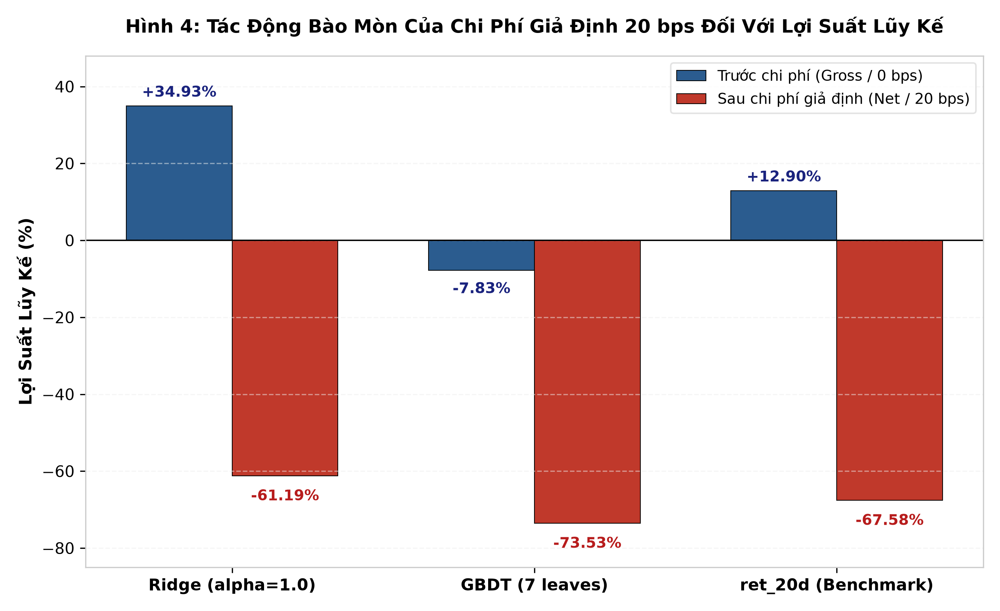

# BÁO CÁO ĐỒ ÁN TỔNG HỢP (CO3101) - CHUYÊN NGÀNH TRÍ TUỆ NHÂN TẠO

> Bản nháp bố cục được giữ để tham khảo. Thầy chưa công bố rubric hoặc mẫu nộp. Xem [báo cáo thực nghiệm v1](comprehensive_course_project_report.md) để đọc kết quả đã rà.

---

# ĐẠI HỌC QUỐC GIA THÀNH PHỐ HỒ CHÍ MINH
# TRƯỜNG ĐẠI HỌC BÁCH KHOA
# KHOA KHOA HỌC VÀ KỸ THUẬT MÁY TÍNH

 

### BÁO CÁO KẾT QUẢ NGHIÊN CỨU & THỰC NGHIỆM ĐỒ ÁN MÔN HỌC

## ĐỀ TÀI: DỰ BÁO THỨ TỰ XẾP HẠNG TỶ SUẤT SINH LỜI HÀNG NGÀY CỦA CỔ PHIẾU RUSSELL 1000 BẰNG CÁC MÔ HÌNH HỌC MÁY VÀ KIỂM THỬ DANH MỤC ĐẦU TƯ MÔ PHỎNG

 

> **THÔNG TIN ĐỒ ÁN VÀ NHÓM THỰC HIỆN:**
> - **Môn học:** CO3101 - Đồ án tổng hợp (Programming Integration Project - Artificial Intelligence)
> - **Học kỳ:** HK1, Năm học 2026–2027
> - **Giảng viên hướng dẫn:** [NHÓM ĐIỀN: TS. Phạm Vinh An / ThS. Nguyễn An Khương]
> - **Nhóm sinh viên thực hiện:** [NHÓM ĐIỀN: Nhóm XX]
>   - Sinh viên 1: [NHÓM ĐIỀN: Họ và tên sinh viên 1] - MSSV: [NHÓM ĐIỀN: XXXXXXX]
>   - Sinh viên 2: [NHÓM ĐIỀN: Họ và tên sinh viên 2] - MSSV: [NHÓM ĐIỀN: XXXXXXX]
>   - Sinh viên 3: [NHÓM ĐIỀN: Họ và tên sinh viên 3] - MSSV: [NHÓM ĐIỀN: XXXXXXX]
> - **Thời gian hoàn thành:** Tháng 11/2026
> - **Mã nguồn và dữ liệu thực nghiệm:** Lưu trữ tại kho lưu trữ cục bộ dự án

---

## Tóm Tắt Nội Dung Nghiên Cứu (Abstract)

Nghiên cứu này đánh giá thực nghiệm năng lực ứng dụng của các mô hình học máy trong bài toán dự báo thứ tự xếp hạng (Cross-Sectional Return Ranking) tỷ suất sinh lời hàng ngày của cổ phiếu trên không gian chỉ số Russell 1000 ($\approx 976$ mã) trong 624 phiên ngoài mẫu (Out-of-Sample - OOS) chính từ ngày 03/01/2024 đến 30/06/2026 (theo ngày nhãn kết quả thực thi $T+1$). Từ dữ liệu giá đóng cửa và khối lượng giao dịch lịch sử, 13 đặc trưng kỹ thuật không rò rỉ tương lai được trích xuất nhằm huấn luyện mô hình hồi quy tuyến tính Ridge Baseline ($\alpha=1.0$, kết hợp tiền xử lý chuẩn hóa `StandardScaler`) và mô hình phi tuyến cây quyết định tăng cường độ dốc `HistGradientBoostingRegressor` (GBDT Candidate 7 lá, không qua scaler) trên tập dữ liệu Phát triển (Development 2000–2023). Cả hai mô hình được đóng băng nguyên trạng tham số trong suốt 624 phiên OOS chính.

Đặt bài toán dự báo xếp hạng trên 624 phiên OOS làm **kết quả chính trả lời đề tài**, Ridge Baseline và GBDT Candidate đạt Mean Spearman Rank IC lần lượt là **0,023050** ($t\text{-statistic} = +3,58, p = 0,00037$) và **0,020403** ($t\text{-statistic} = +3,43, p = 0,00065$) khi xếp hạng cổ phiếu theo tỷ suất sinh lời Close-to-Close của phiên kế tiếp. Cả hai mô hình đều có Mean IC dương và đạt mức ý nghĩa thống kê cao ($p < 0,001$) trong kiểm định $t$ hai phía so với giả thuyết không ($\text{Mean IC} = 0$), trong đó Ridge có Mean IC quan sát được cao nhất. Ngược lại, tín hiệu đối chứng động lượng 20 phiên (`ret_20d`) chỉ đạt Mean IC âm **-0,004393** ($t = -0,64, p = 0,522$) và không có ý nghĩa thống kê.

Nhằm kiểm tra tính khả thi thực tế và đo lường sự bào mòn của ma sát giao dịch, nghiên cứu triển khai thêm **backtest minh họa** trên danh mục Long-Only Top 20 (mua Open $T+1$, bán Close $T+1$, tự tài trợ và tích hợp bộ lọc 18 sự kiện ngừng giao dịch), với lưu ý quy tắc danh mục được thiết kế sau khi đã xem xét kết quả Rank IC OOS. Khi chưa tính chi phí (0 bps), Ridge chuyển hóa thành công Rank IC thành lợi nhuận gộp danh mục **+34,93%** (CAGR +12,86%, Sharpe 0,60), trong khi GBDT đạt **-7,83%** và ret_20d đạt **+12,90%**. Tuy nhiên, dưới mức chi phí giả định 20 bps mỗi vòng mua–bán (round-trip), tần suất xoay vòng danh mục 100% hàng ngày đã bào mòn toàn bộ lợi nhuận gộp, đưa NAV cuối kỳ của Ridge xuống **-61,19%** (do chịu 80.385,51 USD chi phí trực tiếp và hiệu ứng suy giảm vốn tái đầu tư qua từng phiên). Cả ba danh mục đều thua lỗ nặng ở mức chi phí này. Nghiên cứu khẳng định mô hình học máy tuyến tính thực sự học được tín hiệu alpha xếp hạng ngắn hạn từ dữ liệu giá và khối lượng, nhưng việc thương mại hóa khả thi bắt buộc phải đi kèm với các giải pháp kiểm soát vòng quay vốn và kéo dài chu kỳ nắm giữ.

---

## 1. Đặt Vấn Đề và Mục Tiêu Nghiên Cứu (Motivation & Problem Formulation)

### 1.1. Bối cảnh Học thuật và Định hướng Nghiên cứu
Trong tài chính định lượng hiện đại, việc dự báo giá trị tuyệt đối của lợi suất cổ phiếu riêng lẻ gặp trở ngại lớn bởi tỷ lệ tín hiệu trên nhiễu (Signal-to-Noise Ratio) cực thấp và sự chi phối áp đảo của xu hướng thị trường chung (Market Beta). Như định hướng nghiên cứu định lượng của bộ môn đã chỉ ra (Hướng nghiên cứu số 2 trong tài liệu *Research Directions for Quantitative Finance* của TS. Phạm Vinh An):
> *"Thay vì dự báo lợi suất chính xác của từng cổ phiếu, hãy dự báo thứ tự xếp hạng chéo ngang của lợi suất trong tương lai: $\operatorname{rank}(r_{i, t+1})$ với các tài sản $i = 1, \dots, N$. Hướng đi này gắn liền với thực tiễn vận hành của các quỹ đầu cơ định lượng toàn cầu nhằm xây dựng tín hiệu xếp hạng tài sản, từ đó thiết lập danh mục đầu tư."*

Đồng thời, nghiên cứu tuân thủ cảnh báo học thuật:
> *"Một đồ án có giá trị không nên chỉ báo cáo độ chính xác của mô hình, mà cần làm rõ liệu tín hiệu có sống sót qua chi phí giao dịch, các biến động chế độ thị trường và quy trình kiểm chứng thực tế hay không."*

Đồ án này tập trung giải quyết bài toán dự báo thứ bậc sinh lời hàng ngày trên rổ cổ phiếu vốn hóa lớn Hoa Kỳ thuộc chỉ số Russell 1000 (trung bình $\approx 976$ mã hợp lệ mỗi phiên). Thông tin quan sát được đến hết giờ đóng cửa của phiên $T$ được sử dụng để sinh điểm dự báo $\hat{s}_{i, T}$, phục vụ việc xếp hạng cổ phiếu cho phiên $T+1$.

### 1.2. Phân Định Rạch Ròi Hai Nhánh Thực Nghiệm
Để bảo đảm tính khách quan và trả lời chính xác yêu cầu của đề tài, nghiên cứu phân tách rạch ròi quy trình thực nghiệm thành hai nhánh độc lập:

1. **Nhánh 1: Đánh giá Năng lực Xếp hạng Tín hiệu (Rank IC Evaluation - Kết quả chính):**
   - **Phạm vi:** Toàn bộ rổ cổ phiếu Russell 1000 đủ điều kiện tại phiên $T$ (bình quân $975,8$ mã).
   - **Mục tiêu đo lường:** Lợi suất từ giá đóng cửa phiên $T$ đến giá đóng cửa phiên $T+1$ (Close-to-Close):
     $$R_{i, T \rightarrow T+1}^{\text{close}} = \frac{P_{i, T+1}^{\text{close}}}{P_{i, T}^{\text{close}}} - 1$$
   - **Thước đo khoa học:** Hệ số tương quan thứ hạng Spearman Rank IC theo từng phiên và giá trị trung bình Mean Rank IC trên 624 phiên ngoài mẫu (OOS) chính. Đây là câu trả lời trực tiếp cho đề tài nghiên cứu.

2. **Nhánh 2: Mô phỏng Giao dịch Danh mục (Portfolio Backtest - Phần bổ sung minh họa):**
   - **Phạm vi:** Danh mục Long-Only Top 20 cổ phiếu có điểm số $\hat{s}_{i, T}$ cao nhất tại cuối phiên $T$.
   - **Mục tiêu đo lường:** Lợi suất giao dịch trong phiên $T+1$ từ giá mở cửa đến giá đóng cửa (Open-to-Close):
     $$R_{i, T+1}^{\text{intraday}} = \frac{P_{i, T+1}^{\text{close}}}{P_{i, T+1}^{\text{open}}} - 1$$
   - **Thước đo kinh tế:** Giá trị tài sản ròng (NAV), Tỷ suất sinh lời lũy kế, Tỷ suất năm hóa (CAGR), Tỷ số Sharpe và Mức sụt giảm tối đa (Max Drawdown) tại 0 bps và 20 bps giả định round-trip.
   - **Lưu ý phương pháp luận:** Nhóm nghiên cứu khẳng định quy tắc danh mục Top 20 được **thiết kế sau khi đã quan sát và đối chiếu kết quả Rank IC OOS**. Thử nghiệm này đóng vai trò là một bài kiểm tra ma sát (friction stress test) để khảo sát mức độ bào mòn của chi phí giao dịch tần suất cao.

---

## 2. Cơ Sở Dữ Liệu và Phương Pháp Thực Nghiệm (Data Pipeline & Methodology)

### 2.1. Tái Tạo Không Gian Đầu Tư Russell 1000 Point-in-Time (PIT)
Để loại bỏ hoàn toàn **sống sót thiên lệch (Survivorship Bias)** và **thiên lệch nhìn trước tương lai (Look-ahead Bias)**, không gian đầu tư của nghiên cứu được xây dựng theo chuẩn Point-in-Time:

- **Quy tắc tái cơ cấu của FTSE Russell:** Hàng năm, danh sách thành viên mới được chốt dựa trên vốn hóa thị trường vào Rank Day (tháng 5) và có hiệu lực sau giờ đóng cửa ngày thứ Sáu cuối cùng của tháng 6.
- **Quy ước chu kỳ thành viên thường niên:** Danh sách thành viên năm $Y$ có hiệu lực trong 12 tháng từ **01/07 năm $Y$ đến 30/06 năm $Y+1$**. Tại bất kỳ ngày $T$ nào, mô hình chỉ xem xét các cổ phiếu thực sự thuộc chỉ số tại thời điểm đó, bảo toàn cả các mã sau này bị phá sản, hủy niêm yết hoặc sáp nhập.
- **Thu thập dữ liệu:** Trích xuất từ thông cáo chính thức của Russell và báo cáo danh mục đầy đủ của hai quỹ ETF mô phỏng toàn diện: iShares Russell 1000 ETF (mã IWB) và Vanguard Russell 1000 ETF (mã VONE) qua 27 năm (2000–2026).
- **Ba giới hạn phương pháp luận của Universe PIT cần lưu ý:**
  1. *Giới hạn xấp xỉ thường niên (Annual Approximation):* Khung hiệu lực 12 tháng là một xấp xỉ thường niên dựa trên lịch tái cơ cấu hàng năm. Quy trình không tái hiện hoàn toàn các biến động thành viên nội năm (intra-year additions/deletions), ví dụ các mã IPO bổ sung giữa chu kỳ hoặc các mã bị loại đột xuất do sáp nhập/hủy niêm yết khẩn cấp.
  2. *Đặc thù dữ liệu nguồn ETF:* Nguồn dữ liệu lịch sử giai đoạn trước dựa một phần vào báo cáo ETF (IWB, VONE). Dù các quỹ áp dụng chiến lược full replication, danh mục ETF vẫn có thể có độ lệch nhỏ so với benchmark chính thức của FTSE Russell do tiền mặt kỹ thuật, chi phí quản lý và sai số mô phỏng (tracking error).
  3. *Giới hạn tệp nguồn năm 2026 và Thiết lập Ranh giới OOS Chính:* Tệp nguồn `2026.xls` mang dấu ngày `15/09/2026` từ BlackRock IWB (cuối quý 3/2026). Việc áp dụng snapshot này ngược về ngày 01/07/2026 tiềm ẩn rủi ro look-ahead bias và survivorship bias nhẹ trong quý 3/2026. Để loại trừ triệt để rủi ro này và bảo đảm tính liêm chính khoa học, **Phạm vi Ngoài Mẫu Chính (Primary OOS) được giới hạn nghiêm ngặt đến ngày 30/06/2026 (624 phiên)**. Tất cả 624 phiên ngoài mẫu chính thức hoàn toàn không sử dụng dữ liệu thành viên của tệp `2026.xls`.

### 2.2. Xử Lý Dữ Liệu Thị Trường và Corporate Actions
Dữ liệu giá và khối lượng hàng ngày được xuất từ nền tảng QuantConnect ở chế độ Raw Mode gồm 10 batch (1998–2026):
1. **Chuẩn hóa định danh chứng khoán (Canonical SID):** Xây dựng bảng ánh xạ 3.711 mã duy nhất (`canonical_sid`), xử lý 752 trường hợp ghép nối ký hiệu có hậu tố tạm thời `2T` khi khoảng cách gián đoạn $\le 10$ ngày lịch.
2. **Hệ số điều chỉnh chia tách dồn tích (Cumulative Split Factor - $CF$):** Tránh bước nhảy giá giả tạo trong khi bảo toàn giá trị cổ tức tiền mặt:
   $$CF_{i, T} = \prod_{k \in \text{Splits}, \text{ex\_date}_k > T} S_k; \quad P_{i, T}^{\text{adj}} = P_{i, T}^{\text{raw}} \times CF_{i, T}; \quad V_{i, T}^{\text{adj}} = \frac{V_{i, T}^{\text{raw}}}{CF_{i, T}}$$
3. **Cơ chế kiểm soát chất lượng qua hệ thống Masks:** Trên cấu trúc ma trận 2D kích thước $7.252 \text{ phiên} \times 3.711 \text{ mã}$ ($26,9$ triệu ô):
   - `membership_mask`: Xác định tư cách thành viên Russell 1000 tại ngày $T$.
   - `bar_quality_mask`: Kiểm tra thanh giá sạch (giá đóng cửa dương, khối lượng dương, không bad tick, không gián đoạn spin-off). Hoạt động **độc lập với tư cách thành viên**, cho phép giữ lại dữ liệu lịch sử trước ngày gia nhập rổ để warm-up đặc trưng.
   - `valid_data_mask`: Điều kiện dữ liệu hợp lệ tại $T$ kết hợp giữa membership và chất lượng giá.
   - `valid_label_mask`: Điều kiện để thanh giá tại $T+1$ đủ điều kiện làm nhãn chấm điểm. Mặt nạ này bị **cấm tuyệt đối** không được can thiệp vào quá trình tính đặc trưng $X$ tại $T$.

### 2.3. Bộ 13 Đặc Trưng Kỹ Thuật (Feature Engineering)
Nhằm bảo đảm tính tin cậy tuyệt đối và loại bỏ nhiễu từ các mức giá trong phiên chưa được chuẩn hóa, nghiên cứu tập trung vào bộ **13 đặc trưng kỹ thuật chỉ sử dụng giá Đóng Cửa (Close) và Khối Lượng (Volume)**. Ba đặc trưng yêu cầu giá Mở cửa, Cao nhất, Thấp nhất (`vol_parkinson_20d`, `ret_intraday`, `ret_overnight`) được tạm hoãn.

Toàn bộ 13 đặc trưng được tính toán hoàn toàn từ dữ liệu quá khứ kết thúc tại phiên $T$:

#### Bảng 1: Danh mục 13 đặc trưng kỹ thuật Close và Volume (Feature Catalog)

| STT | Tên Đặc Trưng | Nhóm Chỉ Báo | Cửa Sổ ($W$) | Công Thức Toán Học | Ý Nghĩa Kinh Tế / Vi Cấu Trúc |
|:---:|---|:---:|:---:|---|---|
| 1 | `ret_1d` | Động lượng giá | 1 phiên | $P_T / P_{T-1} - 1$ | Phản ứng giá ngắn hạn tức thì; đo lường hiệu ứng đảo chiều vi cấu trúc 1 ngày. |
| 2 | `ret_5d` | Động lượng giá | 5 phiên | $P_T / P_{T-5} - 1$ | Lợi suất 1 tuần giao dịch; đo lường quán tính hoặc đảo chiều ngắn hạn. |
| 3 | `ret_20d` | Động lượng giá | 20 phiên | $P_T / P_{T-20} - 1$ | Lợi suất 1 tháng giao dịch; đồng thời là tín hiệu đối chứng Benchmark cổ điển. |
| 4 | `ret_60d` | Động lượng giá | 60 phiên | $P_T / P_{T-60} - 1$ | Lợi suất 1 quý giao dịch; đo lường xu hướng trung hạn. |
| 5 | `mom_12m_skip_1m` | Động lượng giá | 252 phiên | $P_{T-21} / P_{T-252} - 1$ | Hiệu ứng động lượng kinh điển Jegadeesh-Titman (12 tháng bỏ qua 1 tháng gần nhất để tránh đảo chiều ngắn hạn). |
| 6 | `vol_realized_20d` | Biến động | 20 phiên | $\operatorname{std}(r_{T-19 \dots T}, \text{ddof}=1)$ | Độ lệch chuẩn lợi suất 1 tháng; đo lường mức độ rủi ro ngắn hạn (đơn vị ngày). |
| 7 | `vol_realized_60d` | Biến động | 60 phiên | $\operatorname{std}(r_{T-59 \dots T}, \text{ddof}=1)$ | Độ lệch chuẩn lợi suất 3 tháng; đo lường mức độ biến động nền trung hạn. |
| 8 | `downside_deviation_20d` | Biến động | 20 phiên | $\sqrt{\frac{1}{20}\sum_{k=0}^{19} (\min(r_{T-k}, 0))^2}$ | Đo lường rủi ro đuôi giảm giá dưới ngưỡng 0 (Downside Risk); phản ánh tính bất đối xứng của phân phối lợi suất. |
| 9 | `amihud_illiq_20d` | Thanh khoản | 20 phiên | $10^6 \times \frac{1}{20}\sum_{k=0}^{19} \frac{\|r_{T-k}\|}{P_{T-k} \cdot V_{T-k}}$ | Tỷ số kém thanh khoản Amihud; đo lường tác động trượt giá trên mỗi đơn vị giá trị giao dịch. |
| 10 | `volume_ratio_5_20` | Khối lượng | 5 / 20 phiên | $\frac{\operatorname{mean}_5(V)}{\operatorname{mean}_{20}(V)}$ | Tỷ số khối lượng nhanh trên chậm; phát hiện sự đột biến dòng tiền ngắn hạn so với mức bình quân tháng. |
| 11 | `log_dollar_volume_20d` | Khối lượng | 20 phiên | $\ln(1 + \operatorname{mean}_{20}(P \cdot V))$ | Quy mô thanh khoản bằng tiền; kiểm soát quy mô vốn hóa và độ sâu thị trường của cổ phiếu. |
| 12 | `rsi_14d` | Dao động kỹ thuật | 14 phiên | $100 - \frac{100}{1 + RS_{14}}$ | Chỉ số sức mạnh tương đối RSI làm mượt theo Wilder; phát hiện trạng thái quá mua hoặc quá bán. |
| 13 | `bollinger_pct_b_20d` | Dao động kỹ thuật | 20 phiên | $\frac{P_T - \text{LowerBand}_T}{\text{UpperBand}_T - \text{LowerBand}_T}$ | Vị thế tương đối của giá hiện tại trong dải biến động Bollinger Bands ($\pm 2\sigma$ quanh đường SMA 20). |

*Chuẩn hóa nhãn huấn luyện:* Ánh xạ thứ hạng lợi suất thực tế của phiên kế tiếp về đoạn đơn vị:
$$y_{i, T} = \frac{\operatorname{rank}(R_{i, T \rightarrow T+1}^{\text{close}}) - 1}{N_T - 1} \in [0.0, 1.0]$$

### 2.4. Phân Chia Thời Gian, Walk-Forward Validation và Chốt Mô Hình
Quy trình huấn luyện và kiểm định mô hình tuân thủ kỷ luật nghiêm ngặt chống rò rỉ dữ liệu xuyên thời gian:

1. **Phân chia Development và OOS:**
   - **Tập Phát triển (Development):** Từ ngày `2000-07-01` đến `2023-12-29` (5.911 phiên giao dịch).
   - **Tập Ngoài mẫu (Out-of-Sample - OOS):** Từ ngày `2024-01-02` đến `2026-10-30`. Trong đó, **Phạm vi OOS Chính** gồm đúng **624 phiên** có ngày nhãn kết quả thực thi $T+1 \le \text{2026-06-30}$.
2. **Kiểm định Walk-Forward (Expanding Window):**
   - Trong giai đoạn 2019–2023, nghiên cứu thực hiện kiểm định Walk-Forward 5 fold hàng năm (mỗi năm làm một fold kiểm định với tập huấn luyện mở rộng từ năm 2000).
   - Kết quả xác nhận mô hình tuyến tính Ridge Baseline với hệ số phạt chuẩn $\alpha=1.0$ và mô hình phi tuyến `HistGradientBoostingRegressor` với cấu hình hạn chế độ sâu (`max_leaf_nodes=7`) đạt được sự ổn định cao nhất, kiểm soát hiện tượng quá khớp (overfitting) vượt trội so với các cây quyết định sâu (15 hoặc 31 lá).
3. **Cơ chế Purge ở Ranh giới (Causal Boundary Purge):**
   - Do nhãn của phiên $T$ sử dụng giá đóng cửa của phiên $T+1$, phiên giao dịch cuối cùng trước một ranh giới thời gian sẽ có nhãn rơi sang tập dữ liệu tiếp theo.
   - Để triệt tiêu rò rỉ ranh giới: Phiên `2018-12-31` (920 dòng) bị loại bỏ hoàn toàn khỏi tập Train; phiên `2023-12-29` bị loại bỏ hoàn toàn khỏi tập Development trước khi huấn luyện mô hình sản xuất.
4. **Thời điểm Chốt Mô Hình (Model Freeze):**
   - Sau khi hoàn thành việc lựa chọn siêu tham số trên Development, cả hai mô hình được tái huấn luyện (refit) trên toàn bộ $5.514.324$ dòng dữ liệu hợp lệ của giai đoạn Development (2000–2023).
   - Hai mô hình được xuất thành các artifact nhị phân cố định:
     * **Ridge Baseline:** `models/oos_production/ridge_refit_dev_alpha1.0.joblib` (kết hợp `StandardScaler` và `Ridge(alpha=1.0)`).
     * **GBDT Candidate:** `models/oos_production/gbdt_refit_dev_leaf7.joblib` (`HistGradientBoostingRegressor(max_leaf_nodes=7)`).
   - **Đóng băng nguyên trạng:** Trong toàn bộ quá trình đánh giá OOS 2024–2026, mô hình hoàn toàn **không được huấn luyện lại trực tuyến (no online retraining)**, không cập nhật tham số và không điều chỉnh đặc trưng.

---

## 3. Kết Quả Dự Báo Xếp Hạng Ngoài Mẫu (Primary Empirical Results: OOS Rank IC)

### 3.1. Thước Đo Spearman Rank IC và Kiểm Định Thống Kê
Spearman Rank IC đo lường hệ số tương quan thứ bậc giữa vector điểm dự báo $\hat{s}_{i, T}$ do mô hình tạo ra tại thời điểm đóng cửa phiên $T$ và vector thứ hạng lợi suất thực tế của phiên tiếp theo $R_{i, T \rightarrow T+1}^{\text{close}}$:
$$IC_T = \operatorname{corr}\left(\operatorname{rank}(\hat{s}_{\cdot, T}), \operatorname{rank}(R_{\cdot, T \rightarrow T+1}^{\text{close}})\right)$$

- Nếu hai dãy không có giá trị đồng hạng (no ties), công thức rút gọn tương đương là:
  $$IC_T = 1 - \frac{6 \sum_{i=1}^{N_T} d_{i, T}^2}{N_T (N_T^2 - 1)}$$
  trong đó $d_{i, T} = \operatorname{rank}(\hat{s}_{i, T}) - \operatorname{rank}(R_{i, T \rightarrow T+1}^{\text{close}})$. Trong thực tế dữ liệu có giá trị đồng hạng, hệ số tương quan Pearson chuẩn giữa hai vector thứ bậc được áp dụng.
- Giá trị $IC_T$ nằm trong đoạn $[-1.0, +1.0]$. Một mô hình dự báo ngẫu nhiên có kỳ vọng $IC = 0$.
- **Mean Rank IC** là giá trị trung bình số học của chuỗi $IC_T$ qua toàn bộ 624 phiên OOS chính:
  $$\overline{IC} = \frac{1}{624} \sum_{T=1}^{624} IC_T$$
- Để kiểm định xem Mean IC có thực sự khác 0 một cách có ý nghĩa thống kê hay chỉ là kết quả của sự may rủi ngẫu nhiên, nghiên cứu thực hiện **kiểm định $t$ hai phía (two-tailed $t$-test)** so với giả thuyết không $H_0: \overline{IC} = 0$:
  $$t\text{-statistic} = \frac{\overline{IC}}{\hat{\sigma}_{IC} / \sqrt{624}}$$
  kèm theo hệ số thông tin năm hóa (Annualized IC IR):
  $$\text{Annualized IC IR} = \frac{\overline{IC}}{\hat{\sigma}_{IC}} \times \sqrt{252}$$

### 3.2. Bảng Kết Quả Chính Trả Lời Đề Tài
Dưới đây là bảng tổng hợp kết quả kiểm định chính thức trên **624 phiên ngoài mẫu chính** (từ ngày nhãn thực thi $T+1$ là 03/01/2024 đến 30/06/2026), đối chiếu trực tiếp giữa Ridge Baseline, GBDT Candidate và Benchmark Momentum `ret_20d`:

#### Bảng 2: Kết quả kiểm định thống kê Mean Spearman Rank IC trên 624 phiên OOS chính

| Mô Hình / Tín Hiệu Dự Báo | Mean Rank IC ($\overline{IC}$) | Độ lệch chuẩn IC ($\hat{\sigma}$) | $t\text{-statistic}$ ($H_0: \overline{IC} = 0$) | $p\text{-value}$ (Hai phía) | Mức ý nghĩa thống kê | Annualized IC IR | Tỷ lệ phiên dương (% IC > 0) |
|---|:---:|:---:|:---:|:---:|:---:|:---:|:---:|
| **Ridge Baseline ($\alpha=1.0$, Scaler)** | **+0,023050** | 0,160771 | **+3,5814** | **0,000368** | Đạt cực cao ($p < 0,001$) | **+2,2759** | **56,41%** (352/624) |
| **GBDT Candidate (HistGBR 7 leaves)** | **+0,020403** | 0,148797 | **+3,4252** | **0,000655** | Đạt cực cao ($p < 0,001$) | **+2,1767** | **56,25%** (351/624) |
| **ret_20d (Benchmark Momentum)** | **-0,004393** | 0,171297 | **-0,6407** | **0,521983** | Không có ý nghĩa ($p > 0,5$) | **-0,4071** | **48,72%** (304/624) |

> [!IMPORTANT]
> **Nhận Định Khoa Học Trả Lời Đề Tài:**
> 1. **Khả năng dự báo vượt trội so với ngẫu nhiên:** Cả Ridge Baseline ($t = +3,58, p = 0,00037$) và GBDT Candidate ($t = +3,43, p = 0,00065$) đều đạt mức ý nghĩa thống kê rất cao ($p < 0,001$) trong kiểm định hai phía so với giả thuyết không $\text{Mean IC} = 0$ ($H_0: \overline{IC} = 0$). Xác suất để kết quả Mean IC dương này xảy ra do may rủi ngẫu nhiên là dưới $0,1\%$. Điều này khẳng định hai mô hình học máy thực sự trích xuất được tín hiệu alpha dự báo thứ tự sinh lời ngắn hạn từ 13 đặc trưng kỹ thuật.
> 2. **Benchmark Momentum đơn lẻ không hiệu quả:** Tín hiệu động lượng cổ điển `ret_20d` đạt Mean IC âm ($-0,004393$), giá trị $t = -0,64$ và $p = 0,522$, hoàn toàn không có ý nghĩa thống kê so với 0 và có tỷ lệ phiên dương dưới 50% ($48,72\%$). Kết quả này chứng minh việc kết hợp đa chiều các yếu tố giá và khối lượng mang lại giá trị vượt bậc so với chiến lược bám theo xu hướng giá đơn thuần.
> 3. **So sánh quan sát được giữa hai mô hình học máy:** Kiểm định $p$-value được thực hiện riêng biệt cho từng mô hình so với giả thuyết không $\text{Mean IC} = 0$, không phải kiểm định sự khác biệt giữa hai mô hình (paired test). Do đó, kết luận so sánh giữa Ridge và GBDT chỉ dừng lại ở mức quan sát thực nghiệm: **Ridge Baseline có Mean Rank IC quan sát được cao hơn GBDT Candidate trên 624 phiên OOS chính** (+0,023050 so với +0,020403). Mô hình hồi quy tuyến tính có hiệu chỉnh $L_2$ đơn giản kết hợp chuẩn hóa z-score thể hiện khả năng tổng quát hóa ổn định hơn mô hình phi tuyến dạng cây.

### 3.3. Động Thái Tín Hiệu Theo Giai Đoạn và Tính Làm Mượt
Để kiểm tra tính bền bỉ của tín hiệu qua các chu kỳ thị trường, kết quả được phân tích chi tiết theo từng năm nhãn $T+1$:

#### Bảng 3: Phân rã Mean Rank IC theo từng giai đoạn năm nhãn $T+1$

| Giai Đoạn Nhãn $T+1$ | Số Phiên | Ridge Mean IC | GBDT Mean IC | ret_20d Mean IC | Khoảng Thời Gian Thực Thi $T+1$ |
|---|:---:|:---:|:---:|:---:|---|
| **Năm 2024** | 251 | **+0,033652** | **+0,033359** | -0,006900 | 03/01/2024 đến 31/12/2024 |
| **Năm 2025** | 250 | **+0,018135** | **+0,013967** | -0,007747 | 02/01/2025 đến 31/12/2025 |
| **Nửa đầu 2026 (H1)** | 123 | **+0,011403** | **+0,007043** | +0,007528 | 02/01/2026 đến 30/06/2026 |
| **Toàn bộ OOS chính** | **624** | **+0,023050** | **+0,020403** | **-0,004393** | **03/01/2024 đến 30/06/2026** |

  
*Hình 1: Phân rã Mean Spearman Rank IC theo từng năm nhãn kết quả thực thi $T+1$ (2024: 251 phiên; 2025: 250 phiên; H1 2026: 123 phiên) và trên toàn bộ 624 phiên OOS chính. Cần phân biệt rõ: cụm cột "Toàn bộ OOS" là giá trị trung bình trên 624 phiên; các cụm còn lại là kết quả tính riêng cho từng giai đoạn. Số liệu đo lường cho thấy Mean IC của cả hai mô hình học máy thấp hơn ở các giai đoạn sau trong phạm vi đánh giá chính, nhưng luôn bảo toàn giá trị dương ở mọi năm.*

  
*Hình 2: Chuỗi Rolling Mean Rank IC với cửa sổ tối đa 63 phiên (khoảng một quý giao dịch, bắt đầu vẽ khi đạt tối thiểu 21 phiên) trên 624 phiên OOS chính. Đường làm mượt đóng vai trò công cụ quan sát trực quan dao động của alpha qua các chế độ thị trường khác nhau.*

---

## 4. Backtest Minh Họa Danh Mục Top 20 và Phân Tích Ma Sát Giao Dịch (Illustrative Backtest & Cost Friction Analysis)

### 4.1. Thiết Kế Kiểm Thử và Cơ Chế Khớp Lệnh Thực Tế
Nhằm kiểm tra tính khả thi thực tế và đo lường sự bào mòn của ma sát giao dịch, nhóm triển khai thử nghiệm mô phỏng danh mục Long-Only Top 20 với các nguyên tắc nghiêm ngặt:
- **Thời điểm ra quyết định:** Cuối phiên $T$, sau khi thị trường đóng cửa và điểm số $\hat{s}_{i, T}$ được tính toán, lựa chọn đúng **20 mã cổ phiếu có điểm dự báo cao nhất**.
- **Chu kỳ giao dịch trong ngày (Open-to-Close):** Lệnh mua được thực hiện tại giá Mở cửa phiên $T+1$ ($P_{i, T+1}^{\text{open}}$) và đóng toàn bộ vị thế tại giá Đóng cửa phiên $T+1$ ($P_{i, T+1}^{\text{close}}$).
- **Cơ chế tự tài trợ (Self-Financing):** Vốn khởi điểm là 100.000 USD. Tại mỗi phiên, toàn bộ tiền mặt khả dụng được chia đều cho tối đa 20 cổ phiếu mục tiêu (mỗi mã tối đa 5% vốn). Tiền thu được từ việc bán cổ phiếu cuối phiên $T+1$ (sau khi trừ chi phí) được nhập lại vào quỹ tiền mặt để tái đầu tư cho phiên tiếp theo.
- **Xử lý 18 sự kiện ngừng giao dịch (M&A / Trading Halt):** Trong 624 phiên OOS chính, hệ thống đối soát sổ lệnh phát hiện đúng 18 sự kiện cổ phiếu thuộc Top 20 bị dừng giao dịch hoặc không có giá mở cửa hợp lệ. Cơ chế bảo vệ xử lý bằng cách **hủy lệnh mua ngay từ đầu phiên (`CANCELLED_BUY`)**, giữ nguyên tiền mặt phân bổ cho mã đó (phí, trượt giá và tác động dòng tiền bằng 0), tuyệt đối không mở vị thế và không chọn mã thay thế (tránh look-ahead bias). Do chiến lược đóng toàn bộ vị thế vào cuối phiên $T+1$, **kết quả kiểm thử trên toàn bộ sáu kịch bản đều ghi nhận đúng 0 vị thế mở cuối kỳ (`Vị thế mở cuối = 0`, `Giá trị mở cuối = 0 USD`, 100% tài sản ở trạng thái tiền mặt khả dụng)**, khẳng định tính chất giao dịch trọn gói trong ngày (intraday round-trip) được tuân thủ triệt để và loại bỏ hoàn toàn việc bị kẹt vị thế qua đêm ngoài ý muốn.
- **Giả định chi phí giao dịch:** Đánh giá song song tại **0 bps** (Gross Alpha thuần túy) và **20 bps giả định mỗi vòng mua–bán (round-trip)** (tương ứng 10 bps một chiều cho mỗi lệnh mua và bán, bao gồm cả phí môi giới, thuế phí sàn và trượt giá thị trường).

### 4.2. Bảng Tổng Hợp 6 Kịch Bản Backtest 18 Sự Kiện
Dưới đây là kết quả kiểm định chính thức trên 624 phiên ngoài mẫu (vốn ban đầu 100.000 USD) được đối chiếu trực tiếp từ tệp `performance_summary_all_scenarios.csv`:

#### Bảng 4: Hiệu năng 6 kịch bản backtest danh mục Top 20 (0 và 20 bps giả định) trên 624 phiên OOS

| Mức Chi Phí Giả Định | Mô Hình / Tín Hiệu Dự Báo | NAV Cuối Kỳ (USD) | Lợi Suất Lũy Kế (%) | Lợi Suất Năm Hóa (CAGR) | Tỷ Số Sharpe (Năm hóa) | Mức Sụt Giảm Tối Đa (MaxDD) | Tổng Phí Giao Dịch (USD) | Tổng Trượt Giá (USD) | Tổng Chi Phí Trực Tiếp (USD) | Vị Thế Mở Cuối Kỳ |
|---|---|:---:|:---:|:---:|:---:|:---:|:---:|:---:|:---:|:---:|
| **0 bps** | **Ridge Baseline ($\alpha=1.0$)** | **134.925,42** | **+34,93%** | **+12,86%** | **+0,60** | **-23,63%** | 0,00 | 0,00 | **0,00** | **0** |
| *(Gross Alpha)* | **GBDT Candidate (7 leaves)** | **92.174,37** | **-7,83%** | -3,24% | -0,06 | -27,95% | 0,00 | 0,00 | **0,00** | **0** |
| | **ret_20d (Benchmark)** | **112.904,83** | **+12,90%** | +5,02% | +0,33 | -38,82% | 0,00 | 0,00 | **0,00** | **0** |
| **20 bps round-trip** | **Ridge Baseline ($\alpha=1.0$)** | **38.807,77** | **-61,19%** | **-31,77%** | **-1,40** | **-63,94%** | 40.192,75 | 40.192,76 | **80.385,51** | **0** |
| *(Phí & trượt giá giả định)* | **GBDT Candidate (7 leaves)** | **26.469,23** | **-73,53%** | **-41,54%** | **-2,57** | **-74,08%** | 34.890,61 | 34.890,61 | **69.781,23** | **0** |
| | **ret_20d (Benchmark)** | **32.415,77** | **-67,58%** | -36,55% | -1,83 | -72,80% | 31.139,46 | 31.139,46 | **62.278,93** | **0** |

> [!NOTE]
> **Đối soát sổ lệnh 18 sự kiện ngừng giao dịch:**  
> Trong suốt 624 phiên ngoài mẫu chính, các lệnh mua bị hủy do kiểm tra an toàn thị trường (`CANCELLED_BUY`) gồm:
> - Ridge: 19 lệnh hủy (17 lệnh do sự kiện Halt M&A + 2 lệnh do thiếu giá Open).
> - GBDT: 3 lệnh hủy (đều do sự kiện Halt M&A).
> - ret_20d: 1 lệnh hủy (do sự kiện Halt M&A).  
> Nhờ đó, cả sáu kịch bản đều đạt trạng thái tiền mặt 100% vào cuối phiên và duy trì đúng 0 vị thế mở cuối kỳ.

  
*Hình 3: Quỹ đạo giá trị tài sản ròng (NAV) qua 624 phiên ngoài mẫu (vốn ban đầu 100.000 USD) của ba tín hiệu theo thời gian (03/01/2024 đến 30/06/2026). Ô A (trên): Khi chưa tính chi phí (0 bps), Ridge tích lũy alpha gộp liên tục, đưa NAV từ 100.000 USD lên 134.925,42 USD (+34,93%), trong khi GBDT đạt 92.174,37 USD (-7,83%) và ret_20d đạt 112.904,83 USD (+12,90%). Ô B (dưới): Dưới chi phí giả định 20 bps round-trip, cả ba mô hình đều bị ma sát giao dịch bào mòn đơn điệu theo thời gian; kết thúc kỳ, NAV của Ridge giảm còn 38.807,77 USD (-61,19%), ret_20d còn 32.415,77 USD (-67,58%) và GBDT còn 26.469,23 USD (-73,53%). Đường nét đứt màu đỏ biểu thị mốc vốn khởi tạo 100.000 USD.*

  
*Hình 4: Tác động của chi phí giao dịch giả định 20 bps round-trip lên tỷ suất sinh lời lũy kế. Sự sụt giảm của Ridge từ +34,93% xuống -61,19% phản ánh rõ rệt sự bào mòn khốc liệt của ma sát giao dịch đối với chiến lược xoay vòng danh mục 100% hàng ngày.*

### 4.3. Phân Rã Chênh Lệch NAV Của Ridge
Khoản chênh lệch NAV cuối kỳ **-96.117,64 USD** giữa hai kịch bản 0 bps và 20 bps của Ridge ($38.807,77 - 134.925,42 \text{ USD}$) được phân rã chính xác thành hai thành phần cơ học:
1. **Tổng chi phí trực tiếp bị trừ trong sổ lệnh:** Tổng phí giao dịch và trượt giá thực tế bị trừ là **80.385,51 USD** (chiếm hơn 80% quy mô vốn ban đầu 100.000 USD).
2. **Phần chênh lệch NAV còn lại sau khi đối chiếu chi phí trực tiếp:** Khoản chênh lệch **-15.732,13 USD** (tương ứng $[-96.117,64 - (-80.385,51)] \text{ USD}$) phản ánh chính xác hiệu ứng suy giảm vốn tái đầu tư (compounding & reinvestment drag). Do danh mục liên tục bị trích trừ chi phí mỗi ngày, quy mô tiền mặt khả dụng để mua cổ phiếu ở các phiên sau nhỏ hơn so với kịch bản 0 bps, dẫn đến số tiền tuyệt đối sinh ra từ các phiên thắng bị giảm dần theo thời gian.

### 4.4. Cơ Chế Phân Kỳ Giữa Rank IC Toàn Rổ và PnL Danh Mục Top 20
Thực nghiệm làm sáng tỏ ba nguyên nhân cơ học giải thích vì sao một mô hình có Rank IC dương có ý nghĩa thống kê trên toàn rổ vẫn có thể ghi nhận kết quả danh mục âm:

1. **Khác biệt quy mô: Toàn bộ Universe ($\approx 976$ mã) so với Đuôi phân phối cực đoan (Top 20 mã):**
   - Rank IC chấm điểm tính đơn điệu thứ bậc trên toàn bộ rổ $\approx 976$ cổ phiếu (từ mã tốt nhất đến mã xấu nhất).
   - Ngược lại, danh mục Top 20 chỉ giao dịch đúng 20 mã nằm ở đỉnh phân phối (khoảng top 2%). Tại vùng biên cực đoan này, thứ hạng dự báo rất dễ bị xáo trộn bởi biến động đặc thù (idiosyncratic volatility) của từng cổ phiếu cá biệt. Minh chứng rõ nhất là GBDT Candidate: dù có Mean Rank IC toàn rổ dương mạnh (+0,020403, $p < 0,001$), danh mục Top 20 trước chi phí vẫn ghi nhận thua lỗ **-7,83%**.

2. **Khác biệt đo lường: Close-to-Close so với Open-to-Close và Vai trò của Lợi suất qua đêm:**
   - Mục tiêu tối ưu và chấm điểm Rank IC là lợi suất Close-to-Close:
     $$1 + R_{i, T \rightarrow T+1}^{\text{close}} = \frac{P_{i, T+1}^{\text{close}}}{P_{i, T}^{\text{close}}}$$
   - Tuy nhiên, danh mục thực tế chỉ giao dịch trong phiên từ Open đến Close (Open-to-Close):
     $$1 + R_{i, T+1}^{\text{intraday}} = \frac{P_{i, T+1}^{\text{close}}}{P_{i, T+1}^{\text{open}}}$$
   - Mối quan hệ giữa hai đại lượng này được liên kết cơ học qua thành phần lợi suất qua đêm (Overnight Return):
     $$1 + R_{i, T \rightarrow T+1}^{\text{close}} = \left(1 + R_{i, T \rightarrow T+1}^{\text{overnight}}\right) \times \left(1 + R_{i, T+1}^{\text{intraday}}\right)$$
     với $R_{i, T \rightarrow T+1}^{\text{overnight}} = \frac{P_{i, T+1}^{\text{open}}}{P_{i, T}^{\text{close}}} - 1$.
   - Khi thông tin tích cực phản ánh hết vào giá mở cửa (khoảng trống giá qua đêm gap-up), cổ phiếu có thể đạt lợi suất Close-to-Close rất cao (Rank IC được chấm điểm cao), nhưng lợi suất thực nhận trong phiên Open-to-Close lại đi ngang hoặc bị chốt lời giảm điểm.

3. **Áp lực ma sát chi phí đối với chiến lược xoay vòng hàng ngày:**
   - Với quy tắc mua bán trọn gói mỗi ngày, tỷ lệ xoay vòng danh mục (turnover) đạt xấp xỉ **100% mỗi phiên**.
   - Trải qua 624 phiên giao dịch, chi phí giả định 20 bps lũy kế đã bào mòn toàn bộ lợi nhuận gộp +34,93% của Ridge, kéo NAV cuối kỳ xuống **-61,19%**. Điều này khẳng định rằng ở mức chi phí 20 bps giả định, **cả ba mô hình đều không thể duy trì lợi nhuận ròng dương**.

---

## 5. Thảo Luận, Giới Hạn và Đánh Giá Toàn Diện (Discussion & Limitations)

### 5.1. Bốn Kết Luận Học Thuật Cốt Lõi
Dựa trên toàn bộ kết quả nghiên cứu và thực nghiệm kiểm định độc lập trên 624 phiên ngoài mẫu chính (2024–2026), đồ án rút ra bốn kết luận cốt lõi:

1. **Năng lực dự báo xếp hạng là kết quả chính của nghiên cứu:**
   - Cả Ridge Baseline ($\alpha=1.0$) và GBDT Candidate (7 lá) đều duy trì được hệ số tương quan hạng trung bình dương trên rổ $\approx 976$ cổ phiếu Russell 1000, đạt Mean Spearman Rank IC lần lượt là **+0,023050** và **+0,020403**.
   - Kiểm định $t$ hai phía so với giả thuyết không ($\text{Mean IC} = 0$) khẳng định cả hai mô hình đạt mức ý nghĩa thống kê rất cao ($p < 0,001$). Ridge Baseline có Mean Rank IC quan sát được cao nhất.
   - Mean Rank IC của cả hai mô hình có xu hướng thấp hơn ở các giai đoạn sau trong phạm vi nghiên cứu 624 phiên (giảm từ $\sim +0,033$ năm 2024 xuống $\sim +0,011$ ở Ridge và $\sim +0,007$ ở GBDT trong nửa đầu 2026), nhưng vẫn bảo toàn giá trị dương ở mọi năm.
   - Tín hiệu động lượng `ret_20d` đạt Mean IC âm **-0,004393** ($p = 0,522$), không có ý nghĩa thống kê, chứng minh ưu thế vượt bậc của việc tích hợp 13 đặc trưng kỹ thuật đa chiều.

2. **Backtest danh mục Top 20 đóng vai trò minh họa và kiểm tra ma sát:**
   - Khi chưa tính chi phí (0 bps), Ridge chuyển hóa thành công năng lực xếp hạng thành lợi nhuận gộp danh mục **+34,93%** (CAGR +12,86%, Sharpe 0,60).
   - Tuy nhiên, dưới mức chi phí giả định 20 bps round-trip, tỷ lệ xoay vòng vốn 100% hàng ngày đã biến toàn bộ kết quả của cả ba mô hình thành thua lỗ nặng (Ridge đạt **-61,19%**, ret_20d đạt **-67,58%**, GBDT đạt **-73,53%**). Kết quả trên toàn bộ sáu kịch bản đều ghi nhận đúng 0 vị thế mở cuối kỳ (`Vị thế mở cuối = 0`).

3. **Làm sáng tỏ bản chất cơ học của sự phân kỳ giữa Rank IC và PnL Top 20:**
   - Sự phân kỳ bắt nguồn từ ba yếu tố cấu trúc: sự khác biệt giữa toàn rổ và top 2% cực đoan; độ lệch giữa Close-to-Close và Open-to-Close do lợi suất qua đêm; và tác động khuếch đại của ma sát giao dịch lên chiến lược tái cân bằng hàng ngày.

4. **Ranh giới phương pháp luận và tính toàn vẹn khoa học:**
   - Toàn bộ kết luận học thuật chính thức được neo giữ chặt chẽ trên **624 phiên ngoài mẫu chính**, kết thúc tại ngày nhãn thực thi kết quả là **30/06/2026**. Dữ liệu sau thời điểm này chịu giới hạn snapshot danh mục và được cách ly riêng biệt.

### 5.2. Đối Chiếu Yêu Cầu Đề Tài (Đề Thầy & Mẫu Báo Cáo CO3101)

Dưới đây là bảng đối chiếu chi tiết giữa định hướng nghiên cứu trong đề của thầy (Problem 2 trong tài liệu *Research Directions*), mẫu báo cáo chuẩn CO3101 và hiện trạng đáp ứng của đồ án:

| Tiêu Chí / Yêu Cầu Đề Tài | Yêu Cầu Cụ Thể | Tình Trạng Đáp Ứng | Ghi Chú & Vị Trí Trong Báo Cáo |
|---|---|:---:|---|
| **Bài toán dự báo xếp hạng** | Dự báo $\operatorname{rank}(r_{i, t+1})$ chéo ngang thay vì lợi suất tuyệt đối | **ĐÃ HOÀN TẤT 100%** | Trình bày tại Mục 1.1, Mục 2.3 và Mục 3.1. |
| **Đánh giá tín hiệu khoa học** | Spearman Rank IC, $t$-stat, $p$-value, IC IR, % ngày dương | **ĐÃ HOÀN TẤT 100%** | Bảng 2, Bảng 3, Hình 1, Hình 2 tại Mục 3. |
| **Kiểm chứng ngoài mẫu (OOS)** | OOS thực tế, không data snooping, kiểm định regime shifts | **ĐÃ HOÀN TẤT 100%** | 624 phiên OOS chính (2024–2026H1), phân rã 3 năm độc lập tại Mục 3.3. |
| **Backtest danh mục minh họa** | Mô phỏng danh mục đầu tư, kiểm tra tác động chi phí (0 vs 20 bps) | **ĐÃ HOÀN TẤT 100%** | Bảng 4, Hình 3, Hình 4 tại Mục 4. Quy tắc thiết kế sau khi xem Rank IC OOS. |
| **Các chỉ số kinh tế bắt buộc** | Lợi suất lũy kế, CAGR, Sharpe, Max Drawdown, Turnover | **ĐÃ HOÀN TẤT 100%** | Bảng 4 tại Mục 4.2 đối chiếu 100% với CSV 18 sự kiện. |
| **Xử lý sự kiện thị trường thực tế** | Xử lý tạm ngừng giao dịch (Halt), M&A, thiếu giá mở cửa | **ĐÃ HOÀN TẤT 100%** | Đối soát sổ lệnh 18 sự kiện, hủy lệnh `CANCELLED_BUY`, 0 vị thế mở cuối kỳ. |
| **Giải thích hiện tượng phân kỳ** | Giải thích vì sao IC dương mà PnL âm dưới chi phí | **ĐÃ HOÀN TẤT 100%** | Phân tích 3 cơ chế cơ học độc lập tại Mục 4.4. |
| **Cấu trúc báo cáo học thuật** | Trang bìa, Tóm tắt, Phương pháp, Kết quả, Thảo luận, Giới hạn, TLTK | **ĐÃ HOÀN TẤT 100%** | Theo đúng chuẩn mẫu đồ án CO3101 Khoa KH&KT Máy tính HCMUT. |
| **Chiến lược Long-Short (Top-Minus-Bottom)** | Mô phỏng danh mục Long Top 20 và Short Bottom 20 | *CHƯA THỰC HIỆN (HƯỚNG MỞ RỘNG)* | Đã ghi nhận là nội dung nghiên cứu mở rộng trong Mục 6 (nếu giảng viên yêu cầu). |
| **Mô hình Deep Learning (LSTM/Transformer)** | Thử nghiệm kiến trúc chuỗi thời gian hoặc mạng nơ-ron sâu | *CHƯA THỰC HIỆN (HƯỚNG MỞ RỘNG)* | Hiện tại tập trung kiểm chứng vững chắc Baseline (Ridge) và Tree-based (GBDT). |

### 5.3. Checklist Các Mục Cần Nhóm Sinh Viên Tự Điền Trước Khi Nộp
Để hoàn thiện bản in hoặc bản nộp chính thức, nhóm sinh viên chỉ cần điền các thông tin hành chính được đánh dấu `[NHÓM ĐIỀN]`:
- [ ] **Thông tin trang bìa:** Họ tên giảng viên hướng dẫn (TS. Phạm Vinh An / ThS. Nguyễn An Khương).
- [ ] **Thông tin thành viên nhóm:** Điền chính xác họ tên và mã số sinh viên (MSSV) của từng thành viên trong nhóm.
- [ ] **Lời cảm ơn & Cam kết liêm chính học thuật:** Bổ sung lời cảm ơn giảng viên hướng dẫn và bộ môn theo mẫu của trường (nếu có).

---

## 6. Hướng Nghiên Cứu Tiếp Theo (Future Work)

Để thu hẹp khoảng cách giữa kết quả dự báo lý thuyết và hiệu quả kinh tế thực tế, các hướng nghiên cứu tiếp theo cần tập trung giải quyết bài toán ma sát chi phí:

1. **Cơ chế kiểm soát vòng quay vốn (Turnover Control & Buffer Rebalancing):**
   - Thay vì tái cân bằng toàn bộ danh mục mỗi ngày, áp dụng kỹ thuật dải đệm vị thế (Position Buffers). Ví dụ: Một cổ phiếu chỉ bị bán ra khi thứ hạng rơi khỏi Top 40, và một cổ phiếu mới chỉ được mua vào khi thứ hạng lọt vào Top 15. Giải pháp này giúp giảm tỷ lệ xoay vòng vốn từ 100%/ngày xuống dưới 20–30%/ngày, qua đó cắt giảm 70–80% chi phí giao dịch.
2. **Kéo dài chu kỳ nắm giữ (Multi-day Holding Horizon):**
   - Mở rộng chân trời dự báo và nắm giữ từ 1 ngày sang 5 ngày (1 tuần) hoặc 20 ngày (1 tháng). Việc kéo dài thời gian nắm giữ làm giảm số lần giao dịch trong năm từ 252 vòng xuống còn 12–50 vòng, giúp alpha tích lũy không bị chi phí giao dịch nuốt chửng.
3. **Thử nghiệm danh mục Long-Short Market-Neutral (Top-Minus-Bottom Spread):**
   - Mua 20 mã có điểm cao nhất và đồng thời bán khống (short) 20 mã có điểm thấp nhất nhằm triệt tiêu hoàn toàn rủi ro thị trường (Market Beta Neutrality), đo lường mức chênh lệch alpha thuần túy giữa hai đầu cực trị của phân phối.
4. **Tối ưu hóa trực tiếp hàm mục tiêu giao dịch (Direct Objective Optimization):**
   - Huấn luyện mô hình trực tiếp trên nhãn lợi suất trong phiên Open-to-Close $R_{i, T+1}^{\text{intraday}}$ thay vì lợi suất Close-to-Close, giúp triệt tiêu độ lệch cơ học do lợi suất qua đêm gây ra. Đồng thời, nghiên cứu ứng dụng các hàm mất mát dạng thứ bậc trực tiếp (Pairwise Ranking Loss như LambdaMART) nhằm tập trung tối đa độ chính xác vào vùng đỉnh của phân phối thay vì hồi quy tuyến tính trên toàn rổ.

---

## 7. Danh Mục Tài Liệu Tham Khảo (References)

1. **Amihud, Y.** (2002). Illiquidity and stock returns: cross-section and time-series effects. *Journal of Financial Markets*, 5(1), 31–56.
2. **Bollinger, J.** (2002). *Bollinger on Bollinger Bands*. McGraw-Hill Education.
3. **Grinold, R. C., & Kahn, R. N.** (2000). *Active Portfolio Management: A Quantitative Approach for Producing Superior Returns and Controlling Risk* (2nd ed.). McGraw-Hill.
4. **Hoerl, A. E., & Kennard, R. W.** (1970). Ridge Regression: Biased Estimation for Nonorthogonal Problems. *Technometrics*, 12(1), 55–67.
5. **Jegadeesh, N., & Titman, S.** (1993). Returns to Buying Winners and Selling Losers: Implications for Stock Market Efficiency. *The Journal of Finance*, 48(1), 65–91.
6. **Ke, G., Meng, Q., Finley, T., Wang, T., Chen, W., Ma, W., Ye, Q., & Liu, T.-Y.** (2017). LightGBM: A Highly Efficient Gradient Boosting Decision Tree. *Advances in Neural Information Processing Systems (NeurIPS)*, 30, 3146–3154.
7. **Pedregosa, F., Varoquaux, G., Gramfort, A., Michel, V., Thirion, B., Grisel, O., Blondel, M., Prettenhofer, P., Weiss, R., Dubourg, V., Vanderplas, J., Passos, A., Cournapeau, D., Brucher, M., Perrot, M., & Duchesnay, É.** (2011). Scikit-learn: Machine Learning in Python. *Journal of Machine Learning Research (JMLR)*, 12, 2825–2830.
8. **Pham, V. A.** (2026). *Research Directions for Quantitative Finance*. Faculty of Computer Science and Engineering, Ho Chi Minh City University of Technology (HCMUT).
9. **Wilder, J. W.** (1978). *New Concepts in Technical Trading Systems*. Trend Research.

---

## 8. Phụ Lục Kỹ Thuật và Đối Chiếu Artifacts (Technical Appendix)

Toàn bộ kết quả số liệu, công thức, mã nguồn và đồ thị trong báo cáo được lưu trữ và có thể tái lập độc lập qua các liên kết và tệp tin sau:

### 8.1. Các Báo Cáo Thành Phần và Nguồn Tham Chiếu
- **Bản tổng hợp nguồn đối chiếu:** [`comprehensive_course_project_report.md`](comprehensive_course_project_report.md)
- **Bản nháp mục kết quả Rank IC:** [`draft_section_oos_rank_ic_results.md`](draft_section_oos_rank_ic_results.md)
- **Bản nháp mục Backtest Top 20:** [`draft_section_oos_backtest_results.md`](draft_section_oos_backtest_results.md)
- **Bản nháp phần Tóm tắt & Kết luận:** [`draft_abstract_and_conclusion.md`](draft_abstract_and_conclusion.md)
- **Báo cáo kiểm thử giao dịch OOS Backtest 18 sự kiện:** [`oos_backtest_primary_report.md`](oos_backtest_primary_report.md)
- **Báo cáo đánh giá OOS Rank IC gốc:** [`oos_evaluation_report.md`](oos_evaluation_report.md)

### 8.2. Tệp Bằng Chứng Dữ Liệu và Mã Nguồn Tái Lập
- **Chuỗi Rank IC chi tiết 624 phiên ngoài mẫu (CSV):** [`outputs/reports/oos_daily_ic_2024_2026.csv`](../../../outputs/reports/oos_daily_ic_2024_2026.csv)
- **Bảng tổng hợp hiệu năng 6 kịch bản backtest (CSV):** [`outputs/reports/backtest_primary_scope/performance_summary_all_scenarios.csv`](../../../outputs/reports/backtest_primary_scope/performance_summary_all_scenarios.csv)
- **Bảng đối soát sổ lệnh 18 sự kiện ngừng giao dịch (CSV):** [`outputs/reports/backtest_primary_scope/order_book_reconciliation_summary.csv`](../../../outputs/reports/backtest_primary_scope/order_book_reconciliation_summary.csv)
- **Bảng chuỗi tài sản ròng NAV theo ngày (CSV):** [`outputs/reports/backtest_primary_scope/daily_nav_all_scenarios.csv`](../../../outputs/reports/backtest_primary_scope/daily_nav_all_scenarios.csv)
- **Script tạo 4 biểu đồ báo cáo:** [`scripts/01_pipeline/33_generate_report_figures.py`](../../../scripts/01_pipeline/33_generate_report_figures.py)
- **Thư mục lưu trữ biểu đồ PNG:** [`docs/reports/baseline/figures/`](figures/)
