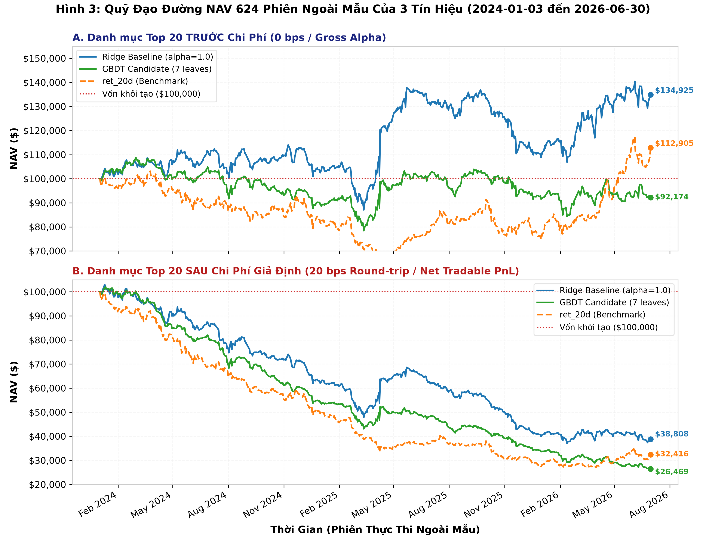
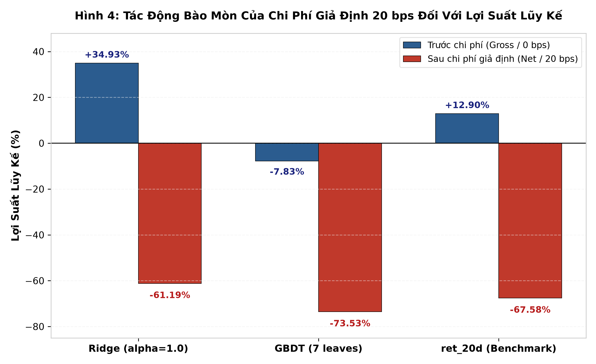

# Bản Nháp Đồ Án: Backtest Minh Họa Danh Mục Long-Only Top 20

> **Mục tiêu của phần này trong đồ án:**  
> Đánh giá tính khả thi kinh tế khi đưa các tín hiệu dự báo vào một chiến lược giao dịch mô phỏng thực tế trên 624 phiên ngoài mẫu (ngày nhãn thực thi $T+1$ từ 03/01/2024 đến 30/06/2026), kiểm tra tác động của sự kiện doanh nghiệp (M&A/Halt) và đo lường trực diện sự bào mòn của ma sát chi phí giao dịch.
>
> **Tài liệu và dữ liệu đối chiếu:**
> - Bảng tổng hợp hiệu năng 6 kịch bản: [`outputs/reports/backtest_primary_scope/performance_summary_all_scenarios.csv`](../../../outputs/reports/backtest_primary_scope/performance_summary_all_scenarios.csv)
> - Danh mục 18 sự kiện ngừng giao dịch trước Open: [`outputs/reports/backtest_primary_scope/reconciliation_open_positions.csv`](../../../outputs/reports/backtest_primary_scope/reconciliation_open_positions.csv)
> - Sổ lệnh và sổ cái chi tiết từng phiên: [`outputs/reports/backtest_primary_scope/`](../../../outputs/reports/backtest_primary_scope/)
> - Báo cáo kiểm thử backtest kỹ thuật: [`docs/reports/baseline/oos_backtest_primary_report.md`](oos_backtest_primary_report.md)

> [!NOTE]
> **Tóm lược kết luận cốt lõi:**  
> Trong backtest minh họa Top 20 (mua Open $T+1$, bán Close $T+1$, tái cân bằng hàng ngày), Ridge Baseline chuyển hóa thành công Rank IC thành lợi nhuận gộp **+34,93%** trước chi phí (0 bps), trong khi GBDT đạt **-7,83%** và ret_20d đạt **+12,90%**. Tuy nhiên, dưới giả định chi phí giao dịch 20 bps mỗi vòng mua–bán (round-trip), tần suất quay vòng danh mục 100% mỗi ngày đã bào mòn toàn bộ lợi nhuận gộp, đưa NAV cuối kỳ của Ridge xuống **-61,19%**, ret_20d xuống **-67,58%** và GBDT xuống **-73,53%**.

---

## 1. Thiết Kế Chiến Lược Và Cơ Chế Khớp Lệnh Mô Phỏng

### 1.1. Ranh giới phương pháp luận
Nhóm nghiên cứu ghi nhận rõ hai ranh giới quan trọng trước khi phân tích số liệu:
1. **Thiết kế sau khi xem kết quả Rank IC:** Toàn bộ quy tắc danh mục Top 20 (chọn 20 mã, mua Open, bán Close) được **thiết kế sau khi đã xem xét và đối chiếu kết quả Rank IC Ngoài mẫu (OOS)**. Mục đích của thử nghiệm này không phải là tìm kiếm chiến lược giao dịch tối ưu (không tối ưu hóa tham số hay tinh chỉnh luật sau OOS), mà là một bài kiểm tra ma sát (friction stress test) nhằm đo lường tính khả thi thực tế và sự bào mòn của chi phí.
2. **Bản chất của mức 20 bps:** Mức chi phí **20 bps round-trip** (5 bps phí sàn + 5 bps trượt giá khi mua; 5 bps phí sàn + 5 bps trượt giá khi bán) là **chi phí giả định mô phỏng**, dùng để phản ánh điều kiện giao dịch tối thiểu của một nhà đầu tư tổ chức.

### 1.2. Quy tắc giao dịch và Quản trị ngân sách
Chiến lược giao dịch mô phỏng được triển khai theo các quy tắc nghiêm ngặt:
* **Lựa chọn danh mục tại Close $T$:** Sau giờ đóng cửa phiên $T$ (16:00), mô hình sinh điểm số dự báo cho toàn bộ các mã hợp lệ. Đúng 20 cổ phiếu có điểm dự báo cao nhất được chọn vào danh sách đặt lệnh mua (`Top 20`).
* **Thời điểm khớp lệnh (Open-to-Close):**
  - Lệnh mua được thực thi tại **giá mở cửa Open của phiên kế tiếp ($T+1$)**.
  - Toàn bộ vị thế được thanh lý tại **giá đóng cửa Close của phiên $T+1$**.
  - Không duy trì vị thế qua đêm (overnight positions); toàn bộ tài sản được chuyển về tiền mặt sau mỗi phiên.
* **Hạn mức ngân sách và Tự tài trợ (Self-financing):**
  - Vốn khởi tạo ban đầu: **100.000 USD** cho mỗi mô hình.
  - Ngân sách phân bổ cho mỗi mã: Tối đa 5% NAV tại phiên trước (`budget = min(0.05 * NAV_prev, Cash / slots)`).
  - Phí mua được trừ trực tiếp trong hạn mức tiền mặt phân bổ cho mã đó (cơ chế tự tài trợ), đảm bảo không bao giờ phát sinh thấu chi tiền mặt.

### 1.3. Cơ chế xử lý 18 sự kiện ngừng giao dịch (Halt / M&A) và Bảo đảm không treo vị thế qua đêm
Chiến lược được thiết kế theo nguyên tắc giao dịch thuần túy trong phiên: vào lệnh tại Open và thanh lý toàn bộ tại Close của cùng phiên $T+1$, không chủ đích nắm giữ vị thế qua đêm. 

Tuy nhiên, trong thực tế thị trường, nhiều cổ phiếu bị đình chỉ giao dịch hoặc tạm ngừng niêm yết trước giờ mở cửa (Pre-market Halt/Suspension) do các sự kiện doanh nghiệp như bị sáp nhập (M&A) hay tư nhân hóa. Nếu simulator không có cơ chế phát hiện và vẫn cho phép khớp lệnh mua ở giá Open của các mã này, danh mục sẽ mở vị thế vào một cổ phiếu bị đóng băng giao dịch và không thể bán ra tại Close, dẫn đến việc vị thế bị kẹt và phải lưu qua đêm ngoài ý muốn.

Để bảo đảm tính chân thực lịch sử và tuân thủ chặt chẽ quy tắc không giữ vị thế qua đêm, hệ thống tích hợp bộ lọc **18 sự kiện ngừng giao dịch trước Open** (đối chiếu trực tiếp với hồ sơ SEC Form 8-K Item 3.01 và thông cáo sở giao dịch Nasdaq/NYSE):
1. **Chặn lệnh mua tại Open:** Khi phát hiện mã nằm trong danh sách ngừng giao dịch trước Open (hoặc thiếu dữ liệu giá Open), simulator lập tức ghi nhận hành động **`CANCELLED_BUY`**.
2. **Bảo toàn tiền mặt:** Giữ nguyên 100% ngân sách phân bổ cho mã đó bằng tiền mặt khả dụng trong tài khoản.
3. **Không phát sinh chi phí:** Ghi nhận số cổ phiếu mua $= 0$, phí hoa hồng $= 0$, trượt giá $= 0$, và tác động tiền mặt $= 0$.
4. **Không mở vị thế và không treo qua đêm:** Do lệnh mua bị hủy, cổ phiếu không được đưa vào danh mục, phiên chiều không phát sinh lệnh bán và hoàn toàn không tồn tại vị thế bị kẹt qua đêm.
5. **Chống thiên lệch nhìn trước (No Look-ahead):** Hệ thống **tuyệt đối không đôn mã số 21 lên thay thế**, vì tại thời điểm Open $T+1$, nhà đầu tư không thể biết trước mã nào bị hủy để chuẩn bị lệnh cho mã khác.

Nhờ cơ chế kiểm soát này, tại thời điểm kết thúc 624 phiên ngoài mẫu (30/06/2026), **toàn bộ 6 kịch bản đều có đúng 0 vị thế mở**, 100% giá trị tài sản nằm ở tiền mặt khả dụng.

---

## 2. Kết Quả Thực Nghiệm 6 Kịch Bản Chuẩn Mực

### 2.1. Bảng tổng hợp hiệu năng 6 dòng chuẩn mực
Bảng dưới đây trình bày đầy đủ kết quả của 3 tín hiệu mô hình trên 2 mức chi phí sau 624 phiên ngoài mẫu (vốn khởi tạo: 100.000 USD):

| Kịch bản Chi phí | Mô hình Tín hiệu | NAV Cuối kỳ ($) | Lợi nhuận ròng ($) | Tỷ suất (%) | CAGR (%) | Sharpe (Ann.) | Max Drawdown (%) | Tổng Phí ($) | Tổng Trượt giá ($) | Tổng Chi phí ($) | Lệnh Mua Khớp | Lệnh Hủy (Tổng) | Vị thế Mở Cuối |
| :--- | :--- | :---: | :---: | :---: | :---: | :---: | :---: | :---: | :---: | :---: | :---: | :---: | :---: |
| **0 bps (Gross Alpha)** | **Ridge ($\alpha=1.0$)** | **134.925,42** | +34.925,42 | **+34,93%** | **+12,86%** | **+0,60** | **-23,63%** | 0,00 | 0,00 | **0,00** | 12.461 | **19** | **0** |
| *(Không chi phí)* | **GBDT (7 leaves)** | **92.174,37** | -7.825,63 | **-7,83%** | -3,24% | -0,06 | **-27,95%** | 0,00 | 0,00 | **0,00** | 12.477 | **3** | **0** |
| | **ret_20d (Benchmark)** | **112.904,83** | +12.904,83 | **+12,90%** | +5,02% | +0,33 | **-38,82%** | 0,00 | 0,00 | **0,00** | 12.479 | **1** | **0** |
| **20 bps (Net Tradable)** | **Ridge ($\alpha=1.0$)** | **38.807,77** | -61.192,23 | **-61,19%** | **-31,77%** | **-1,40** | **-63,94%** | 40.192,75 | 40.192,76 | **80.385,51** | 12.461 | **19** | **0** |
| *(5 bps fee + 5 bps slip)* | **GBDT (7 leaves)** | **26.469,23** | -73.530,77 | **-73,53%** | -41,54% | -2,57 | **-74,08%** | 34.890,61 | 34.890,61 | **69.781,23** | 12.477 | **3** | **0** |
| | **ret_20d (Benchmark)** | **32.415,77** | -67.584,23 | **-67,58%** | -36,55% | -1,83 | **-72,80%** | 31.139,46 | 31.139,46 | **62.278,93** | 12.479 | **1** | **0** |

> [!NOTE]
> **Hiệu đính thống kê số lệnh hủy:**  
> Bộ đếm lý do hủy lệnh được lọc chính xác trên tập các lệnh mua bị chặn (`action == "CANCELLED_BUY"`):
> - Ridge: 19 lệnh hủy (gồm 17 lệnh do sự kiện Halt M&A + 2 lệnh do thiếu giá Open).
> - GBDT: 3 lệnh hủy (đều do sự kiện Halt M&A).
> - ret_20d: 1 lệnh hủy (do sự kiện Halt M&A).

### 2.2. Biến động quỹ đạo NAV theo thời gian (0 bps vs 20 bps)

*Hình 3: Quỹ đạo NAV 624 phiên ngoài mẫu (vốn ban đầu 100.000 USD) của 3 mô hình. Ô A (trên): Khi chưa tính chi phí (0 bps), Ridge tích lũy alpha gộp liên tục, kết thúc ở mức 134.925 USD (+34,93%). Ô B (dưới): Dưới chi phí giả định 20 bps round-trip, cả ba mô hình đều bị ma sát giao dịch bào mòn đơn điệu theo thời gian; tuy nhiên Ridge vẫn bảo toàn vốn tốt hơn GBDT (+12.338 USD) và ret_20d (+6.392 USD).*

### 2.3. Tác động bào mòn của chi phí giả định đối với lợi suất lũy kế

*Hình 4: So sánh trực quan lợi suất lũy kế Trước chi phí (cột xanh) và Sau chi phí giả định 20 bps (cột đỏ). Người đọc nên nhìn thấy rõ sự đảo chiều nghiêm trọng của Ridge từ mức sinh lời gộp +34,93% rớt xuống -61,19% do áp lực quay vòng danh mục 100% mỗi ngày.*

---

## 3. Vì Sao Rank IC Dương Toàn Rổ Có Thể Đi Cùng Kết Quả Danh Mục Âm?

Một trong những bài học quan trọng nhất rút ra từ thực nghiệm định lượng là: **Một mô hình đạt Rank IC dương có ý nghĩa thống kê cao trên toàn bộ Universe vẫn hoàn toàn có thể ghi nhận kết quả danh mục âm trong thực tế.**

Sự phân kỳ này được giải thích bởi ba cơ chế tài chính độc lập:

### 3.1. Sự khác biệt giữa Toàn Universe và Đuôi phân phối Top 20 (Full Cross-section vs. Extreme Tail)
* **Rank IC đánh giá toàn diện:** Hệ số Rank IC được tính toán trên toàn bộ $\approx 976$ cổ phiếu, đo lường mối tương quan thứ hạng từ mã kém nhất đến mã tốt nhất. Một mô hình có thể đạt Rank IC cao nhờ việc nhận diện rất chuẩn xác nhóm cổ phiếu suy yếu (short side) hoặc phân loại tốt nhóm cổ phiếu trung bình.
* **Top 20 chỉ là lát cắt cực đoan:** Danh mục Long-only chỉ chọn ra đúng 20 cổ phiếu điểm cao nhất (tương đương nhóm $\approx 2\%$ ở đuôi phân phối). Mối quan hệ tương quan tuyến tính trên toàn rổ không đảm bảo rằng nhóm $2\%$ cực trị này sẽ mang lại lợi suất trung bình dương, do tại vùng đuôi phân phối thường tập trung nhiều cổ phiếu có độ biến động cá biệt (idiosyncratic volatility) cao hoặc phân phối lợi suất bị lệch.
* **Minh chứng từ GBDT:** Mô hình GBDT đạt Mean Rank IC dương rất mạnh (+0,020403, $t = +3,43, p < 0,001$), nhưng danh mục Top 20 trước chi phí lại ghi nhận thua lỗ **-7,83%**. Điều này phản ánh rõ việc mô hình phi tuyến bị phân tán tại nhóm cực trị ở đuôi phân phối.

### 3.2. Sai khác về chân trời giá và Lợi suất qua đêm (Close-to-Close vs. Open-to-Close)
* **Tín hiệu Rank IC chấm điểm Close-to-Close:**
  $$R_{i, T \rightarrow T+1}^{\text{close}} = \frac{P_{i, T+1}^{\text{close}}}{P_{i, T}^{\text{close}}} - 1$$
* **Backtest danh mục thực thi Open-to-Close:** Nhà đầu tư chỉ có thể đặt lệnh mua sau khi mở cửa phiên $T+1$ và bán trước khi đóng cửa phiên $T+1$, ghi nhận lợi suất trong phiên:
  $$R_{i, T+1}^{\text{intraday}} = \frac{P_{i, T+1}^{\text{close}}}{P_{i, T+1}^{\text{open}}} - 1$$
* **Mối liên hệ qua lợi suất qua đêm (Overnight Return):**
  $$1 + R_{i, T \rightarrow T+1}^{\text{close}} = \left(1 + R_{i, T \rightarrow T+1}^{\text{overnight}}\right) \times \left(1 + R_{i, T+1}^{\text{intraday}}\right), \quad \text{với } R_{i, T \rightarrow T+1}^{\text{overnight}} = \frac{P_{i, T+1}^{\text{open}}}{P_{i, T}^{\text{close}}} - 1$$
* Do có sự hiện diện của thành phần lợi suất qua đêm $R_{i, T \rightarrow T+1}^{\text{overnight}}$ giữa thời điểm chốt dữ liệu Close $T$ và thời điểm mở cửa Open $T+1$, thứ tự xếp hạng của chuỗi lợi suất Close-to-Close không trùng khớp hoàn toàn với thứ tự xếp hạng của chuỗi lợi suất Open-to-Close. Mô hình được huấn luyện để xếp hạng Close-to-Close, nhưng danh mục thực tế lại chỉ hưởng lợi suất Open-to-Close trong phiên, tạo ra sự khác biệt cơ học về mặt đo lường giữa hai nhánh đánh giá.

### 3.3. Tác động bào mòn của ma sát chi phí và Hiệu ứng vốn tái đầu tư thay đổi
Chiến lược tái cân bằng 100% hàng ngày (mỗi ngày mua mới 20 mã và bán hết 20 mã) tạo ra số vòng quay danh mục cực lớn (turnover $\approx 100\%$/ngày):
* **Ví dụ điển hình từ Ridge Baseline:**
  - **Trước chi phí (0 bps):** Ridge chuyển hóa rất tốt Rank IC thành lợi nhuận gộp danh mục Top 20, đạt **+34,93%** (NAV tăng từ 100.000 USD lên **134.925,42 USD**, CAGR +12,86%).
  - **Sau chi phí giả định (20 bps):** Dưới mức ma sát 20 bps round-trip (5 bps phí + 5 bps trượt giá mỗi chiều), lợi suất ròng bị kéo tụt xuống **-61,19%** (NAV chỉ còn **38.807,77 USD**).
  - **Phân rã chênh lệch NAV giữa 0 bps và 20 bps:** Chênh lệch NAV cuối kỳ của Ridge giữa hai kịch bản là **-96.117,64 USD** ($38.807,77 - 134.925,42$). Khoản chênh lệch này phản ánh hai thành phần:
    1. **Chi phí giao dịch trực tiếp:** Tổng số tiền nộp phí môi giới và tổn thất do trượt giá ghi nhận trong sổ lệnh 20 bps là **80.385,51 USD** (gồm 40.192,75 USD phí và 40.192,76 USD trượt giá, chiếm hơn $80\%$ vốn gốc ban đầu).
    2. **Phần chênh lệch NAV còn lại (-15.732,13 USD):** Khoản chênh lệch này phản ánh việc quy mô vốn tái đầu tư thay đổi qua từng phiên giữa hai kịch bản. Ở kịch bản 0 bps, toàn bộ lợi nhuận được giữ nguyên để tái đầu tư với quy mô vốn ngày càng tăng (tích lũy lãi kép dương); trong khi ở kịch bản 20 bps, việc bị khấu trừ chi phí hàng ngày khiến quy mô vốn tái đầu tư của các phiên tiếp theo bị thu hẹp dần, làm suy giảm khả năng sinh lời ở các phiên sau.

---

## 4. Danh Mục Liên Kết Đối Chiếu

Người đọc có thể kiểm tra toàn bộ bằng chứng số học qua các tệp dữ liệu nguồn sau:
* **Bảng tổng hợp hiệu năng 6 kịch bản (CSV):** [`outputs/reports/backtest_primary_scope/performance_summary_all_scenarios.csv`](../../../outputs/reports/backtest_primary_scope/performance_summary_all_scenarios.csv)
* **Danh mục 18 sự kiện ngừng giao dịch (CSV):** [`outputs/reports/backtest_primary_scope/reconciliation_open_positions.csv`](../../../outputs/reports/backtest_primary_scope/reconciliation_open_positions.csv)
* **Bảng phân rã chi phí và vốn tái đầu tư (CSV):** [`outputs/reports/backtest_primary_scope/comparison_0bps_vs_20bps.csv`](../../../outputs/reports/backtest_primary_scope/comparison_0bps_vs_20bps.csv)
* **Xác nhận 0 vị thế mở cuối kỳ (CSV):** [`outputs/reports/backtest_primary_scope/open_positions_summary.csv`](../../../outputs/reports/backtest_primary_scope/open_positions_summary.csv)
* **Sổ lệnh chi tiết Ridge 20 bps (CSV):** [`outputs/reports/backtest_primary_scope/trades_ridge_20bps.csv`](../../../outputs/reports/backtest_primary_scope/trades_ridge_20bps.csv)
* **Sổ cái tài sản từng phiên Ridge 20 bps (CSV):** [`outputs/reports/backtest_primary_scope/ledger_ridge_20bps.csv`](../../../outputs/reports/backtest_primary_scope/ledger_ridge_20bps.csv)
* **Báo cáo kiểm thử backtest kỹ thuật:** [`docs/reports/baseline/oos_backtest_primary_report.md`](oos_backtest_primary_report.md)
