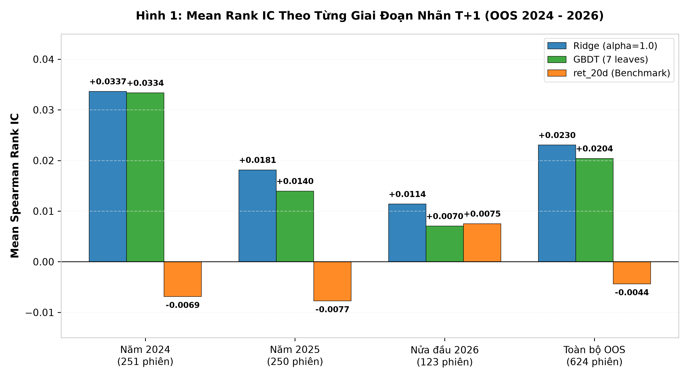

# Bản Nháp Đồ Án: Kết Quả Dự Báo Xếp Hạng Lợi Suất Ngoài Mẫu (Out-of-Sample Rank IC)

> **Mục tiêu của phần này trong đồ án:**  
> Trình bày và giải thích kết quả đánh giá năng lực dự báo thứ hạng tỷ suất sinh lời của các mô hình học máy trên dữ liệu ngoài mẫu (Out-of-Sample - OOS) một cách dễ hiểu, có căn cứ toán học và bám sát các số liệu thực nghiệm đã kiểm chứng.
>
> **Tài liệu và dữ liệu đối chiếu:**
> - Bảng dữ liệu Rank IC hàng ngày: [`outputs/reports/oos_daily_ic_2024_2026.csv`](../../../outputs/reports/oos_daily_ic_2024_2026.csv) (bộ lọc `is_primary_strict_t1 == True`, $N = 624$).
> - Báo cáo đánh giá OOS gốc: [`docs/reports/baseline/oos_evaluation_report.md`](oos_evaluation_report.md)
> - Báo cáo kết quả thực nghiệm tổng hợp: [`docs/reports/baseline/comprehensive_experimental_results_report.md`](comprehensive_experimental_results_report.md)

> [!NOTE]
> **Tóm lược kết luận cốt lõi:**  
> Trên 624 phiên ngoài mẫu chính, Ridge và GBDT đạt Mean Spearman Rank IC lần lượt là 0,023050 và 0,020403 khi xếp hạng cổ phiếu theo lợi suất Close-to-Close của phiên kế tiếp. Cả hai có Mean IC dương và đạt $p < 0,001$ trong kiểm định hai phía so với 0. Ridge có Mean IC quan sát được cao nhất trong ba tín hiệu, còn tín hiệu đối chứng ret_20d đạt −0,004393. Mean IC của cả hai mô hình thấp hơn ở các giai đoạn sau trong phạm vi đánh giá chính.

---

## 1. Mô Hình Dự Báo Điều Gì?

### 1.1. Bản chất bài toán dự báo xếp hạng
Trong đồ án này, bài toán được thiết kế không phải là dự đoán mức giá cụ thể hay phần trăm tăng giảm tuyệt đối của từng cổ phiếu, mà là **dự báo thứ tự tương đối về tỷ suất sinh lời của các cổ phiếu trong phiên kế tiếp**.

Nói một cách đơn giản: Thay vì trả lời câu hỏi *"Ngày mai cổ phiếu Apple sẽ tăng bao nhiêu phần trăm?"*, mô hình sẽ trả lời câu hỏi: *"Trong danh sách gần 1.000 cổ phiếu hôm nay, cổ phiếu nào sẽ có mức sinh lời cao hơn các cổ phiếu còn lại vào ngày mai?"*.

### 1.2. Ví dụ trực quan với một ngày cụ thể
Để người đọc dễ hình dung quy trình vận hành, ta xét mốc thời gian cụ thể:
* **Thời điểm dự báo (Hết phiên $T$):** Lúc 16:00 chiều ngày thứ Ba, **02/01/2024** (khi thị trường chứng khoán Mỹ đóng cửa phiên đầu năm 2024).
* **Đầu vào của mô hình:** Dữ liệu giá đóng cửa (Close) và khối lượng giao dịch (Volume) tính đến hết ngày 02/01/2024 được đưa vào để tính toán **13 đặc trưng kỹ thuật** (gồm các chỉ số động lượng, tỷ lệ so với đường trung bình MA, độ lệch chuẩn và độ biến động).
* **Mô hình thực hiện dự báo:**
  1. **Ridge Baseline ($\alpha=1.0$):** Mô hình hồi quy tuyến tính có hiệu chỉnh L2 (`Ridge` của thư viện `scikit-learn`). Vì mô hình tuyến tính nhạy cảm với thang đo của các đặc trưng, dữ liệu đầu vào được chuẩn hóa qua `StandardScaler`.
  2. **GBDT Candidate (7 leaves):** Mô hình cây quyết định tăng cường độ dốc dạng histogram (`HistGradientBoostingRegressor` của thư viện `scikit-learn`), giới hạn tối đa 7 nút lá nhằm chống quá khớp (overfitting). Thuật toán cây quyết định vốn bất biến với thang đo đơn điệu nên tiếp nhận trực tiếp 13 đặc trưng thô mà không cần qua scaler.
* **Đầu ra dự báo:** Mỗi mô hình sinh ra một điểm số $\hat{s}_T$ cho từng cổ phiếu trong rổ Russell 1000 ($\approx 976$ mã đủ điều kiện giao dịch tại ngày hôm đó). Điểm số càng cao nghĩa là mô hình kỳ vọng cổ phiếu đó sẽ tăng giá càng tốt.
* **Mục tiêu cần xếp hạng:** Tỷ suất sinh lời từ giá đóng cửa phiên $T$ (02/01/2024) đến giá đóng cửa phiên $T+1$ (03/01/2024), gọi là lợi suất Close-to-Close:
  $$r_{i, T+1} = \frac{P_{i, T+1}^{\text{close}}}{P_{i, T}^{\text{close}}} - 1$$
* **Tín hiệu đối chứng (`ret_20d`):** Để biết mô hình học máy có thực sự hữu ích hay không, nhóm sử dụng thêm tín hiệu `ret_20d` làm mốc so sánh (benchmark). Đây là tỷ suất sinh lời quá khứ 20 phiên của cổ phiếu ($P_T^{\text{close}} / P_{T-20}^{\text{close}} - 1$), đại diện cho chiến lược bám theo xu hướng truyền thống mà không dùng bất kỳ thuật toán học máy nào.

### 1.3. Ranh giới huấn luyện và kiểm thử ngoài mẫu
Nhằm loại bỏ hoàn toàn nguy cơ nhìn trước tương lai (Look-ahead Bias):
- Cả hai mô hình Ridge và GBDT đều được **huấn luyện (fit) duy nhất một lần trên tập dữ liệu Phát triển (Development: 2000–2023)**.
- Khi bước sang tập dữ liệu Ngoài mẫu (Out-of-Sample - OOS) chính gồm **624 phiên giao dịch** (tương ứng với ngày nhãn kết quả $T+1$ từ **03/01/2024 đến 30/06/2026**), **toàn bộ trọng số và cấu hình của mô hình được giữ nguyên tuyệt đối**, không tái huấn luyện (refit) và không điều chỉnh tham số.

---

## 2. Chấm Điểm Dự Báo Thế Nào? (Cách Đo Bằng Spearman Rank IC)

### 2.1. Ví dụ dễ hiểu với ba cổ phiếu
Giả sử tại một phiên giao dịch, thị trường chỉ có 3 cổ phiếu: **A**, **B** và **C**.
1. Sau giờ đóng cửa phiên $T$, mô hình cho điểm dự báo:
   - Mã A: 0,85 $\rightarrow$ Xếp hạng dự báo $\operatorname{rank}(\hat{s}_T) = 1$ (kỳ vọng tăng mạnh nhất).
   - Mã B: 0,40 $\rightarrow$ Xếp hạng dự báo $\operatorname{rank}(\hat{s}_T) = 2$ (kỳ vọng tăng nhì).
   - Mã C: -0,20 $\rightarrow$ Xếp hạng dự báo $\operatorname{rank}(\hat{s}_T) = 3$ (kỳ vọng kém nhất).
2. Khi phiên $T+1$ kết thúc, thị trường trả về kết quả lợi suất thực tế:
   - Mã A: tăng $+3,5\%$ $\rightarrow$ Xếp hạng thực tế $\operatorname{rank}(r_{T+1}) = 1$.
   - Mã B: tăng $+1,2\%$ $\rightarrow$ Xếp hạng thực tế $\operatorname{rank}(r_{T+1}) = 2$.
   - Mã C: giảm $-2,0\%$ $\rightarrow$ Xếp hạng thực tế $\operatorname{rank}(r_{T+1}) = 3$.

Trong trường hợp này, thứ hạng dự báo và thứ hạng thực tế **trùng khớp hoàn hảo 100%**. Hệ số tương quan thứ hạng giữa hai chuỗi là $+1,0$ (tuyệt đối).

Ngược lại:
- Nếu thực tế đảo ngược hoàn toàn (C tăng mạnh nhất, A giảm mạnh nhất), hệ số tương quan sẽ là $-1,0$.
- Nếu mô hình gieo xúc xắc ngẫu nhiên, thứ hạng dự báo không liên quan gì đến thực tế, hệ số tương quan sẽ dao động quanh $0,0$.

### 2.2. Công thức toán học tính theo từng phiên
Mở rộng ví dụ trên cho toàn bộ $N_T \approx 976$ cổ phiếu hợp lệ trong cùng phiên $T$, hệ số tương quan hạng Spearman (Spearman Rank Information Coefficient - Rank IC) của phiên $T$ được định nghĩa bằng hệ số tương quan Pearson giữa hai vector thứ hạng:

$$\text{IC}_T = \operatorname{corr}\left(\operatorname{rank}(\hat{s}_T), \operatorname{rank}(r_{T+1})\right)$$

Công thức chi tiết được tính như sau:
$$\text{IC}_T = 1 - \frac{6 \sum_{i=1}^{N_T} d_{i, T}^2}{N_T(N_T^2 - 1)}, \quad \text{trong đó } d_{i, T} = \operatorname{rank}(\hat{s}_{i, T}) - \operatorname{rank}(r_{i, T+1})$$

> [!NOTE]
> **Điều kiện áp dụng công thức rút gọn:**  
> Công thức rút gọn dựa trên sai phân thứ hạng $d_{i, T}$ ở trên chỉ áp dụng chính xác khi cả hai dãy điểm dự báo và lợi suất thực tế **không xuất hiện các giá trị đồng hạng (no tied ranks)**. Khi xuất hiện giá trị đồng hạng (ties), công thức chuẩn xác là tính trực tiếp hệ số tương quan Pearson giữa hai vector thứ hạng đã được xử lý trung bình hạng: $\operatorname{corr}\left(\operatorname{rank}(\hat{s}_T), \operatorname{rank}(r_{T+1})\right)$.

### 2.3. Tổng hợp Mean Rank IC qua 624 phiên ngoài mẫu
Chỉ số $\text{IC}_T$ được tính riêng cho từng ngày giao dịch. Để đánh giá năng lực tổng thể của mô hình qua suốt 2,5 năm ngoài mẫu, ta lấy trung bình số học của toàn bộ 624 phiên:

$$\overline{\text{Rank IC}} = \frac{1}{624} \sum_{T=1}^{624} \text{IC}_T$$

> [!IMPORTANT]
> **Điểm cần lưu ý về mặt bản chất:**
> Con số Mean Rank IC (ví dụ $+0,023050$) là **hệ số tương quan thứ hạng**, có giá trị nằm trên thang đo từ $-1,0$ đến $+1,0$.
> **Chỉ số này hoàn toàn khác với tỷ lệ dự báo đúng (Accuracy %)**. Rank IC phản ánh mức độ tương đồng về thứ bậc giữa điểm dự đoán và lợi suất thực tế, không đo lường tỷ lệ đoán trúng hướng tăng giảm tuyệt đối của từng cổ phiếu.

---

## 3. Kết Quả Thực Nghiệm Ngoài Mẫu Nói Lên Điều Gì?

### 3.1. Bảng số liệu tổng hợp trên 624 phiên OOS chính
Dưới đây là kết quả kiểm định chính thức trích xuất từ dữ liệu thực nghiệm đã đối soát:

| Tiêu chí Đánh giá | Ridge Baseline ($\alpha=1.0$) | GBDT Candidate (7 leaves) | Benchmark `ret_20d` | Ý nghĩa Thống kê & Thực nghiệm |
| :--- | :---: | :---: | :---: | :--- |
| **Số phiên kiểm thử ($N$)** | **624** | **624** | **624** | Phạm vi nhãn thực thi $T+1$: 03/01/2024 đến 30/06/2026 |
| **Mean Rank IC** | **+0,023050** | **+0,020403** | **-0,004393** | Năng lực xếp hạng tương đối trung bình mỗi phiên |
| **Độ lệch chuẩn IC ($\hat{\sigma}_{\text{IC}}$)** | 0,160771 | 0,148797 | 0,171297 | Mức độ biến thiên của tín hiệu giữa các ngày |
| **$t$-statistic ($df=623$)** | **+3,58** | **+3,43** | **-0,64** | Kiểm định Mean IC so với 0: $t = \frac{\overline{\text{IC}}}{\hat{\sigma} / \sqrt{624}}$ |
| **$p$-value (kiểm định 2 phía)** | **0,00037** ($< 0,001$) | **0,00065** ($< 0,001$) | **0,522** ($> 0,5$) | Xác suất kết quả xảy ra do ngẫu nhiên nếu thực tế alpha = 0 |
| **Annualized IC IR** | **+2,28** | **+2,18** | **-0,41** | Độ ổn định thông tin quy năm: $\text{IR} = \frac{\overline{\text{IC}}}{\hat{\sigma}} \times \sqrt{252}$ |
| **Tỷ lệ phiên IC dương (%)** | **56,4%** (352/624 phiên) | **56,2%** (351/624 phiên) | **48,7%** (304/624 phiên) | Tỷ lệ số ngày mô hình xếp hạng đúng chiều |

### 3.2. Biến động Mean Rank IC theo từng giai đoạn
Khi nhóm 624 phiên theo **ngày nhãn thực thi kết quả $T+1$**, số liệu thu được như sau:

| Giai đoạn theo ngày kết quả $T+1$ | Số phiên ($N$) | Ridge ($\alpha=1.0$) | GBDT (7 leaves) | ret_20d (Benchmark) | Khoảng thời gian cụ thể |
| :--- | :---: | :---: | :---: | :---: | :--- |
| **Năm 2024** | 251 | **+0,033652** | **+0,033359** | -0,006895 | 03/01/2024 đến 31/12/2024 |
| **Năm 2025** | 250 | **+0,018135** | **+0,013967** | -0,007747 | 02/01/2025 đến 31/12/2025 |
| **Nửa đầu 2026 (H1)** | 123 | **+0,011403** | **+0,007043** | +0,007528 | 02/01/2026 đến 30/06/2026 |
| **Toàn bộ OOS chính** | **624** | **+0,023050** | **+0,020403** | **-0,004393** | 03/01/2024 đến 30/06/2026 |

Dưới đây là biểu đồ đối chiếu trực quan:

*Hình 1: Mean Rank IC theo từng giai đoạn ngoài mẫu được nhóm theo ngày nhãn thực thi $T+1$. Cụm cột bên phải (“Toàn bộ OOS”) thể hiện kết quả trung bình trên toàn bộ 624 phiên ngoài mẫu chính (+0,023050 cho Ridge, +0,020403 cho GBDT và -0,004393 cho ret_20d). Ba cụm cột bên trái thể hiện kết quả trung bình tính riêng cho từng giai đoạn (Năm 2024: 251 phiên; Năm 2025: 250 phiên; Nửa đầu 2026: 123 phiên), cho thấy mức Mean IC đo được ở các giai đoạn sau thấp hơn năm đầu tiên.*

### 3.3. Phân tích kết quả và giới hạn so sánh
Từ bảng số liệu và biểu đồ thực nghiệm, nhóm nghiên cứu rút ra ba kết luận định lượng:

1. **Ý nghĩa thống kê so với giả thuyết không:**
   - Cả Ridge Baseline ($t = +3,58, p = 0,00037$) và GBDT Candidate ($t = +3,43, p = 0,00065$) đều đạt mức ý nghĩa thống kê rất cao ($p < 0,001$).
   - Vì xác suất $p$-value nhỏ hơn $0,1\%$, ta có đủ bằng chứng thực nghiệm để bác bỏ giả thuyết không ($H_0: \text{Mean IC} = 0$), khẳng định hai mô hình học máy thực sự nắm bắt được tín hiệu dự báo từ 13 đặc trưng kỹ thuật.
2. **Benchmark động lượng quá khứ không có hiệu quả:**
   - Tín hiệu `ret_20d` đạt Mean IC âm (-0,004393) với $t = -0,64$ và $p = 0,522$ ($p > 0,5$). Tỷ lệ phiên dương dưới 50% (48,7%). Điều này chứng minh rằng việc dựa đơn thuần vào quán tính tăng giá 20 ngày quá khứ không mang lại lợi thế dự báo xếp hạng trên rổ cổ phiếu vốn hóa lớn Russell 1000.
3. **Mô hình có dấu hiệu suy giảm Mean IC ở các giai đoạn sau:**
   - Số liệu đo lường theo từng năm nhãn $T+1$ ghi nhận Mean IC của cả hai mô hình giảm dần: từ mức $\sim +0,033$ trong năm 2024 xuống $\sim +0,018$ (Ridge) và $\sim +0,014$ (GBDT) năm 2025, rồi tiếp tục ở mức $\sim +0,011$ (Ridge) và $\sim +0,007$ (GBDT) trong nửa đầu 2026. Mặc dù biên độ giảm sút theo thời gian, tín hiệu của cả hai mô hình vẫn duy trì được giá trị dương ở mọi giai đoạn.
4. **Giới hạn phạm vi so sánh giữa Ridge và GBDT:**
   - Trên tập mẫu 624 phiên OOS chính, **Ridge có Mean Rank IC quan sát được cao hơn GBDT** (+0,023050 so với +0,020403).
   - Tuy nhiên, cần lưu ý về mặt phương pháp luận: Các giá trị $p$-value được báo cáo ở trên ($p = 0,00037$ và $p = 0,00065$) là kết quả kiểm định Mean IC của **từng mô hình riêng rẽ so với mốc 0**. Sự chênh lệch giữa Ridge và GBDT hiện tại được ghi nhận ở mức khác biệt quan sát được trên mẫu thực nghiệm, chứ chưa phải là kết luận khẳng định Ridge cao hơn GBDT có ý nghĩa thống kê qua một bài kiểm định so sánh cặp (paired t-test).

---

## 4. Trả Lời Câu Hỏi Của Đề Thầy Bằng Lời Dễ Hiểu

> **Câu hỏi trọng tâm:**  
> *"Các mô hình học máy có thực sự học được quy luật để xếp thứ tự cổ phiếu sinh lời cho ngày tiếp theo hay không, hay kết quả chỉ là may rủi ngẫu nhiên?"*

**Câu trả lời ngắn gọn và rõ ràng:**
1. **Mô hình thực sự học được tín hiệu:** Kết quả thực nghiệm ngoài mẫu khẳng định cả hai mô hình học máy (Ridge Regression và HistGradientBoostingRegressor) đều đạt hệ số tương quan thứ hạng dương có ý nghĩa thống kê rất cao ($p < 0,001$). Khả năng những con số này sinh ra do ngẫu nhiên là chưa tới 1 phần 1.000.
2. **Hiệu quả so với tín hiệu đà giá quá khứ:** Việc kết hợp 13 đặc trưng kỹ thuật giá và khối lượng mang lại Mean Rank IC dương có ý nghĩa thống kê ($p < 0,001$), trong khi việc chỉ dựa vào đà tăng giá 20 ngày trước (`ret_20d`) cho kết quả Mean IC âm (-0,004393) và không đạt mức ý nghĩa thống kê ($p = 0,522$).
3. **Mô hình tuyến tính đơn giản hoạt động rất hiệu quả:** Trên 624 phiên ngoài mẫu độc lập, mô hình hồi quy tuyến tính có hiệu chỉnh L2 (Ridge) đạt Mean Rank IC quan sát được cao nhất (+0,023050), cho thấy trong bài toán dự báo tài chính ngắn hạn với tỷ lệ nhiễu cao, các mô hình tuyến tính có kiểm soát độ phức tạp (regularization) mang lại độ ổn định rất cao.

---

## 5. Danh Mục Liên Kết Đối Chiếu

Người đọc và hội đồng chấm có thể tra cứu toàn bộ bằng chứng số học qua các tài liệu và tệp dữ liệu gốc sau:
* **Chuỗi Rank IC chi tiết từng phiên (CSV):** [`outputs/reports/oos_daily_ic_2024_2026.csv`](../../../outputs/reports/oos_daily_ic_2024_2026.csv) (cột `ic_ridge`, `ic_gbdt`, `ic_ret_20d` trên 624 dòng `is_primary_strict_t1 == True`).
* **Báo cáo đánh giá OOS Rank IC gốc:** [`docs/reports/baseline/oos_evaluation_report.md`](oos_evaluation_report.md) (báo cáo one-shot nghiệm thu giai đoạn đánh giá tín hiệu).
* **Báo cáo thực nghiệm tổng hợp toàn diện:** [`docs/reports/baseline/comprehensive_experimental_results_report.md`](comprehensive_experimental_results_report.md) (báo cáo bao gồm cả phần Rank IC và mô phỏng danh mục backtest Top 20).
