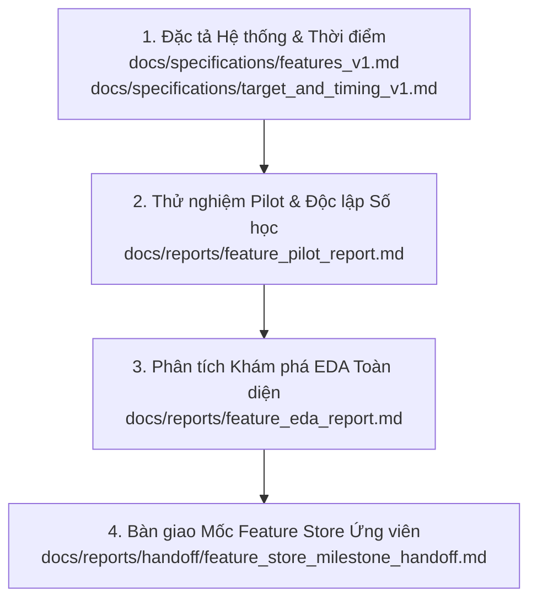

# Tài liệu Bàn giao Mốc: Feature Store Ứng viên (Candidate Tier 3 Feature Store)

Ngày thực hiện: **2026-11-07**  
Tình trạng mốc: **BẢN ỨNG VIÊN (CANDIDATE FEATURE STORE) — ĐÃ ĐỒNG BỘ TOÀN DIỆN — CHƯA NGHIỆM THU CHO TRAINING**  
Phạm vi dữ liệu: **Tập Development (2000-07-01 đến 2023-12-29)** — 5.911 phiên giao dịch $\times$ 3.711 mã Canonical SID.  
Phiên bản Manifest: [`v1.4.0`](../../data/processed/features/feature_store_manifest.json)  
Git Commit cơ sở: `5b108475a6f405d8cade0fe5146ce06cbbb0cc49` (Working Tree ghi nhận trạng thái sửa đổi minh bạch).  

---

## 1. Tóm lược Mốc & Cam kết Bảo toàn Dữ liệu

Tài liệu này xác nhận việc hoàn tất mốc xây dựng **Tier 3 Feature Store** (gồm 16 ma trận đặc trưng ở định dạng Parquet float64) và phân tích dữ liệu khám phá (EDA) trên tập Development.

### Cam kết Bảo toàn Bắt buộc
1. **Trạng thái bản ứng viên**: Toàn bộ feature store hiện tại được lưu giữ làm **bản ứng viên (candidate)** để phục vụ nghiệm thu, rà soát chất lượng và thiết lập baseline. **Tuyệt đối chưa nghiệm thu cho huấn luyện mô hình (ML training)**.
2. **Không can thiệp làm sạch tùy tiện**: Không áp dụng clipping, winsorizing hay z-score scaling ở tầng feature store để che giấu các giá trị cực trị. Mọi phân phối bất thường đều được ghi nhận trung thực.
3. **Đóng băng tuyệt đối Out-of-Sample (OOS 2024–2026)**:
   - Tại tầng tải ma trận (`src/data/matrix_loader.py`), cơ chế đẩy lọc xuống Parquet (Predicate Pushdown Filters) bảo đảm dữ liệu từ `2024-01-02` trở đi **hoàn toàn không được nạp vào bộ nhớ RAM**.
   - Bất kỳ lời gọi nào thiếu cờ `dev_only=True` mà không có `allow_oos=True` đều lập tức kích hoạt lỗi `OOSFreezeViolationError`.
4. **Không tối ưu hóa sớm**: Tuyệt đối chưa tính tương quan thông tin (Information Coefficient - IC) với nhãn mục tiêu, chưa thử nghiệm chiến lược alpha, chưa chạy mô hình hồi quy hay backtest.

---

## 2. Đối chiếu Phạm vi Số đếm Ô (Làm rõ 6.31M ô vs 5.61M ô)

Để loại bỏ hoàn toàn sự không nhất quán giữa các báo cáo, số liệu ô tọa độ (stock-day cells) được đếm trực tiếp từ các ma trận Parquet trên đĩa cứng như sau:

### Bảng Thống kê Số đếm Ô theo Khoảng thời gian và Loại Mask

| Khoảng thời gian | Số phiên | Số mã Canonical SID | Tổng số ô ma trận ($N_{dates} \times N_{sids}$) | Ô `strict_membership_mask = True` | Ô `valid_data_mask = True` | Ghi chú & Vai trò |
|---|:---:|:---:|:---:|:---:|:---:|---|
| **Toàn bộ lưới (Full Grid: 1998–2026)** | 7.252 | 3.711 | 26.912.172 | 6.307.492 | **6.311.822** | **Nguồn gốc con số ~6.31M ô**: Tổng số ô có dữ liệu giao dịch hợp lệ của các thành viên Russell 1000 trên toàn bộ lịch sử 28 năm (kể cả OOS) theo `valid_data_mask`. |
| **Tập Development (2000–2023)** | 5.911 | 3.711 | 21.935.721 | **5.607.409** | 5.610.691 | **Nguồn gốc con số ~5.61M ô**: Số ô tọa độ thành viên đang hoạt động trong rổ Russell 1000 tại ngày $T$ theo `strict_membership_mask`. **Đây là mẫu số chuẩn để đánh giá độ phủ của các feature**. |
| **Giai đoạn Warm-up (1998–2000)** | 630 | 3.711 | 2.337.930 | 0 | 0 | Rổ Russell 1000 bắt đầu ghi nhận từ giữa năm 2000. Dữ liệu giá giai đoạn này chỉ dùng làm sạch lịch sử khởi tạo trượt (Warm-up) theo `bar_quality_mask`, độc lập với membership. |
| **Giai đoạn Out-of-Sample (2024–2026)** | 711 | 3.711 | 2.638.521 | 700.083 | 701.131 | Dữ liệu kiểm thử mù. Tuyệt đối đóng băng, không nạp vào RAM. ($5.607.409 + 700.083 = 6.307.492$ ô strict membership). |

> [!IMPORTANT]
> **Quan hệ giữa `valid_data_mask` và `strict_membership_mask` trên Development**:
> - `valid_data_mask` hiện tại trong pipeline được xây dựng dựa trên `resolved_membership_mask` (5.631.824 ô trên Development), bao gồm cả các phân đoạn chuyển tiếp tuần tự Level 2/3, do đó **rộng hơn `strict_membership_mask`** (5.607.409 ô):
>   * Số ô `valid_data_mask == True` trên Development: **5.610.691 ô**.
>   * Số ô `strict_membership_mask == True` trên Development: **5.607.409 ô**.
>   * Có **22.220 ô** `valid_data_mask == True` nằm ngoài `strict_membership_mask` (thuộc các phân đoạn chuyển tiếp heuristic).
>   * Có **18.938 ô** thuộc `strict_membership_mask` có `valid_data_mask == False` (do lỗi nến, thiếu volume, hoặc phiên không liên tục).
>   * Giao cắt giữa hai mask: **5.588.471 ô**.
> - **Quy định bắt buộc**: Dataset baseline khi xây dựng phải áp dụng `strict_membership_mask` tại ngày đầu ra $T$ để đảm bảo tính nhất quán với vũ trụ được kiểm chứng vĩnh viễn cao nhất. Mẫu số chuẩn đánh giá độ phủ feature trên Development bắt buộc là **5.607.409 ô thành viên**. Số ô ngoài rổ tại $T$ ($21.935.721 - 5.607.409 = 16.328.312$ ô, chiếm $74,44\%$) nhận giá trị `NaN` nghiêm ngặt theo đặc tả.

---

## 3. Quy tắc Return Mới, Nhãn Target và Chính sách Chọn Mẫu

Nhằm khắc phục triệt để lỗi bỏ sót lợi suất phục hồi (recovery return) sau phiên nến bị cách ly, hệ thống đã chuẩn hóa quy tắc return dựa trên đầu vào (Universal Input-based Return Rule) trong `src/data/corrections.py`:
- Nếu một phiên $T$ bị cách ly toàn bar (`is_bar_quarantine = True`), thì cả $R_T$ và $R_{T+1}$ đều được đặt thành `NaN`.
- Hệ thống **tuyệt đối không nối bước giá qua phiên bị cách ly** ($Close_{T+1} / Close_{T-1} - 1$).
- Đồng thời, cờ chuyển tiếp phiên liên tục `is_consecutive_session` tại ngày $T+1$ được đặt thành `False`.

### Phân định Rạch ròi giữa Tính Hợp lệ Số học và Chính sách Chọn Mẫu

Giả sử tại phiên $T$, cổ phiếu xuất hiện lỗi dữ liệu giá đóng cửa (Close contaminated / Quarantined bar):

1. **Về mặt số học của Daily Return ($R_t = \frac{AdjClose_t}{AdjClose_{t-1}} - 1$)**:
   - Tại phiên $T$: $R_T = \frac{Close_T}{Close_{T-1}} - 1$. Tử số $Close_T$ bị lỗi $\implies R_T$ **không hợp lệ** ($\to \text{NaN}$).
   - Tại phiên $T+1$: $R_{T+1} = \frac{Close_{T+1}}{Close_T} - 1$. Mẫu số $Close_T$ bị lỗi $\implies R_{T+1}$ **không hợp lệ** ($\to \text{NaN}$).
   - Tại phiên $T+2$: $R_{T+2} = \frac{Close_{T+2}}{Close_{T+1}} - 1$. Cả $Close_{T+1}$ và $Close_{T+2}$ đều là giá giao dịch sạch và hợp lệ $\implies R_{T+2}$ **hoàn toàn hợp lệ về mặt số học**.

2. **Về mặt số học của Nhãn Mục tiêu ($\text{target}_t = R_{t+1}$)**:
   - Tại phiên $T-1$: $\text{target}_{T-1} = R_T$. Vì $R_T$ không hợp lệ $\implies \text{target}_{T-1}$ **không hợp lệ** ($\to \text{NaN}$).
   - Tại phiên $T$: $\text{target}_T = R_{T+1}$. Vì $R_{T+1}$ không hợp lệ $\implies \text{target}_T$ **không hợp lệ** ($\to \text{NaN}$).
   - Tại phiên $T+1$: $\text{target}_{T+1} = R_{T+2}$. Vì $R_{T+2}$ hợp lệ $\implies \mathbf{\text{target}_{T+1}}$ **hoàn toàn hợp lệ về mặt số học!**

3. **Về mặt Chính sách Chọn Mẫu Huấn luyện (`valid_data_mask`)**:
   - Mặc dù nhãn $\text{target}_{T+1} = R_{T+2}$ là đúng đắn về mặt số học, quan sát tại ngày $T+1$ vẫn bị **loại bỏ khỏi tập mẫu huấn luyện** bởi chính sách `valid_data_mask`.
   - **Lý do loại bỏ**:
     a) Cờ `is_consecutive_session` tại ngày $T+1$ bằng `False` (do bước chuyển tiếp từ phiên $T$ bị cách ly).
     b) Các đặc trưng đầu vào $X_{T+1}$ phụ thuộc vào $Close_T$ (chẳng hạn như $ret\_1d$, $ret\_intraday$, v.v.) đều nhận giá trị `NaN` tại phiên $T+1$.
   - **Kết luận giải trình**: Việc loại mẫu tại $T+1$ là do **chính sách kỹ thuật lọc mẫu và tính sẵn sàng của đặc trưng đầu vào $X$**, **không phải do nhãn $\text{target}(T+1)$ bị sai toán học**.

### Bảng Minh họa Chuỗi 4 Phiên Liên tiếp

| Phiên giao dịch | Trạng thái Nến | Return Close-to-Close $R_t$ | Nhãn Target $y_t = R_{t+1}$ | Cờ `is_consecutive_session` | Mặt nạ `valid_data_mask` | Mẫu $(X_t, y_t)$ được chọn cho Model? | Lý giải kỹ thuật |
|:---:|:---:|:---:|:---:|:---:|:---:|:---:|---|
| **$T-1$** | Sạch | Hợp lệ | **NaN** (vì $R_T$ hỏng) | `True` | `True` | **KHÔNG** | Bị loại vì thiếu nhãn target ($y_{T-1} = \text{NaN}$). |
| **$T$** | **BỊ CÁCH LY** | **NaN** (tử số hỏng) | **NaN** (vì $R_{T+1}$ hỏng) | `False` | `False` | **KHÔNG** | Bị loại vì nến tại $T$ hỏng và cả target $y_T = \text{NaN}$. |
| **$T+1$** | Sạch | **NaN** (mẫu số hỏng) | **HỢP LỆ ($R_{T+2}$)** | **`False`** (chuyển tiếp đứt đoạn) | **`False`** | **KHÔNG** | **Bị loại do chính sách chọn mẫu**: $y_{T+1}$ đúng toán học nhưng $X_{T+1}$ thiếu giá trị sạch và phiên không liên tục. |
| **$T+2$** | Sạch | Hợp lệ | Hợp lệ ($R_{T+3}$) | `True` | `True` | **Tùy điều kiện $X$** | Return 1d và cờ nến $T+2$ đã phục hồi, target $y_{T+2}$ hợp lệ. Tuy nhiên, các **rolling features (20d, 60d, 252d) vẫn là NaN** cho đến khi nến/return lỗi trôi hoàn toàn ra khỏi cửa sổ trượt tương ứng. |

> [!WARNING]
> **Lưu ý về Thời điểm Phục hồi của Rolling Features**:
> - Tuyệt đối không suy diễn rằng *"toàn bộ features phục hồi ngay tại $T+2$"*.
> - Tại $T+2$, chỉ có các đặc trưng 1-ngày phụ thuộc trực tiếp vào cặp $(Close_{T+1}, Close_{T+2})$ như `ret_1d` là phục hồi.
> - Các đặc trưng có cửa sổ trượt dài hạn (20 phiên, 60 phiên, 252 phiên) tiếp tục nhận giá trị `NaN` tại $T+2, T+3, \dots$ và **phục hồi theo độ dài cửa sổ riêng của từng feature**:
>   * `ret_20d`, `vol_realized_20d`, `downside_deviation_20d`: Chỉ phục hồi sau **20 phiên sạch** liên tiếp kể từ sau sự kiện lỗi.
>   * `ret_60d`, `vol_realized_60d`: Chỉ phục hồi sau **60 phiên sạch** liên tiếp.
>   * `mom_12m_skip_1m`: Chỉ phục hồi sau **252 phiên** (với tối thiểu 232 phiên sạch trên $[T-252, T-21]$).
> - Do đó, nếu mô hình baseline yêu cầu đủ toàn bộ 13 features ($X$ không chứa NaN), dòng quan sát này sẽ chỉ được đưa vào tập huấn luyện khi tất cả các rolling features thành phần đã lần lượt phục hồi xong.

---

## 4. Kết quả Tái tạo Features Chịu Ảnh Hưởng và Đối chiếu Cụ thể

### 4.1. Phân tích Phụ thuộc (Dependency DAG)
- **4 Features phụ thuộc trực tiếp vào `daily_return`**: `vol_realized_20d`, `vol_realized_60d`, `downside_deviation_20d`, `amihud_illiq_20d`. Các features này bắt buộc phải tái tạo khi `daily_return` thay đổi.
- **12 Features còn lại độc lập với `daily_return`**:
  * Nhóm Momentum (`ret_1d`, `ret_5d`, `ret_20d`, `ret_60d`, `mom_12m_skip_1m`) và Kỹ thuật (`rsi_14d`, `bollinger_pct_b_20d`): Chỉ phụ thuộc vào ma trận `adj_close`. Trong hàm `compute`, `bar_quality_mask` đã làm sạch các nến cách ly ngay từ đầu nên giá trị tính ra bất biến.
  * Nhóm Parkinson (`vol_parkinson_20d`): Chỉ phụ thuộc `adj_high` và `adj_low`.
  * Nhóm Khối lượng (`volume_ratio_5_20`, `log_dollar_volume_20d`): Chỉ phụ thuộc `volume` và `close`.
  * Nhóm Trong ngày (`ret_intraday`, `ret_overnight`): Chỉ phụ thuộc `adj_open` và `adj_close`.
  $\implies$ Việc giữ nguyên 12 features này là hoàn toàn chính xác theo đồ thị phụ thuộc (DAG).

### 4.2. Đối chiếu Hai Tọa độ Kiểm chứng Bắt buộc
Theo yêu cầu đối chiếu độc lập, hai tọa độ cụ thể được kiểm tra trước và sau khi áp dụng quy tắc return mới:

| Cổ phiếu & Tọa độ | Ngày kiểm tra | Giá trị cũ trong Feature Store | Giá trị tính lại từ Return mới | Đánh giá & Cơ chế |
|---|:---:|:---:|:---:|---|
| **LOW `R735QTJ8XC9X`** | `2008-07-16` | `0.151942283666` | **`NaN`** | **Chính xác 100%**: Phiên 2008-07-16 cách ngày cách ly (2008-06-17) đúng 20 phiên giao dịch. Khi return phục hồi ngày 2008-06-18 trở thành `NaN`, cửa sổ 20 phiên chỉ còn 19 giá trị hợp lệ, vi phạm điều kiện `min_periods=20` của biến động nên chuyển thành `NaN`. |
| **CPTH `RJF8CZIDFLNP`** | `2001-03-15` | `0.185147910772` | **`NaN`** | **Chính xác 100%**: Phiên 2001-03-15 cách ngày đình chỉ giao dịch (2001-02-14) đúng 20 phiên. Khi return phục hồi ngày 2001-02-15 trở thành `NaN`, cửa sổ 20 phiên chuyển thành `NaN`. |

### 4.3. Bảng Kiểm kê Thay đổi Ô trên Toàn bộ 4 Features
So sánh từng ô dữ liệu (cell-by-cell) giữa phiên bản cũ và phiên bản mới cho thấy sự thay đổi diễn ra có chọn lọc tuyệt đối:

| Feature | Kích thước ma trận | Số ô thay đổi trạng thái NaN | Tọa độ và ngày thay đổi cụ thể | Số ô hợp lệ trước $\to$ sau | Độ phủ Membership (%) |
|---|:---:|:---:|---|:---:|:---:|
| `vol_realized_20d` | $5.911 \times 3.711$ | **Đúng 2 ô** | `CPTH` (2001-03-15): 0.185148 $\to$ `NaN` `LOW` (2008-07-16): 0.151942 $\to$ `NaN` | 5.589.781 $\to$ **5.589.779** | 99,69% |
| `vol_realized_60d` | $5.911 \times 3.711$ | **Đúng 2 ô** | `CPTH` (2001-05-11): 0.144327 $\to$ `NaN` `LOW` (2008-09-11): 0.093193 $\to$ `NaN` | 5.587.016 $\to$ **5.587.014** | 99,64% |
| `downside_deviation_20d` | $5.911 \times 3.711$ | **Đúng 2 ô** | `CPTH` (2001-03-15): 0.176909 $\to$ `NaN` `LOW` (2008-07-16): 0.153237 $\to$ `NaN` | 5.589.781 $\to$ **5.589.779** | 99,69% |
| `amihud_illiq_20d` | $5.911 \times 3.711$ | **Đúng 2 ô** | `CPTH` (2001-03-15): 0.019971 $\to$ `NaN` `LOW` (2008-07-16): 0.000249 $\to$ `NaN` | 5.586.614 $\to$ **5.586.612** | 99,63% |

> Toàn bộ các ô còn lại trong 4 ma trận đều duy trì tính đồng nhất tuyệt đối (sai số dấu phẩy động $< 10^{-15}$).

---

## 5. Rà soát Hệ thống OHLC & Đề xuất 13-Feature Baseline

### 5.1. Hiện trạng Kiểm kê Dị thường OHLC (Lượt quét 251 bản ghi)
Kết quả quét tự động toàn diện trên $24,27$ triệu nến giao dịch (`anomaly_inventory.csv`) ghi nhận:
- **Lượt quét OHLC toàn diện (script 10b) phát hiện 251 ca dị thường**:
  * **4 ca đã cách ly**: `CORR_016` (RGC, 24/07/2008: Open/Low $0.01$), `CORR_017` (CEPH, 06/05/2008: Open/High $999.99$, Low $0.01$), `CORR_018` (FRT, 06/06/2008: High $999.99$, Low $0.01$), `CORR_019` (TR, 06/06/2008: High/Close $999.99$).
  * **247 ca giữ trạng thái `unresolved`**: Tiêu biểu gồm `CELG` (14/09/2005, ret_intraday = +272.95%), `BA` (08/02/2007, ret_overnight = +121.36%), `PCP` (27/02/2007, vol_parkinson = 1.2261).
- **Số lũy kế toàn dự án**: Nếu tính thêm 2 ca ngoại lai ban đầu đã điều tra và cách ly trước đó (`CORR_009` GMT ngày 25/01/2007 và `CORR_010` HOMS ngày 04/08/1999), toàn dự án có **lũy kế 6 ca dị thường đã cách ly**.
- **Cơ chế vi cấu trúc**: Trước quy định Stub Quote Ban năm 2010 của SEC/FINRA, các Market Maker thường đặt giá tượng trưng $0.01 và $999.99 để rút thanh khoản khi hệ thống nghẽn lệnh hoặc thị trường chao đảo dữ dội (phiên 06/06/2008 dầu tăng vọt, phiên 27/02/2007 nghẽn lệnh Dow Jones, Flash Crash 06/05/2010).

### 5.2. Đề xuất Chiến lược Baseline Model: Nhóm 13 Features Close/Volume
Để chuẩn bị cho giai đoạn huấn luyện mô hình tiếp theo mà không bị ảnh hưởng bởi 247 ca dị thường nến chưa xác minh, chúng tôi đề xuất:

1. **Nhóm 13 Features Khuyến nghị cho Baseline Đầu tiên (Close & Volume Only)**:
   - **Momentum (5)**: `ret_1d`, `ret_5d`, `ret_20d`, `ret_60d`, `mom_12m_skip_1m`.
   - **Volatility (3)**: `vol_realized_20d`, `vol_realized_60d`, `downside_deviation_20d`.
   - **Liquidity & Volume (3)**: `amihud_illiq_20d`, `volume_ratio_5_20`, `log_dollar_volume_20d`.
   - **Technical (2)**: `rsi_14d`, `bollinger_pct_b_20d`.
   - **Lý do**: Toàn bộ 13 đặc trưng này chỉ sử dụng giá **Close** và **Volume**. Giá đóng cửa tại các sàn NYSE/NASDAQ được ấn định qua phiên khớp lệnh đóng cửa chính thức (Consolidated Closing Cross) với sự giám sát chặt chẽ của cơ quan quản lý và bù trừ thanh toán, ít bị ảnh hưởng bởi các lỗi râu nến hoặc bản in giá tượng trưng trên Open, High, Low, dù không loại trừ được 100% mọi lỗi dữ liệu (như trường hợp nến TR bị giá trần 999.99 tràn vào cả Close).

2. **Tạm hoãn 3 Features OHLC cho Baseline Ban đầu**:
   - `ret_intraday` (dùng Open & Close)
   - `ret_overnight` (dùng Open & Close)
   - `vol_parkinson_20d` (dùng High & Low)
   - **Lý do**: Đây là 3 đặc trưng trực tiếp chịu ảnh hưởng của các ngoại lai vi cấu trúc nến và 247 trường hợp `unresolved`. Việc tạm hoãn giúp mô hình baseline ban đầu có độ nhiễu thấp nhất. Ba đặc trưng này sẽ được xem xét bổ sung sau khi xây dựng bộ lọc vi cấu trúc chuyên biệt hoặc áp dụng các kỹ thuật biến đổi phi tham số (rank transformation/winsorizing) ở tầng huấn luyện.

---

## 6. Khung Phân Định 3 Tầng Nhận Thức Khoa Học

Để duy trì tính khách quan khoa học, tài liệu phân định rõ ranh giới thông tin:

| Tầng Nhận Thức | Nội dung Cụ thể | Căn cứ Kiểm chứng |
|---|---|---|
| **1. Sự thật đã kiểm chứng (Verified Facts)** | - 16 ma trận đặc trưng có kích thước chính xác $5.911 \times 3.711$, $0$ ô Inf, đúng kiểu `float64`. - 104 bài kiểm tra cấu trúc và 144 bài kiểm tra nhân quả (làm nhiễu/cắt ngắn) đạt sai số $< 10^{-11}$. - 6 tọa độ cách ly (GMT, HOMS, RGC, CEPH, FRT, TR) đã được truy vết dòng chính xác trong tệp ZIP raw và đối chiếu hồ sơ SEC / quy định thị trường. - Toàn bộ 79 bài unit/integration tests trong Pytest đều PASSED. | Bộ log kiểm thử, mã băm SHA-256 trong manifest v1.4.0, tệp Parquet và các hồ sơ lưu trữ SEC công khai. |
| **2. Chính sách kỹ thuật đã áp dụng (Applied Engineering Policies)** | - Cách ly toàn bar thì hủy bỏ return $R_T$ và $R_{T+1}$, không nối bước giá qua nến lỗi. - Lọc nến bằng `bar_quality_mask` độc lập với membership. - Gán `NaN` cho toàn bộ tọa độ ngoài rổ Russell 1000 tại ngày $T$. - Loại bỏ quan sát $T+1$ khỏi mẫu huấn luyện do điều kiện `is_consecutive_session = False`. - Chặn OOS ở mức nạp dữ liệu đĩa vào RAM (`dev_only=True`). | Các quy chuẩn thiết kế được mã hóa trong `src/data/matrix_loader.py`, `src/data/corrections.py`, và `src/features/base.py`. |
| **3. Giả thuyết chưa xác minh (Unverified Hypotheses)** | - 247 ca dị thường OHLC còn lại được suy đoán là do stub quotes hoặc lỗi vi cấu trúc sàn trước năm 2010. - Khả năng dự báo vượt trội hay tính độc lập hoàn toàn của 16 đặc trưng trên thị trường thực tế. | Cần dữ liệu sổ lệnh cấp độ 2 (Level 2 Order Book) để kiểm chứng vi cấu trúc, và cần quá trình huấn luyện/backtest độc lập để đánh giá năng lực alpha. |

---

## 7. Lộ trình Tài liệu Đọc Chuẩn (Documentation Reading Roadmap)

Để phục vụ quá trình review và nghiệm thu toàn diện, tài liệu dự án được tổ chức theo lộ trình đọc khuyến nghị:

1. **Đặc tả Hệ thống (Specifications)**:
   - [`docs/specifications/features_v1.md`](../specifications/features_v1.md): Hợp đồng toán học, định dạng nến và cửa sổ trượt của 16 features.
   - [`docs/specifications/target_and_timing_v1.md`](../specifications/target_and_timing_v1.md): Đặc tả nhãn mục tiêu lợi suất ngày tiếp theo ($R_{t+1}$), thời điểm khớp lệnh và ma trận mặt nạ.
2. **Kiểm chứng Pilot (Pilot Verification)**:
   - [`docs/reports/feature_pilot_report.md`](feature_pilot_report.md): Kết quả kiểm định trên tập mẫu đại diện (AAPL, MSFT, Agilent, BF, KSU, CPTH).
3. **Phân tích Khám phá Dữ liệu (EDA Report)**:
   - [`docs/reports/feature_eda_report.md`](feature_eda_report.md): Báo cáo chi tiết về kiểm định cấu trúc 104 tiêu chí, kiểm định nhân quả mở rộng 144 bài test, phân rã NaN, thống kê phân phối và ma trận tương quan chéo ngang.
4. **Bàn giao Mốc Ứng viên (Milestone Handover)**:
   - [`docs/reports/handoff/feature_store_milestone_handoff.md`](handoff/feature_store_milestone_handoff.md): Báo cáo bàn giao mốc hiện tại (tài liệu này).

---

## 8. Kết luận & Trạng thái Dừng

Mốc xây dựng **Tier 3 Feature Store (Bản Ứng viên)** đã hoàn tất toàn diện:
- Toàn bộ artifacts và manifest (`v1.4.0`) đã đồng bộ hoàn hảo cùng một phiên bản đầu vào.
- Hai tọa độ kiểm chứng (`LOW` 2008-07-16 và `CPTH` 2001-03-15) đều xác nhận chuyển sang `NaN` chính xác.
- Bộ test hồi quy 79/79 bài test PASSED 100%.
- Không thực hiện bất kỳ hoạt động huấn luyện, tinh chỉnh siêu tham số hay truy cập vùng dữ liệu OOS (2024–2026).
- Hệ thống dừng tại đây để người dùng review và thẩm định trước khi bước sang giai đoạn tiếp theo.
