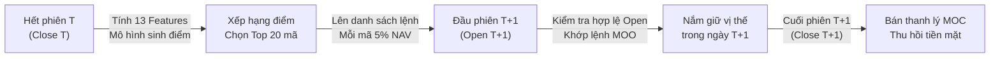
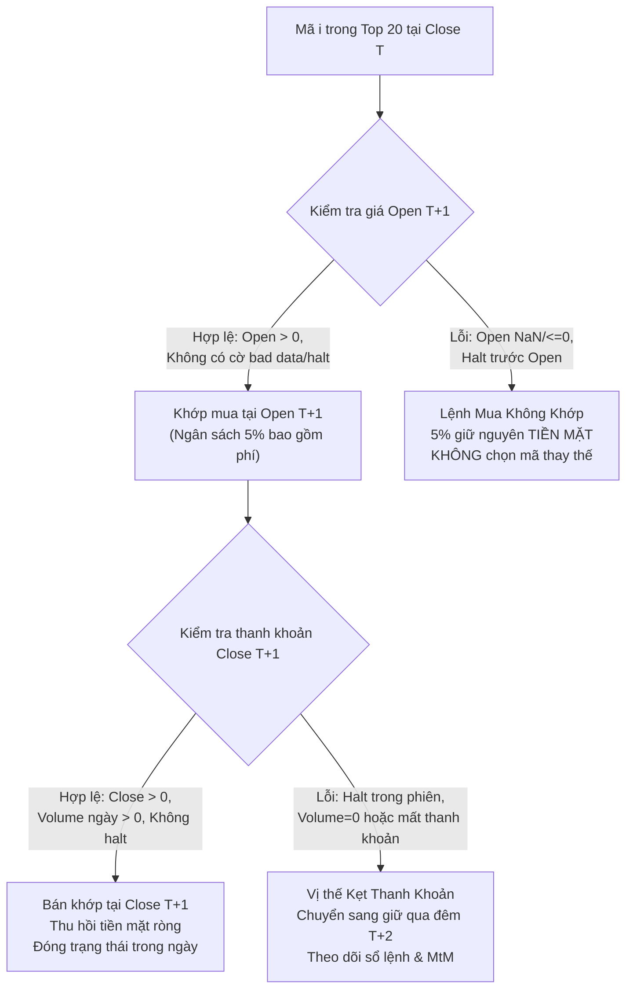

# Đặc Tả Kế Hoạch Kiểm Thử Danh Mục Đầu Tư v1 (Backtest Plan Specification v1)
## Long-Only Top 20 Chiến Lược Open-to-Close trên Phạm Vi Ngoài Mẫu (OOS 2024–2026)

- **Ngày chốt thiết kế**: 2026-11-08  
- **Tài liệu tham chiếu**:
  - Đặc tả target và thời điểm: [`docs/specifications/target_and_timing_v1.md`](target_and_timing_v1.md)
  - Đặc tả đánh giá ngoài mẫu: [`docs/specifications/oos_evaluation_plan_v1.md`](oos_evaluation_plan_v1.md)
  - Báo cáo kết quả OOS chính thức: [`docs/reports/baseline/oos_evaluation_report.md`](../reports/baseline/oos_evaluation_report.md)
- **Trạng thái**: **BẢN DỰ THẢO ĐỀ XUẤT CHO LƯỢT ĐẦU (PROPOSAL FOR INITIAL REVIEW)** — Đã tích hợp 3 điểm phản biện phương pháp luận: bỏ volume cả ngày khỏi quyết định khớp Open, tính phí mua trong ngân sách từng mã, và theo dõi vị thế chưa thoát qua các phiên.

---

## 1. Mục Tiêu & Nguyên Tắc Thiết Kế

### 1.1. Mục tiêu cốt lõi
1. **Chuyển hóa tín hiệu xếp hạng sang hiệu năng kinh tế**: Đánh giá xem năng lực dự báo tương quan dương ngoài mẫu (Rank IC từ $+0.020$ đến $+0.023$) đã được xác nhận của các mô hình có thể tạo ra lợi nhuận danh mục thực tế (Portfolio P&L, Sharpe Ratio, Drawdown) sau khi trừ chi phí giao dịch và trượt giá hay không.
2. **So sánh ngang hàng, nhất quán (Fair Apples-to-Apples Comparison)**: Áp dụng cùng một bộ quy tắc giao dịch, cùng cơ chế khớp lệnh, cùng giả định chi phí và cùng ranh giới thời gian cho 3 nguồn điểm dự đoán:
   - **Ridge Baseline ($\alpha = 1.0$)**: Điểm số `ridge_score` đã lưu.
   - **GBDT Candidate (7 lá)**: Điểm số `gbdt_score` đã lưu.
   - **Benchmark Momentum Đơn Biến (`ret_20d`)**: Tỷ suất sinh lời quá khứ 20 ngày đã lưu.
3. **Tuân thủ tính khả thi thực tế (Execution Realism)**: Phân tách tuyệt đối thời điểm ra quyết định (sau khi kết thúc phiên $T$) và thời điểm khớp lệnh (trong phiên $T+1$), xử lý nghiêm ngặt các rủi ro không khớp lệnh và dữ liệu bất thường.

### 1.2. Bản chất đề xuất lượt đầu
> [!IMPORTANT]
> Cấu hình **Long-Only Top 20, tỷ trọng đều 5%, vào Open $T+1$ và ra Close $T+1$** trong tài liệu này là **đề xuất đơn giản nhất cho lượt đầu (Baseline Backtest Configuration v1)**. Mục tiêu là tạo ra một khung tham chiếu chuẩn mực, dễ kiểm chứng độc lập, trước khi xem xét các kỹ thuật phức tạp hơn (như lọc thanh khoản nâng cao, tối ưu hóa trọng số Markowitz, hay cơ chế chặn lỗ/chốt lời động).

---

## 2. Nguồn Dữ Liệu & Quy Tắc Lựa Chọn Mã Đặt Lệnh

### 2.1. Nguồn điểm dự đoán
Điểm dự đoán được đọc trực tiếp từ bảng dữ liệu đã đóng băng:
- Đường dẫn: [`data/processed/oos_predictions_2024_2026.parquet`](../../data/processed/oos_predictions_2024_2026.parquet)
- Quy mô: 693.803 dòng quan sát trên 711 phiên OOS (2024-01-02 đến 2026-10-30), bình quân 975,8 mã/ngày (nhỏ nhất 969 mã, lớn nhất 982 mã).
- Các cột sử dụng: `date`, `canonical_sid`, `ridge_score`, `gbdt_score`, `ret_20d`.

### 2.2. Thời điểm chốt danh sách đặt lệnh
- **Thời điểm ra quyết định**: Cuối ngày giao dịch $T$, sau khi thị trường đóng cửa và toàn bộ dữ liệu giá đóng cửa, khối lượng, đặc trưng kỹ thuật của phiên $T$ đã được cập nhật đầy đủ.
- Toàn bộ cổ phiếu trong `oos_predictions_2024_2026.parquet` tại ngày $T$ đều đã vượt qua 5 tiêu chí Inference Eligibility tại $T$:
  1. Thuộc danh mục thành viên chỉ số nghiêm ngặt (`strict_membership_mask == True`).
  2. Không nằm trong giai đoạn dữ liệu bất thường (`is_bad_data_period == False` và `is_spinoff_discontinuity == False`).
  3. Là phiên giao dịch liên tục trên lịch dự án (`is_consecutive_session == True`).
  4. Giá đóng cửa và khối lượng hữu hạn, dương ($P_{i,T}^{\text{close}} > 0, V_{i,T} > 0$).
  5. Đủ 13 đặc trưng kỹ thuật hữu hạn, không chứa `NaN` hay `Inf`.

### 2.3. Nguyên tắc cấm rò rỉ dữ liệu tương lai (No Look-Ahead Leakage)
> [!CAUTION]
> **Quy định bất biến về danh sách đặt lệnh**:
> 1. Danh sách 20 mã đặt lệnh được lựa chọn **thuần túy từ bảng dự đoán tại phiên $T$**, sắp xếp theo thứ tự giảm dần của điểm mô hình tương ứng.
> 2. **Tuyệt đối KHÔNG sử dụng `valid_label_mask` hay `target_next_return` từ phiên $T+1$ để lọc trước danh sách đặt lệnh**.
> 3. Tại thời điểm sau Close $T$, nhà đầu tư không thể biết ngày mai mã nào sẽ bị đình chỉ giao dịch, mất thanh khoản, hoặc thiếu giá. Mọi hành vi dùng nhãn $T+1$ để loại bỏ cổ phiếu trước khi lên danh sách đặt lệnh đều cấu thành vi phạm Look-Ahead Bias nghiêm trọng.

---

## 3. Cấu Hình Chiến Lược Giao Dịch Đề Xuất (Baseline Strategy v1)

### 3.1. Thông số danh mục mục tiêu
| Tham số | Giá trị đề xuất | Diễn giải |
| :--- | :---: | :--- |
| **Loại vị thế** | Long-Only | Chỉ mua cổ phiếu có điểm cao nhất, không bán khống (phù hợp với đa số quỹ đại chúng). |
| **Số lượng vị thế ($N$)** | 20 mã | Tập trung vào top alpha cao nhất (~2% universe), cân bằng giữa độ tập trung tín hiệu và phân tán rủi ro. |
| **Tỷ trọng mỗi vị thế ($w^*_i$)** | 5,0% NAV | Tỷ trọng đều tuyệt đối ($20 \times 5\% = 100\%$ NAV). |
| **Thời điểm vào lệnh** | Open phiên $T+1$ | Lệnh Market-on-Open (MOO) khớp tại giá mở cửa chính thức của phiên $T+1$. |
| **Thời điểm thoát lệnh** | Close phiên $T+1$ | Lệnh Market-on-Close (MOC) thanh lý toàn bộ vị thế tại giá đóng cửa phiên $T+1$. |
| **Thời gian nắm giữ** | Intraday (1 phiên) | Nắm giữ từ Open đến Close của cùng phiên $T+1$, đóng trạng thái tiền mặt qua đêm. |
| **Chu kỳ tái cân bằng** | Hằng ngày (Daily) | Mỗi ngày là một chu kỳ hoàn toàn độc lập nếu không có vị thế bị kẹt thanh khoản. |

---

## 4. Xử Lý Các Tình Huống Biên & Sự Cố Khớp Lệnh (Edge Cases & Failure Handling)

Trong môi trường thực tế, việc đặt lệnh tại Open $T+1$ và bán tại Close $T+1$ có thể gặp trục trặc kỹ thuật hoặc sự kiện doanh nghiệp bất ngờ. Quy chuẩn xử lý các tình huống biên được cập nhật chặt chẽ:

### 4.1. Xử lý giá Open thiếu hoặc đáng ngờ (Missing / Suspicious Open)
Một mức giá mở cửa $P_{i, T+1}^{\text{open}}$ bị coi là không hợp lệ để vào lệnh nếu rơi vào một trong các điều kiện:
1. Giá mở cửa là `NaN`, `null`, hoặc không dương ($P_{i, T+1}^{\text{open}} \le 0$).
2. Cổ phiếu bị tạm ngừng giao dịch trước giờ mở cửa (Trading Halt / Suspension trước phiên $T+1$).
3. Phiên $T+1$ bị đánh cờ lỗi dữ liệu nghiêm trọng trong hệ thống trước giờ mở cửa: `is_bad_data_period[i, T+1] == True` hoặc `is_spinoff_discontinuity[i, T+1] == True`.

> [!IMPORTANT]
> **Quy tắc bỏ khối lượng cả ngày khỏi quyết định khớp Open**:
> Tại thời điểm mở cửa $T+1$, khối lượng giao dịch cả ngày $V_{i, T+1}$ là thông tin **chưa tồn tại**. Do đó, thuật toán **tuyệt đối không dùng $V_{i, T+1}$ để quyết định việc khớp lệnh tại Open**. Việc kiểm tra tính thanh khoản chỉ dựa trên sự tồn tại hợp lệ của giá mở cửa $P_{i, T+1}^{\text{open}}$ và trạng thái niêm yết trước giờ giao dịch. Khối lượng cả ngày $V_{i, T+1} > 0$ chỉ được dùng ở cuối ngày khi đánh giá điều kiện thoát lệnh tại Close $T+1$.

### 4.2. Xử lý lệnh mua không khớp (Unfilled Buy Orders)
- **Hành động**: Khi một mã trong danh sách Top 20 không thỏa mãn điều kiện khớp lệnh tại Open $T+1$, lệnh mua đối với mã đó xem như **bị hủy / không khớp**.
- **Chính sách phân bổ vốn**: Phần vốn dự kiến giải ngân cho mã đó (**đúng 5% NAV**) được **giữ nguyên dưới dạng TIỀN MẶT (Cash)** trong toàn bộ phiên $T+1$.
- **Tỷ suất sinh lời của phần vốn này**: Bằng **$0,0\%$** (hoặc lãi suất tiền gửi phi rủi ro qua đêm nếu có mô hình hóa).
- **Quy tắc cấm thay thế (No Replacement Rule)**:
  > [!WARNING]
  > Tuyệt đối **KHÔNG** đôn mã xếp hạng #21 lên thay thế. Việc đôn mã thay thế sau khi phát hiện mã Top 20 bị lỗi tại Open $T+1$ đòi hỏi thông tin thời gian thực trong phiên sáng và phá vỡ quy ước đặt lệnh trước giờ mở cửa (pre-market batch submission), đồng thời tạo ra rủi ro snooping bias.

### 4.3. Theo dõi và xử lý vị thế chưa bán được qua các phiên (Multi-Session Position Tracking)
Trong trường hợp cổ phiếu đã mua thành công tại Open $T+1$ nhưng bị halt bất ngờ trong phiên, mất thanh khoản ($V_{i, T+1} = 0$), hoặc thiếu giá Close hợp lệ, vị thế không thể thanh lý tại Close $T+1$. Hệ thống quản lý trạng thái sổ lệnh (Portfolio State Machine) xử lý đa phiên như sau:

1. **Sổ theo dõi vị thế mở (Open Positions Ledger)**:
   - Vị thế được giữ nguyên trong danh mục với các trường: `{sid, shares, cost_basis, entry_date, last_price}`.
   - **Định giá tài sản cuối ngày $T+1$ (Mark-to-Market)**: Giá trị vị thế được tính theo giá hợp lệ gần nhất trong phiên (chính là $P_{i, T+1}^{\text{open}}$ nếu có khớp mở cửa, hoặc giá Close $T$). Giá trị này cộng với tiền mặt khả dụng tạo thành $NAV_{T+1}$.
2. **Quy trình xử lý tại phiên tiếp theo ($T+2$)**:
   - **Bước 1 — Ưu tiên thanh lý vị thế kẹt (Priority Liquidation at Open $T+2$)**:
     Ngay đầu phiên $T+2$, kiểm tra xem mã kẹt có giá Open $P_{k, T+2}^{\text{open}}$ hợp lệ hay không. Nếu có, thực hiện bán thanh lý ngay lập tức tại Open $T+2$ (chịu trượt giá và phí bán). Tiền thu về được cộng ngay vào tiền mặt khả dụng. Nếu vẫn halt tại Open, tiếp tục theo dõi để bán tại Close $T+2$.
   - **Bước 2 — Ràng buộc tiền mặt và phân bổ cho danh sách mới (Cash-Constrained Sizing)**:
     Mô hình tại Close $T+1$ vẫn sinh ra danh sách Top 20 đề xuất cho ngày $T+2$. Tuy nhiên:
     - Nếu còn $M$ vị thế kẹt chưa bán được ($M \ge 1$), số vị thế mua mới tối đa là $N_{\text{new}} = \max(0, 20 - M)$.
     - Ngân sách phân bổ cho mỗi mã mới $j$ phụ thuộc vào tiền mặt khả dụng thực tế:
       $$B_j = \min\left(0,05 \times NAV_{T+1}, \frac{\text{Cash}_{\text{available}}}{N_{\text{new}}}\right)$$
     - Cơ chế này đảm bảo danh mục **tuyệt đối không bao giờ dùng đòn bẩy (Leverage $\le 1.0$)** và tự động thích ứng khi một phần vốn bị phong tỏa.
   - **Bước 3 — Hạch toán chi phí khi thoát được**:
     Chi phí chiều bán ($c_{\text{exit}}$) chỉ được trừ vào thời điểm vị thế thực sự thoát được. Lợi nhuận toàn vòng đời của vị thế kẹt được phản ánh chuẩn xác qua chuỗi NAV các ngày tương ứng.

### 4.4. Xử lý trường hợp ít hơn 20 mã đủ điều kiện ($K < 20$)
- Trên dữ liệu OOS thực tế của Russell 1000, số lượng mã đủ điều kiện luôn dao động từ 969 đến 982 mã, do đó xác suất $K < 20$ trên thực tế là bằng 0.
- Tuy nhiên, để đảm bảo tính chặt chẽ về mặt thuật toán: Nếu một phiên bất thường có $K < 20$ mã đủ điều kiện dự đoán, hệ thống sẽ:
  - Phân bổ đúng $5\%$ NAV cho mỗi mã trong số $K$ mã đó (tổng phân bổ cổ phiếu = $K \times 5\%$).
  - Giữ nguyên phần còn lại $(20 - K) \times 5\%$ dưới dạng tiền mặt.

---

## 5. Giả Định Chi Phí Giao Dịch & Trượt Giá (Transaction Costs & Slippage)

### 5.1. Cơ sở lựa chọn giả định chi phí
Giao dịch thực tế trên thị trường chứng khoán Mỹ (US Equities) đối với nhóm cổ phiếu Russell 1000 chịu các khoản chi phí sau:
1. **Phí hoa hồng môi giới & Phí quản lý (Broker Commission & Exchange Fees)**:
   - Các quỹ định lượng tổ chức giao dịch khối lượng lớn qua cổng DMA (Direct Market Access) hoặc hệ thống định tuyến thông minh (Smart Order Routing) thường chịu mức phí khoảng $0,005$ đến $0,01$ USD/cổ phiếu, tương đương khoảng **$2$ đến $4$ bps** giá trị giao dịch.
   - Các khoản phí quản lý bắt buộc của SEC (Section 31 fee) và FINRA (TAF) ở chiều bán rất nhỏ (dưới $0,5$ bps).
2. **Trượt giá & Chênh lệch giá mua - bán (Bid-Ask Spread & Market Impact)**:
   - Cổ phiếu thành viên Russell 1000 có thanh khoản rất cao (khối lượng bình quân hàng triệu USD/phiên).
   - Lệnh vào tại phiên mở cửa (Open Auction) và ra tại phiên đóng cửa (Closing Auction) được hưởng lợi từ cơ chế khớp lệnh tập trung của Sở (NYSE / NASDAQ Crossing Session), giúp thu hẹp spread và giảm thiểu tối đa market impact so với lệnh thị trường giữa phiên. Mức trượt giá ước tính khoảng **$3$ đến $6$ bps** mỗi chiều.

### 5.2. Mức chi phí đề xuất chuẩn (Baseline Cost Model)
Đề xuất áp dụng mô hình chi phí tỷ lệ cố định (linear proportional cost) theo mỗi chiều giao dịch:
- **Chiều mua (Entry Leg - Open $T+1$)**:
  - Phí hoa hồng + Phí Sở: $c_{\text{fee}}^{\text{buy}} = 5 \text{ bps} = 0,0005$
  - Trượt giá thực hiện: $c_{\text{slip}}^{\text{buy}} = 5 \text{ bps} = 0,0005$
  - **Tổng chi phí chiều mua**: $c_{\text{entry}} = 10 \text{ bps} = 0,0010$ ($0,10\%$)
- **Chiều bán (Exit Leg - Close $T+1$)**:
  - Phí hoa hồng + Phí Sở / Thuế: $c_{\text{fee}}^{\text{sell}} = 5 \text{ bps} = 0,0005$
  - Trượt giá thực hiện: $c_{\text{slip}}^{\text{sell}} = 5 \text{ bps} = 0,0005$
  - **Tổng chi phí chiều bán**: $c_{\text{exit}} = 10 \text{ bps} = 0,0010$ ($0,10\%$)
- **Tổng chi phí trọn vòng (Round-Trip Cost)**: **$20 \text{ bps} = 0,0020$ ($0,20\%$)** trên giá trị giao dịch.

### 5.3. Khung phân tích độ nhạy chi phí (Cost Sensitivity Grid)
Để đánh giá độ bền vững của chiến lược trước các mức độ ma sát thị trường khác nhau, backtest sẽ báo cáo kết quả trên 3 kịch bản:
1. **Kịch bản Gross (Lý thuyết)**: $0 \text{ bps}$ / round-trip ($0 \text{ bps}$ mua, $0 \text{ bps}$ bán). Phản ánh tiềm năng alpha thuần túy của mô hình.
2. **Kịch bản Baseline (Thực tế cơ sở)**: **$20 \text{ bps}$** / round-trip ($10 \text{ bps}$ mua, $10 \text{ bps}$ bán). Đây là kịch bản nghiệm thu chính.
3. **Kịch bản Conservative (Thận trọng / Phí cao)**: **$40 \text{ bps}$** / round-trip ($20 \text{ bps}$ mua, $20 \text{ bps}$ bán). Dành cho trường hợp quy mô vốn lớn gây áp lực trượt giá cao hơn.

---

## 6. Công Thức Tính Toán Lợi Suất & Ví Dụ Minh Họa Số Nhỏ

### 6.1. Công thức toán học (Tích hợp phí mua trong ngân sách từng mã)

Giả sử tại đầu phiên $T+1$, tổng tài sản danh mục là $NAV_T$, lượng tiền mặt khả dụng là $\text{Cash}_T$.  
Nhà đầu tư phân bổ cho $N=20$ mã với tỷ trọng mục tiêu $w^*_i = 5\%$. Ngân sách phân bổ tối đa cho mỗi vị thế là:
$$B_i = 0,05 \times NAV_T$$

#### Bước 1: Khớp lệnh chiều mua tại Open $T+1$ (Self-Financing Allocation)
- Giá khớp thực tế chiều mua (đã cộng trượt giá):
  $$P_{i, T+1}^{\text{exec\_buy}} = P_{i, T+1}^{\text{open}} \times (1 + c_{\text{slip}}^{\text{buy}})$$
- **Nguyên tắc tính phí trong ngân sách**: Tổng số tiền mặt xuất ra khỏi tài khoản để mua cổ phiếu $i$ (gồm giá trị chứng khoán mua và phí hoa hồng) **tuyệt đối không vượt quá ngân sách $B_i$**:
  $$\text{Cash Outlay}_i = \text{Notional}_{i, T+1}^{\text{buy}} + Cost_{i, T+1}^{\text{buy}} = \text{Notional}_{i, T+1}^{\text{buy}} \times (1 + c_{\text{fee}}^{\text{buy}}) = B_i$$
  Từ đó, giá trị mua ròng của chứng khoán là:
  $$\text{Notional}_{i, T+1}^{\text{buy}} = \frac{B_i}{1 + c_{\text{fee}}^{\text{buy}}}$$
  Phí mua hoa hồng thực tế:
  $$Cost_{i, T+1}^{\text{buy}} = B_i - \text{Notional}_{i, T+1}^{\text{buy}} = \frac{B_i \times c_{\text{fee}}^{\text{buy}}}{1 + c_{\text{fee}}^{\text{buy}}}$$
  Số lượng cổ phiếu sở hữu (ở mô hình cổ phiếu liên tục):
  $$Q_i = \frac{\text{Notional}_{i, T+1}^{\text{buy}}}{P_{i, T+1}^{\text{exec\_buy}}}$$
- **Nếu mã $i$ không khớp được tại Open $T+1$**:
  - Không phát sinh giao dịch: $\text{Notional}_{i, T+1}^{\text{buy}} = 0, Cost_{i, T+1}^{\text{buy}} = 0$.
  - Toàn bộ ngân sách $B_i$ được giữ nguyên dưới dạng tiền mặt.

#### Bước 2: Tỷ suất sinh lời cổ phiếu trong phiên (Intraday Return)
Đối với mã $i$ đã mua thành công, giá khớp bán thực tế tại Close $T+1$ (đã trừ trượt giá):
$$P_{i, T+1}^{\text{exec\_sell}} = P_{i, T+1}^{\text{close}} \times (1 - c_{\text{slip}}^{\text{sell}})$$

#### Bước 3: Khớp lệnh chiều bán tại Close $T+1$
- Giá trị bán gộp:
  $$V_{i, T+1}^{\text{gross\_sell}} = Q_i \times P_{i, T+1}^{\text{exec\_sell}} = \text{Notional}_{i, T+1}^{\text{buy}} \times \frac{P_{i, T+1}^{\text{exec\_sell}}}{P_{i, T+1}^{\text{exec\_buy}}}$$
- Phí bán hoa hồng & thuế:
  $$Cost_{i, T+1}^{\text{sell}} = V_{i, T+1}^{\text{gross\_sell}} \times c_{\text{fee}}^{\text{sell}}$$
- Số tiền mặt ròng thu về tài khoản sau khi bán:
  $$V_{i, T+1}^{\text{net\_sell}} = V_{i, T+1}^{\text{gross\_sell}} - Cost_{i, T+1}^{\text{sell}} = V_{i, T+1}^{\text{gross\_sell}} \times (1 - c_{\text{fee}}^{\text{sell}})$$
- Lợi nhuận ròng bằng tiền của vị thế $i$:
  $$\Delta \Pi_{i, T+1} = V_{i, T+1}^{\text{net\_sell}} - B_i$$

#### Bước 4: Lợi suất toàn danh mục phiên $T+1$
- **Tổng tiền mặt cuối ngày**:
  $$\text{Cash}_{T+1} = \text{Cash}_{\text{unallocated}} + \sum_{i \in \text{Filled}} V_{i, T+1}^{\text{net\_sell}}$$
- **Giá trị tài sản ròng cuối phiên**:
  $$NAV_{T+1} = \text{Cash}_{T+1} + \sum_{k \in \text{Carried}} Q_k \times P_{k, T+1}^{\text{MtM}}$$
- **Lợi suất ròng toàn danh mục (Net Portfolio Return)**:
  $$R^{\text{net}}_{p, T+1} = \frac{NAV_{T+1}}{NAV_T} - 1$$

---

### 6.2. Ví dụ số nhỏ trực quan (Mini Numerical Example)

Để minh họa cụ thể, xét danh mục gồm **4 vị thế mục tiêu** ($N=4$), mỗi vị thế được phân bổ **25% vốn** ($w^*_i = 0,25$).  
Tổng tài sản đầu phiên: $NAV_T = 100.000 \text{ USD}$.  
Mỗi vị thế nhận ngân sách tối đa: $B_i = 25.000 \text{ USD}$.  
Giả định chi phí Baseline: Phí môi giới $c_{\text{fee}}^{\text{buy}} = c_{\text{fee}}^{\text{sell}} = 5 \text{ bps} = 0,0005$; Trượt giá $c_{\text{slip}}^{\text{buy}} = c_{\text{slip}}^{\text{sell}} = 5 \text{ bps} = 0,0005$.  
Tổng chi phí mỗi chiều = $10 \text{ bps}$.

| Vị thế | Tình trạng khớp lệnh | Giá Open thô | Giá Open thực tế (+5 bps) | Giá trị mua ròng ($Notional^{\text{buy}}$) | Phí mua ($Cost^{\text{buy}}$) | Tổng tiền chi mua | Giá Close thô | Giá Close thực tế (-5 bps) | Giá trị bán gộp | Phí bán ($Cost^{\text{sell}}$) | Tiền mặt ròng thu về ($V^{\text{net\_sell}}$) | Lợi nhuận ròng vị thế ($\Delta \Pi$) |
| :--- | :--- | :---: | :---: | :---: | :---: | :---: | :---: | :---: | :---: | :---: | :---: | :---: |
| **Mã A** | Khớp thành công (Lãi) | $100,00 | $100,05 | $24.987,51 | $12,49 | **$25.000,00** | $102,00 | $101,949 | $25.461,78 | $12,73 | $25.449,05 | **+$449,05** |
| **Mã B** | Khớp thành công (Lỗ) | $50,00 | $50,025 | $24.987,51 | $12,49 | **$25.000,00** | $49,00 | $48,9755 | $24.463,28 | $12,23 | $24.451,05 | **-$548,95** |
| **Mã C** | **Lệnh mua không khớp** (Halt trước Open) | *NaN* | — | $0,00 | $0,00 | **$0,00** (Giữ cash) | $80,00 | — | — | — | $25.000,00 (Cash) | **$0,00** |
| **Mã D** | Khớp thành công (Lãi nhẹ) | $200,00 | $200,10 | $24.987,51 | $12,49 | **$25.000,00** | $201,00 | $200,8995 | $25.087,34 | $12,54 | $25.074,80 | **+$74,80** |
| **Tổng** | **3 khớp, 1 tiền mặt** | — | — | **$74.962,53** | **$37,47** | **$75.000,00** | — | — | **$75.012,40** | **$37,50** | **$99.974,90** | **-$25,10** |

#### Hạch toán chi tiết danh mục:
1. **Tổng tiền mặt xuất ra đầu ngày**: $25.000 \times 3 = 75.000 \text{ USD}$ (đúng bằng ngân sách phân bổ, không vượt 1 xu). Tiền mặt còn lại trong tài khoản = $25.000 \text{ USD}$ (từ mã C không khớp).
2. **Tổng tiền mặt thu về cuối ngày**: $25.449,05 + 24.451,05 + 25.074,80 = 74.974,90 \text{ USD}$.
3. **Giá trị tài sản ròng cuối ngày**:
   $$NAV_{T+1} = \text{Cash}_{\text{unallocated}} + \text{Cash}_{\text{returned}} = 25.000,00 + 74.974,90 = 99.974,90 \text{ USD}$$
4. **Lợi suất ròng danh mục phiên $T+1$**:
   $$R^{\text{net}}_{p, T+1} = \frac{99.974,90 - 100.000,00}{100.000,00} = -0,02510\% \quad (-2,51 \text{ bps})$$
5. **Tổng chi phí ma sát (Fees + Slippage)**:
   - Chi phí hoa hồng: $\text{Phí mua } 37,47 + \text{Phí bán } 37,50 = 74,97 \text{ USD}$.
   - Chi phí trượt giá: Mua trượt $5 \text{ bps} \approx 37,48 + \text{Bán trượt } 5 \text{ bps} \approx 37,51 = 74,99 \text{ USD}$.
   - Tổng chi phí thực hiện: $\approx 149,96 \text{ USD}$ (tương đương $15,0 \text{ bps}$ trên tổng NAV $100.000$ USD do chỉ có 3/4 danh mục được giải ngân).

*Ý nghĩa của ví dụ*: Làm nổi bật rõ ràng rằng với chiến lược nắm giữ ngắn hạn 1 phiên (intraday), chi phí giao dịch có tác động rất lớn đến hiệu năng cuối cùng; các tín hiệu alpha biên độ nhỏ có thể bị chi phí bào mòn hoàn toàn nếu không kiểm soát tốt tỷ lệ quay vòng và mức trượt giá.

---

## 7. Các Chỉ Số Đo Lường & Báo Cáo Hiệu Năng

Kết quả backtest sẽ được tính toán và lập bảng biểu đồ so sánh chi tiết giữa 3 mô hình trên các nhóm chỉ số chuẩn mực tài chính định lượng:

### 7.1. Nhóm chỉ số Lợi nhuận (Return Metrics)
1. **Đường cong vốn tích lũy (Cumulative Equity Curve)**:
   $$NAV_t = NAV_0 \times \prod_{\tau=1}^{t} (1 + R_{p,\tau})$$
   Báo cáo song song cho cả **Gross Equity Curve** và **Net Equity Curve**.
2. **Lợi suất hàng năm hóa (CAGR - Compound Annual Growth Rate)**:
   $$\text{CAGR} = \left( \frac{NAV_{\text{end}}}{NAV_0} \right)^{\frac{252}{M}} - 1$$
   *(với $M$ là tổng số phiên giao dịch được đánh giá).*
3. **Lợi suất trung bình ngày (Mean Daily Return)** và **Độ lệch chuẩn hàng ngày (Daily Volatility)**.

### 7.2. Nhóm chỉ số Điều chỉnh Rủi ro (Risk-Adjusted Metrics)
1. **Tỷ số Sharpe hàng năm hóa (Annualized Sharpe Ratio)**:
   $$\text{Sharpe} = \sqrt{252} \times \frac{\text{Mean}(R_{p,t} - R_{f,t})}{\text{Std}(R_{p,t})}$$
   *(Trong đó $R_{f,t}$ là lãi suất phi rủi ro hàng ngày, giả định bằng $0\%$ hoặc trần tín phiếu kho bạc Mỹ ngắn hạn / SOFR).*
2. **Tỷ số Sortino (Sortino Ratio)**:
   $$\text{Sortino} = \sqrt{252} \times \frac{\text{Mean}(R_{p,t} - R_{f,t})}{\text{DownsideDeviation}(R_{p,t})}$$
   *(Chỉ phạt các phiên có lợi suất âm).*
3. **Mức sụt giảm tối đa (Maximum Drawdown - MDD)**:
   $$DD_t = \frac{NAV_t - \max_{0 \le \tau \le t} NAV_\tau}{\max_{0 \le \tau \le t} NAV_\tau}, \quad \text{MDD} = \min_{t} DD_t$$
4. **Thời gian chịu sụt giảm dài nhất (Max Drawdown Duration)**: Số phiên dài nhất danh mục nằm dưới đỉnh cũ.
5. **Tỷ số Calmar (Calmar Ratio)**: $\text{Calmar} = \frac{\text{CAGR}}{|\text{MDD}|}$.

### 7.3. Nhóm chỉ số Giao dịch & Độ bền (Trading & Robustness Metrics)
1. **Hệ số quay vòng danh mục hàng ngày (Daily Turnover)**:
   Vì chiến lược thanh lý toàn bộ vị thế tại Close $T+1$ và mở mới tại Open $T+2$:
   - Nếu danh mục mở mới 100% cổ phiếu mỗi ngày: Turnover một chiều là **$100\%$ / ngày** (Turnover hai chiều là $200\%$).
   - Nếu có mã trùng lặp giữa hai ngày liên tiếp: Đo lường chính xác tỷ lệ cổ phiếu trùng lặp giữa Top 20 ngày $T$ và Top 20 ngày $T+1$ để xem xét tiềm năng giảm chi phí qua việc giữ lệnh (nếu mở rộng chiến lược sang nắm giữ liên phiên).
2. **Tỷ lệ phiên thắng (Daily Win Rate)**: Tỷ lệ phần trăm số phiên $R_{p,t} > 0$.
3. **Tỷ số Lời / Lỗ (Profit Factor)**:
   $$\text{Profit Factor} = \frac{\sum |R_{p,t}| \quad (R_{p,t} > 0)}{\sum |R_{p,t}| \quad (R_{p,t} < 0)}$$
4. **Độ phủ thực thi (Execution Coverage Rate)**: Tỷ lệ phần trăm số lệnh trong Top 20 khớp thành công tại giá Open $T+1$ so với tổng số 20 lệnh đặt.

---

## 8. Phạm Vi Áp Dụng & Giới Hạn Phương Pháp Luận

### 8.1. Phân định phạm vi đánh giá OOS
Theo đúng nguyên tắc liêm chính phương pháp luận đã thiết lập trong `oos_evaluation_report.md`:
1. **Phạm vi kiểm định chính (Primary OOS Scope - Mốc nghiệm thu bắt buộc)**:
   - **Giai đoạn**: Các phiên giao dịch $T$ có phiên khớp lệnh và thực hiện $T+1$ kết thúc muộn nhất vào ngày **`2026-06-30`** (**624 phiên giao dịch**).
   - **Lý do**: Đây là giai đoạn danh mục thành viên Russell 1000 (các năm reconstitution 2024 và 2025) đã được đối chiếu và kiểm chứng nguồn gốc độc lập $100\%$, hoàn toàn sạch sẽ về mặt dữ liệu.
2. **Phạm vi mở rộng (Extended / Exploratory OOS Scope)**:
   - **Giai đoạn**: Các phiên có $T+1$ từ `2026-07-01` đến `2026-10-30` (**85 phiên giao dịch**).
   - **Quy ước**: Báo cáo tách biệt trong phụ lục dưới giả định danh sách `2026.xls`, ghi nhận rõ giới hạn tiềm ẩn về snapshot tháng 9.

### 8.2. Giới hạn phương pháp luận quan trọng (Critical Methodological Limitations)
> [!WARNING]
> **CẢNH BÁO MINH BẠCH VỀ QUY TẮC THIẾT KẾ POST-HOC (POST-HOC DESIGN CAVEAT)**:
> 1. **Thiết kế sau khi đã quan sát OOS**: Quy tắc giao dịch này (Top 20, tỷ trọng đều 5%, giữ từ Open đến Close) được xây dựng **SAU KHI nhóm nghiên cứu đã quan sát và hoàn thành báo cáo Rank IC OOS**.
> 2. **Bản chất kiểm chứng**: Đây là bài toán **mô phỏng chuyển đổi alpha sang dòng tiền (Illustrative Translation Simulation)** để đo lường tính khả thi kinh tế của tín hiệu, KHÔNG PHẢI là một chiến lược đầu tư được đăng ký trước (Pre-registered Trading Strategy).
> 3. **Rủi ro chọn lọc (Selection Bias)**: Mặc dù các mô hình học máy (Ridge và GBDT) được đóng băng tuyệt đối không tái huấn luyện, việc lựa chọn ngưỡng cắt Top 20 và chu kỳ giữ lệnh Open-to-Close vẫn có thể mang tính chủ quan. Mọi báo cáo kết quả nghiệm thu sau này bắt buộc phải trích dẫn giới hạn này để bảo toàn tính trung thực học thuật.
> 4. **Giới hạn khớp lệnh giả lập**: Việc giả lập khớp lệnh tại Open và Close với mức trượt giá cố định $5 \text{ bps}$ chưa phản ánh đầy đủ hàng đợi lệnh (limit order book queue) và rủi ro trượt giá phi tuyến đối với các lệnh có quy mô vốn đặc biệt lớn.

---

## 9. Kế Hoạch Bàn Giao & Bước Tiếp Theo

1. **Trạng thái hiện tại**: Hoàn thành tài liệu đặc tả thiết kế [`docs/specifications/backtest_plan_v1.md`](backtest_plan_v1.md) và cập nhật mục lục [`docs/README.md`](../README.md).
2. **Điều kiện dừng**: Dừng lại ở bước đặc tả để người hướng dẫn / người dùng rà soát, phản biện và phê duyệt các giả định:
   - Quy mô Top 20 và tỷ trọng đều 5%.
   - Cơ chế xử lý tiền mặt khi lệnh mua không khớp.
   - Mức chi phí $10 \text{ bps}$ mỗi chiều ($20 \text{ bps}$ round-trip).
3. **Các công việc KHÔNG thực hiện trong bước này**:
   - Chưa viết mã thực thi kiểm thử (`scripts/01_pipeline/29_run_backtest.py`).
   - Chưa sinh bảng kết quả PnL hay đường cong vốn.
   - Tuyệt đối không tinh chỉnh mô hình, không huấn luyện lại weights hay điều chỉnh features.
