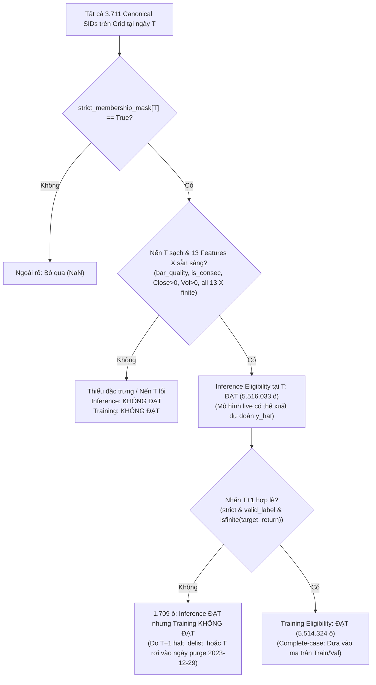

# Đặc tả Thiết kế Dataset Baseline v1 (13 Features Close/Volume & Target Ranking)

Ngày cập nhật chốt thiết kế: **2026-11-07**  
Phiên bản: **v1.1 (Final Trial Verified)**  
Trạng thái: **ĐÃ CHỐT ĐẶC TẢ VÀ CHẠY THỬ NGHIỆM BUILDER THÀNH CÔNG — CHƯA DỰNG DATASET TOÀN DIỆN — CHƯA TRAIN MODEL**  
Phạm vi dữ liệu: **Tập Development (2000-07-01 đến 2023-12-29)** — 5.911 phiên giao dịch $\times$ 3.711 mã Canonical SID.  
Mục tiêu: Quy chuẩn hóa cấu trúc bảng phẳng Parquet (17 cột), định hình rõ ràng hai khái niệm Inference Eligibility vs. Training Eligibility, cố định mẫu số xếp hạng lát cắt ngang $N_{label}[T]$ (No Re-ranking), và xác thực thực nghiệm qua builder chạy thử trên 3 phiên đại diện.

Tài liệu tham chiếu nền tảng:
- [Đặc tả 16 features candidate v1](features_v1.md)
- [Đặc tả Target và Thời điểm Khớp lệnh v1](target_and_timing_v1.md)
- [Tài liệu Bàn giao Mốc Feature Store Ứng viên](../reports/handoff/feature_store_milestone_handoff.md)
- [Báo cáo EDA Feature Store Development](../reports/feature_eda_report.md)

---

## 1. Đơn vị Mẫu và Ranh Giới Thời Điểm Thông Tin

### 1.1. Đơn vị quan sát (Sample Unit)
Mỗi dòng trong dataset đại diện cho một cặp tọa độ không-thời gian duy nhất:
$$\text{Dòng dữ liệu} = (\text{ngày } T, \text{canonical\_sid } i)$$
- `date T`: Ngày giao dịch chuẩn trên lịch giao dịch của dự án (`pandas.Timestamp`, từ `2000-07-03` đến `2023-12-29`).
- `canonical_sid i`: Định danh thực thể chứng khoán duy nhất xuyên suốt lịch sử (ví dụ: `AAPL R735QTJ8XC9X`).
- Trục thời gian $T+1$ chỉ **phiên giao dịch tiếp theo có trên lịch thị trường**, không phải ngày lịch tự nhiên tiếp theo.

### 1.2. Ranh giới thời điểm thông tin (Point-in-Time Cutoff)
- **Thời điểm chốt thông tin đầu vào**: Đúng thời điểm kết thúc phiên giao dịch ngày $T$ (sau khi các sàn giao dịch NYSE/NASDAQ hoàn tất phiên khớp lệnh đóng cửa chính thức - Consolidated Closing Cross và công bố giá `Close[T]`, `Volume[T]`).
- **Nguyên tắc bảo toàn nhân quả (Strict Zero Lookahead)**: Mọi biến đầu vào $X[i, T]$ chỉ được sử dụng thông tin phát sinh $\le T$. Tuyệt đối không sử dụng giá, khối lượng, sự kiện doanh nghiệp hay trạng thái giao dịch phát sinh từ phiên $T+1$ trở đi.
- **Dữ liệu Out-of-Sample (OOS 2024–2026)**: Hoàn toàn không được nạp vào bộ nhớ RAM hoặc sử dụng dưới bất kỳ hình thức nào trong giai đoạn thiết kế baseline này.

---

## 2. Danh Sách 13 Features Close/Volume (Ma trận Đầu vào $X$)

Nhóm đặc trưng cho mô hình baseline ban đầu gồm **đúng 13 features**, chỉ sử dụng dữ liệu giá đóng cửa điều chỉnh chia tách (`adj_close`), giá đóng cửa thô (`close`) và khối lượng giao dịch (`volume`, `adj_volume`).

| STT | Tên Feature ($X_k$) | Nguồn Parquet trong Feature Store | Cửa sổ trượt ($W$) | Tóm tắt Công thức Toán học | Ý nghĩa Kinh tế & Kỹ thuật |
|:---:|---|---|:---:|---|---|
| 1 | `ret_1d` | `data/processed/features/ret_1d.parquet` | 1 phiên | $P_T / P_{T-1} - 1$ | Lợi suất 1 ngày; tín hiệu đảo chiều ngắn hạn (short-term reversal) hoặc vi cấu trúc thanh khoản. |
| 2 | `ret_5d` | `data/processed/features/ret_5d.parquet` | 5 phiên | $P_T / P_{T-5} - 1$ | Momentum giá 1 tuần (weekly momentum). |
| 3 | `ret_20d` | `data/processed/features/ret_20d.parquet` | 20 phiên | $P_T / P_{T-20} - 1$ | Momentum giá 1 tháng (monthly momentum). |
| 4 | `ret_60d` | `data/processed/features/ret_60d.parquet` | 60 phiên | $P_T / P_{T-60} - 1$ | Momentum giá 1 quý (quarterly momentum). |
| 5 | `mom_12m_skip_1m` | `data/processed/features/mom_12m_skip_1m.parquet` | 252 phiên (bỏ 21 phiên) | $P_{T-21} / P_{T-252} - 1$ *(yêu cầu $\ge 232$ giá sạch)* | Yếu tố Momentum kinh điển Jegadeesh-Titman (12-1 momentum); bỏ tháng gần nhất để tránh nhiễu đảo chiều. |
| 6 | `vol_realized_20d` | `data/processed/features/vol_realized_20d.parquet` | 20 phiên | $\sqrt{\frac{1}{19}\sum_{\tau=0}^{19} (R_{T-\tau} - \bar{R})^2}$ | Biến động thực hiện 20 ngày (Realized Volatility, đơn vị ngày); đo lường rủi ro biến động ngắn hạn. |
| 7 | `vol_realized_60d` | `data/processed/features/vol_realized_60d.parquet` | 60 phiên | $\sqrt{\frac{1}{59}\sum_{\tau=0}^{59} (R_{T-\tau} - \bar{R})^2}$ | Biến động thực hiện 60 ngày; đo lường rủi ro biến động trung hạn. |
| 8 | `downside_deviation_20d` | `data/processed/features/downside_deviation_20d.parquet` | 20 phiên | $\sqrt{\frac{1}{20}\sum_{\tau=0}^{19} \min(R_{T-\tau}, 0)^2}$ | Độ lệch giảm 20 ngày tại ngưỡng 0; đo lường rủi ro đuôi dưới bất đối xứng (asymmetric downside risk). |
| 9 | `amihud_illiq_20d` | `data/processed/features/amihud_illiq_20d.parquet` | 20 phiên | $\frac{10^6}{20}\sum_{\tau=0}^{19} \frac{\|R_{T-\tau}\|}{Close_{T-\tau} \times Volume_{T-\tau}}$ | Tỷ số kém thanh khoản Amihud (2002); mức độ tác động giá trên mỗi USD giá trị giao dịch. |
| 10 | `volume_ratio_5_20` | `data/processed/features/volume_ratio_5_20.parquet` | 5d / 20d | $\frac{\text{mean}_5(\text{adj\_volume})}{\text{mean}_{20}(\text{adj\_volume})}$ | Tỷ số khối lượng nhanh/chậm; đo lường dòng tiền bất thường và sự chú ý đột biến của nhà đầu tư. |
| 11 | `log_dollar_volume_20d` | `data/processed/features/log_dollar_volume_20d.parquet` | 20 phiên | $\ln(1 + \frac{1}{20}\sum_{\tau=0}^{19} Close_\tau \cdot Volume_\tau)$ | Log giá trị giao dịch bình quân 20 ngày; đại diện cho quy mô thanh khoản và năng lực hấp thụ lệnh. |
| 12 | `rsi_14d` | `data/processed/features/rsi_14d.parquet` | 14 phiên | $100 - \frac{100}{1 + RS_{14}}$ (Wilder smoothing) | Chỉ số sức mạnh tương đối RSI 14 ngày; dao động kỹ thuật đo trạng thái quá mua / quá bán. |
| 13 | `bollinger_pct_b_20d` | `data/processed/features/bollinger_pct_b_20d.parquet` | 20 phiên | $\frac{P_T - (\mu_{20} - 2\sigma_{20})}{4\sigma_{20}}$ | Vị trí tương đối của giá trong dải Bollinger Bands (%B, unclipped); đo mức độ căng giãn giá theo biến động. |

> [!NOTE]
> **3 Features OHLC đang tạm hoãn**:
> - `ret_intraday` ($Close_T / Open_T - 1$)
> - `ret_overnight` ($Open_T / Close_{T-1} - 1$)
> - `vol_parkinson_20d` (tính từ High và Low)
> - **Lý do tạm hoãn**: Các trường Open, High, Low trước năm 2010 chứa 247 ca dị thường chưa giải quyết (`unresolved` trong `anomaly_inventory.csv`) phát sinh từ lệnh tượng trưng của Market Makers ($0.01 và $999.99). Nhằm đảm bảo baseline khởi đầu với dữ liệu ít nhiễu nhất, 3 features này được tạm hoãn và sẽ xem xét bổ sung sau.

---

## 3. Schema Bảng Hoàn Chỉnh 17 Cột của Dataset Baseline v1

Bảng dataset baseline v1 được thiết kế dưới dạng bảng phẳng (tabular dataframe) lưu trữ trong định dạng Parquet nén Snappy, sắp xếp tăng dần theo cặp khóa `(date, canonical_sid)`.

| Cột STT | Tên Cột | Kiểu Dữ Liệu | Nullable trong Tập Training | Nguồn Dữ Liệu Gốc | Mô Tả & Điều Kiện Ràng Buộc |
|:---:|---|:---:|:---:|---|---|
| **1** | `date` | `datetime64[ns]` | **Không (NOT NULL)** | Trục chỉ mục ngày lịch thị trường | Ngày giao dịch $T$ ra quyết định / chốt thông tin. |
| **2** | `canonical_sid` | `string` | **Không (NOT NULL)** | `matrix_columns_sids.parquet` | Định danh thực thể duy nhất (vd: `AAPL R735QTJ8XC9X`). |
| **3** | `ret_1d` | `float64` | **Không (NOT NULL)** | `features/ret_1d.parquet` | Lợi suất 1 ngày tại $T$. |
| **4** | `ret_5d` | `float64` | **Không (NOT NULL)** | `features/ret_5d.parquet` | Lợi suất 5 ngày tại $T$. |
| **5** | `ret_20d` | `float64` | **Không (NOT NULL)** | `features/ret_20d.parquet` | Lợi suất 20 ngày tại $T$. |
| **6** | `ret_60d` | `float64` | **Không (NOT NULL)** | `features/ret_60d.parquet` | Lợi suất 60 ngày tại $T$. |
| **7** | `mom_12m_skip_1m` | `float64` | **Không (NOT NULL)** | `features/mom_12m_skip_1m.parquet` | Momentum 12 tháng bỏ 1 tháng tại $T$. |
| **8** | `vol_realized_20d` | `float64` | **Không (NOT NULL)** | `features/vol_realized_20d.parquet` | Biến động thực hiện 20 ngày tại $T$. |
| **9** | `vol_realized_60d` | `float64` | **Không (NOT NULL)** | `features/vol_realized_60d.parquet` | Biến động thực hiện 60 ngày tại $T$. |
| **10** | `downside_deviation_20d`| `float64` | **Không (NOT NULL)** | `features/downside_deviation_20d.parquet` | Độ lệch giảm 20 ngày tại $T$. |
| **11** | `amihud_illiq_20d` | `float64` | **Không (NOT NULL)** | `features/amihud_illiq_20d.parquet` | Tỷ số kém thanh khoản Amihud 20 ngày tại $T$. |
| **12** | `volume_ratio_5_20` | `float64` | **Không (NOT NULL)** | `features/volume_ratio_5_20.parquet` | Tỷ số khối lượng 5 ngày / 20 ngày tại $T$. |
| **13** | `log_dollar_volume_20d` | `float64` | **Không (NOT NULL)** | `features/log_dollar_volume_20d.parquet` | Log giá trị giao dịch 20 ngày tại $T$. |
| **14** | `rsi_14d` | `float64` | **Không (NOT NULL)** | `features/rsi_14d.parquet` | Chỉ số RSI 14 ngày tại $T$. |
| **15** | `bollinger_pct_b_20d` | `float64` | **Không (NOT NULL)** | `features/bollinger_pct_b_20d.parquet` | Vị trí tương đối Bollinger %B 20 ngày tại $T$. |
| **16** | `target_return` | `float64` | **Không (NOT NULL)** | `matrices/target_next_return.parquet` | Lợi suất giá đóng cửa phiên tiếp theo ($T \to T+1$), đã qua mask. |
| **17** | `target_rank` | `float64` | **Không (NOT NULL)** | Tính toán chéo ngang theo ngày | Thứ hạng chéo ngang chuẩn hóa $[0.0, 1.0]$ trên tập $\mathcal{U}_{label}[T]$. |

> [!IMPORTANT]
> **Quy cách sắp xếp và tính trọn vẹn**:
> - Bảng dữ liệu huấn luyện (Training Set) áp dụng triệt để chính sách **Complete-Case**: Không có bất kỳ ô `NaN` hay `Inf` nào trong cả 17 cột trên toàn bộ 5.514.324 dòng.
> - Bảng được sắp xếp theo thứ tự thời gian tăng dần: `df.sort_values(["date", "canonical_sid"])`. Điều này đảm bảo tính tương thích tự nhiên với các cơ chế chia tập theo chuỗi thời gian (TimeSeriesSplit, Purged Walk-Forward).

---

## 4. Nhãn Mục Tiêu & Cơ Chế Mask Của `target_next_return.parquet`

### 4.1. Lợi suất giá gốc đã qua Mask (Masked Split-Adjusted Price Return)
Lợi suất mục tiêu gốc là lợi suất giá đóng cửa phiên tiếp theo ($T \to T+1$) đã điều chỉnh chia tách:
$$R_{t+1}[i] = \frac{AdjClose[i, T+1]}{AdjClose[i, T]} - 1$$
- Ma trận lưu trữ: `data/processed/matrices/target_next_return.parquet`.
- **Cơ chế Mask tích hợp sẵn**: Ma trận này **đã được lọc sẵn qua mặt nạ `valid_label_mask`** trong bước tiền xử lý `07_build_2d_matrices_and_masks.py`:
  $$\text{target\_next\_return}[i, T] = \begin{cases} R_{t+1}[i] & \text{khi } \text{valid\_label\_mask}[i, T] == \text{True} \\ \text{NaN} & \text{khi } \text{valid\_label\_mask}[i, T] == \text{False} \end{cases}$$

### 4.2. Các điều kiện cấu thành `valid_label_mask` (Kế thừa từ $T$ và Kiểm tra tại $T+1$)
Chính sách nhãn hiện tại giữ nguyên toàn vẹn, bao gồm các lớp kiểm tra chặt chẽ:
1. **Kế thừa toàn bộ điều kiện dữ liệu tại phiên $T$ (`valid_data_mask[T] == True`)**:
   - Thuộc danh sách thành viên rổ chỉ số tại $T$ (`membership_mask[T] == True`).
   - Giá đóng cửa hữu hạn và dương: `adj_close[T] > 0`.
   - Khối lượng giao dịch dương: `adj_volume[T] > 0`.
   - Bước chuyển tiếp phiên liên tục trên lịch thị trường: `is_consecutive_session[T] == True`.
   - Lịch sử tích lũy tối thiểu: đã có $\ge 20$ nến giao dịch (`cum_bars >= 20`).
   - Nến sạch không bị cách ly: `is_bad_data_period[T] == False` và `is_spinoff_discontinuity[T] == False`.
2. **Kiểm tra tính thanh khoản và khả thi thực hiện lệnh tại phiên tiếp theo $T+1$**:
   - Giá đóng cửa $T+1$ hữu hạn và dương: `adj_close[T+1] > 0`.
   - **Khối lượng giao dịch $T+1$ dương**: `adj_volume[T+1] > 0` (loại bỏ phiên bị tạm dừng giao dịch - Halt hoặc đứt thanh khoản).
   - Bước chuyển tiếp $T \to T+1$ liên tục: `is_consecutive_session[T+1] == True`.
   - Lợi suất $R_{T+1}$ là số thực hữu hạn: `np.isfinite(daily_return[T+1])`.
3. **Cơ chế Purge ranh giới chống rò rỉ thông tin**:
   - Phiên cuối cùng của tập Development (`2023-12-29`) bị **ép thành `False` (Purged)** để đảm bảo nhãn không đọc sang phiên đầu tiên của tập Out-of-Sample (`2024-01-02`).
   - Phiên cuối cùng của ma trận tổng thể (`2026-10-30`) bị gán `False` vì không có phiên $T+1$.

### 4.3. Công thức Thứ hạng Lát cắt ngang (Cross-Sectional Target Rank)
Theo đúng mục 5 của đặc tả [`target_and_timing_v1.md`](target_and_timing_v1.md), nhãn huấn luyện được chuẩn hóa về đoạn $[0.0, 1.0]$ trên từng ngày $T$:

$$\text{rank}[i, T] = \text{ascending\_rank}(R_{t+1}[i], \text{method}="average")$$

$$\text{target\_next\_rank}[i, T] = \begin{cases} 
\frac{\text{rank}[i, T] - 1}{N_{label}[T] - 1} & \text{khi } N_{label}[T] > 1 \\ 
0.5 & \text{khi } N_{label}[T] = 1 \\ 
\text{NaN} & \text{khi không thuộc tập nhãn hợp lệ } \mathcal{U}_{label}[T]
\end{cases}$$

Trong đó:
- `method="average"`: Cổ phiếu có cùng lợi suất nhận trung bình cộng thứ hạng của các vị trí đồng hạng.
- Lợi suất thấp nhất nhận nhãn $0.0$; lợi suất cao nhất nhận nhãn $1.0$.
- Mẫu số $N_{label}[T]$ là tổng số cổ phiếu thuộc tập nhãn hợp lệ $\mathcal{U}_{label}[T]$ tại ngày $T$.

---

## 5. Phân Biệt Tuyệt Đối: Inference Eligibility vs. Training Eligibility

Dự án phân định rõ ràng ranh giới logic giữa khả năng sinh dự đoán tại ngày $T$ và khả năng đưa vào huấn luyện có giám sát:

### 5.1. Điều kiện Dự đoán tại ngày $T$ (Inference Eligibility)
Một cổ phiếu $i$ đủ điều kiện để mô hình sinh dự đoán $\hat{y}[i, T]$ khi và chỉ khi thỏa mãn đầy đủ các điều kiện **chỉ sử dụng thông tin tính đến hết ngày $T$**:
1. **Thuộc rổ Russell 1000 tại ngày $T$**: `strict_membership_mask[i, T] == True`.
2. **Nến ngày $T$ hợp lệ**: `is_bad_data_period[i, T] == False` và `is_spinoff_discontinuity[i, T] == False`.
3. **Phiên liên tục tại $T$**: `is_consecutive_session[i, T] == True`.
4. **Giá và khối lượng dương**: `Close[i, T] > 0` và `Volume[i, T] > 0`.
5. **Đầy đủ 13 đặc trưng đầu vào**: Cả 13 đặc trưng $X_1, \dots, X_{13}$ đều có giá trị hữu hạn (không chứa `NaN` hay `Inf`).

> [!CRITICAL]
> **Quy tắc Bất Biến về Tính Nhân Quả**:
> - Khi xét Inference Eligibility tại ngày $T$, **tuyệt đối không kiểm tra $R_{T+1}$ hay bất kỳ thông tin nào của phiên $T+1$**.
> - Mặt nạ nhãn `valid_label_mask` **tuyệt đối không được dùng để lọc tập dự đoán hoặc ma trận đầu vào $X$ tại ngày $T$**.

### 5.2. Điều kiện Huấn luyện & Đánh giá (Training Eligibility / Complete-Case)
Một quan sát $(T, i)$ đủ điều kiện để đưa vào tập huấn luyện hoặc tập kiểm thử khi và chỉ khi:
1. Thỏa mãn **Inference Eligibility** tại ngày $T$ (mục 5.1).
2. **Nhãn tương lai hợp lệ**: Thuộc tập hợp $\mathcal{U}_{label}[T]$ (`strict_membership[T] & valid_label[T] & isfinite(target_next_return[T])`).

### 5.3. Đối chiếu Thực nghiệm Số Lượng Ô NaN trên Tập Development (5.911 Phiên)

Thống kê đối soát thực nghiệm toàn diện từ Feature Store v1.4.0 và hệ thống ma trận 2D:

| Hạng mục thống kê | Số lượng ô tọa độ | Tỷ lệ so với Strict Membership | Diễn giải kỹ thuật & Ý nghĩa hệ thống |
|---|:---:|:---:|---|
| **Tổng số ô thành viên chuẩn (`strict_membership_mask == True`)** | **5.607.409** | **100,00%** | Toàn bộ không gian các phiên giao dịch chính thức của Russell 1000. |
| **Ô có nhãn mục tiêu hợp lệ ($\mathcal{U}_{label}[T]$)** | **5.586.728** | **99,63%** | Mẫu số $N_{label}[T]$ dùng để tính thứ hạng phân phối chéo ngang của thị trường. |
| **Ô có đủ 13 features hữu hạn** | **5.516.033** | **98,37%** | Tập hợp cổ phiếu có trọn vẹn vector đầu vào $X$. |
| **Ô đạt điều kiện Inference Eligibility (Mục 5.1)** | **5.516.033** | **98,37%** | **Chênh lệch = 0** so với nhóm có đủ 13 features (xem phân tích bên dưới). |
| **Ô ĐẠT ĐIỀU KIỆN TRAINING ELIGIBILITY (COMPLETE-CASE)** | **5.514.324** | **98,34%** | **Tập dữ liệu huấn luyện và đánh giá chính thức của Baseline v1**. |
| Ô có nhãn hợp lệ nhưng thiếu $\ge 1$ feature trong $X$ | **72.404** | 1,29% | $94,4\%$ do cổ phiếu mới niêm yết thiếu lịch sử 252 phiên cho `mom_12m_skip_1m`. |
| **Ô đạt Inference Eligibility nhưng thiếu nhãn huấn luyện** | **1.709** | **0,03%** | Tại $T$ mô hình **hoàn toàn dự đoán được**, nhưng $T+1$ không có nhãn để tính loss. |

#### Phân tích chuyên sâu về sự đồng nhất giữa "Đủ 13 Features" và "Inference Eligibility"
Về mặt định nghĩa hình thức, Inference Eligibility đòi hỏi thêm các điều kiện nến sạch tại $T$ (`~is_bad & ~is_spinoff`), phiên liên tục (`is_consec`), và giá/khối lượng dương. Tuy nhiên, trong thực nghiệm:
- Toàn bộ 13 features Close/Volume đều được xây dựng với cơ chế cô lập lỗi triệt để: bất kỳ nến nào vi phạm bar cleanliness, khối lượng bằng 0 hoặc nến không liên tục đều bị hàm toán học ép trả về `NaN`.
- Do đó, **nếu một cổ phiếu có đủ toàn bộ 13 features hữu hạn tại ngày $T$, cổ phiếu đó chắc chắn thỏa mãn 100% các điều kiện nến sạch tại $T$**.
- Kết quả đối soát xác nhận: $(\text{strict} \ \& \ \text{all 13 valid}) \equiv \text{Inference Eligibility}$ với đúng **5.516.033 dòng** (chênh lệch tuyệt đối = 0).

#### Bản chất của 1.709 ô "Dự đoán được nhưng không Huấn luyện được"
Khoảng cách giữa 5.516.033 dòng Inference-Eligible và 5.514.324 dòng Training-Eligible là **đúng 1.709 quan sát**:
1. **978 quan sát rơi vào ngày cuối cùng của Development (`2023-12-29`)**:
   - Tại ngày $T = 2023-12-29$, có 978 cổ phiếu đạt Inference Eligibility (đủ 13 features sạch). Nếu hệ thống chạy live tại thời điểm đó, mô hình hoàn toàn có thể sinh dự đoán $\hat{y}$ cho danh mục ngày hôm sau.
   - Tuy nhiên, để ngăn chặn rò rỉ thông tin sang tập OOS (`2024-01-02`), toàn bộ nhãn ngày `2023-12-29` bị purge về `False`. Do đó, 978 dòng này không có nhãn và bị loại khỏi tập huấn luyện.
2. **731 quan sát còn lại trong giai đoạn 2000–2023**:
   - Đây là các trường hợp cổ phiếu giao dịch hoàn toàn bình thường tại ngày $T$, nhưng sang phiên tiếp theo $T+1$ volume bằng 0 nên nhãn bị loại theo chính sách hiện tại (ví dụ mã `CCB` ngày `2000-07-03`), hoặc bị hủy niêm yết, khiến không quan sát được giá đóng cửa thanh khoản tại $T+1$. Không tự ý kết luận là halt nếu chưa có nguồn độc lập xác nhận.

---

## 6. Mẫu Số Xếp Hạng $N_{label}[T]$ & Bằng Chứng Thực Nghiệm "No Re-ranking"

### 6.1. Nguyên tắc Không Tự Ý Xếp Hạng Lại (No Re-ranking on Subpopulations)
- **Quy tắc**: Giá trị `target_rank` của một cổ phiếu phải được **tính cố định một lần duy nhất trên tập toàn thể $\mathcal{U}_{label}[T]$** (gồm $N_{label}[T]$ cổ phiếu):
  $$\mathcal{U}_{label}[T] = \{ i \mid \text{strict\_membership}[i, T] = \text{True} \ \wedge \ \text{valid\_label}[i, T] = \text{True} \ \wedge \ R_{t+1}[i] \text{ hữu hạn} \}$$
- **Tuyệt đối cấm**: Không được tính lại thứ hạng (re-rank) trên tập con sau khi đã lọc bỏ các dòng thiếu feature $X$.
- **Lý do kinh tế & toán học**: Lợi suất chéo ngang là đại diện cho phân phối vị thế tương đối của cổ phiếu trên toàn thị trường (Russell 1000). Nếu ta xếp hạng lại chỉ trên nhóm cổ phiếu có đủ 252 phiên lịch sử để tính `mom_12m`, thứ hạng mục tiêu của một cổ phiếu lớn như Apple sẽ bị dịch chuyển cơ học tùy thuộc vào việc ngày hôm đó có bao nhiêu công ty IPO mới vào rổ. Việc này làm sai lệch định nghĩa phân phối nhãn và vi phạm tính nhất quán khi so sánh giữa các mô hình dùng các tập features khác nhau.

### 6.2. Kiểm Chứng Thực Nghiệm Rank Stability trên Builder (`scripts/01_pipeline/16_build_baseline_dataset_sample.py`)

Chạy thử nghiệm builder trên 3 phiên giao dịch đại diện:
1. **Phiên `2000-07-03`**: Ngay sau đợt tái cơ cấu rổ, có nhiều mã mới niêm yết thiếu `mom_12m_skip_1m` nhưng có nhãn hợp lệ (ví dụ: Agilent Technologies `A RPTMYV3VC57P`).
2. **Phiên `2015-06-15`**: Phiên giao dịch bình thường ở giữa mẫu, thanh khoản cao, hầu hết cổ phiếu đủ điều kiện.
3. **Phiên `2023-12-29`**: Phiên kết thúc của tập Development, kiểm tra cơ chế cách ly ranh giới (purge boundary).

#### Bảng Thống Kê Tổng Hợp Đối Soát 3 Phiên Thử Nghiệm

| Ngày Giao Dịch | Strict Membership | Nhãn Hợp Lệ ($N_{label}$) | Inference-Eligible tại $T$ | Training Complete-Case | Nhãn Hợp Lệ nhưng Thiếu $X$ | Inference-Eligible nhưng Thiếu Nhãn |
|:---:|:---:|:---:|:---:|:---:|:---:|:---:|
| **`2000-07-03`** | 936 | **931** | 863 | **862** | **69** (thiếu `mom_12m`) | **1** (`CCB`, $T+1$ volume = 0) |
| **`2015-06-15`** | 971 | **966** | 965 | **965** | **1** | **0** |
| **`2023-12-29`** | 984 | **0** (purged) | **978** | **0** | **0** | **978** (purged) |

#### Đo lường Thực Nghiệm Mức Độ Bóp Méo Thứ Hạng Nếu Tự Ý Re-ranking tại `2000-07-03`
Nếu ai đó sai lầm khi loại bỏ 69 cổ phiếu thiếu $X$ trước rồi mới tính rank trên 862 cổ phiếu còn lại:
- **Số cổ phiếu bị loại do thiếu $X$**: 69 mã (trong đó có `A RPTMYV3VC57P`).
- **Mức độ dịch chuyển thứ hạng lớn nhất (Max Rank Distortion)**: **$0.010063$** (dịch chuyển hơn **1,0%** bách phân vị thị trường!).
- **Mức độ dịch chuyển thứ hạng bình quân (Mean Rank Distortion)**: **$0.004307$** (~$0,43\%$).
- **Kết luận**: Nhờ giữ nguyên thứ hạng tính trên $N_{label} = 931$, thứ hạng của 862 cổ phiếu huấn luyện phản ánh chính xác vị thế thị trường thực tế, với độ lệch méo mó bằng **đúng $0.000000$**.

---

## 7. Chi Tiết Các Tọa Độ Quan Sát Tiêu Biểu (Canonical Coordinates)

Từ kết quả thực thi builder trên dữ liệu thực tế, 4 ca tọa độ sau đây minh họa chính xác các quy tắc thiết kế:

### Ca 1: Cổ phiếu có nhãn nhưng thiếu $X$ — Agilent Technologies (`A RPTMYV3VC57P`, ngày `2000-07-03`)
- **Tình trạng đầu vào tại $T$**:
  * `ret_1d = -0.0344`, `ret_20d = -0.0454`, `rsi_14d = 48.12`.
  * `mom_12m_skip_1m = NaN` (Agilent IPO vào tháng 11/1999, tính đến tháng 7/2000 mới có ~150 phiên giao dịch, không đủ 252 phiên lịch sử).
- **Tình trạng nhãn tại $T+1$**:
  * Giao dịch bình thường, `target_return = -0.050115` (giảm $-5,01\%$).
  * Tham gia vào tập $\mathcal{U}_{label}[T]$ ($N_{label} = 931$) và nhận **`target_rank = 0.161290`** (xếp thứ 151 / 931).
- **Trạng thái phân loại**:
  * `is_inference_eligible = False` (do vector $X$ không đủ 13 chiều).
  * `is_training_eligible = False` (chính sách Complete-Case loại bỏ khỏi tập train).
- **Ý nghĩa**: Agilent đóng góp một quan sát thực tế vào phân phối thị trường để cố định thang đo rank cho các cổ phiếu khác, nhưng bản thân nó không bị ép điền giá trị giả tạo (imputation) để huấn luyện mô hình.

### Ca 2: Cổ phiếu đủ 13 $X$ nhưng volume phiên kế tiếp bằng 0 nên nhãn bị loại theo chính sách hiện tại — Capital City Bank Group (`CCB R735QTJ8XC9X`, ngày `2000-07-03`)
- **Tình trạng đầu vào tại $T$**:
  * Đạt chuẩn 100%: `Close = 39.50`, `Volume = 214,500`, nến sạch, phiên liên tục.
  * Đầy đủ 13 features: `ret_1d = +0.0327`, `mom_12m_skip_1m = -0.1023`, `vol_realized_20d = 0.0189`.
- **Tình trạng nhãn tại $T+1$ (`2000-07-05`)**:
  * Khối lượng giao dịch bằng 0 (`Volume[T+1] = 0.0`), nhãn bị loại theo điều kiện thanh khoản bắt buộc của chính sách hiện tại (chưa kết luận halt nếu chưa có nguồn xác nhận).
  * `valid_label_mask[T] == False` $\implies$ `target_return = NaN`, `target_rank = NaN`.
- **Trạng thái phân loại**:
  * `is_inference_eligible = True` (Tại thời điểm đóng cửa phiên $T$, mô hình live hoàn toàn có thể tính được $\hat{y}$ cho CCB).
  * `is_training_eligible = False` (Không thể dùng để huấn luyện vì không có nhãn thanh khoản ở tương lai để tính loss).

### Ca 3: Cổ phiếu hoàn chỉnh cả $X$ và $y$ — Apple Computer (`AAPL R735QTJ8XC9X`, ngày `2000-07-03`)
- **Tình trạng đầu vào tại $T$**:
  * `ret_1d = +0.0178`, `mom_12m_skip_1m = +0.9487`, `rsi_14d = 55.19`.
  * Đầy đủ 13 đặc trưng hữu hạn.
- **Tình trạng nhãn tại $T+1$**:
  * `target_return = -0.031514`, `target_rank = 0.255914`.
- **Trạng thái phân loại**:
  * `is_inference_eligible = True`.
  * `is_training_eligible = True` $\implies$ Dòng dữ liệu hoàn chỉnh đưa vào ma trận huấn luyện của Ridge Regression.

### Ca 4: Phiên Purge Cuối Kỳ Development — (`2023-12-29`)
- **Tình trạng tại ngày $T = 2023-12-29$**:
  * Có **978 cổ phiếu** thuộc Russell 1000 có đầy đủ 13 đặc trưng sạch $\implies$ **`inference_eligible_count = 978`**.
  * Toàn bộ nhãn mục tiêu bị xóa: `label_ranked_count = 0`, `target_return = NaN`, `target_rank = NaN`.
  * **`training_eligible_count = 0`**.
- **Ý nghĩa kiểm chứng**: Cơ chế purge hoạt động tuyệt đối chính xác; không một dòng dữ liệu nào tại ngày $2023-12-29$ có thể rò rỉ lợi suất từ ngày $2024-01-02$ (tập Out-of-Sample) vào quá trình huấn luyện.

---

## 8. Kết Quả Kiểm Thử Kỹ Thuật (Automated Test Suite)

Toàn bộ logic của đặc tả và script builder đã được bảo vệ bởi bộ test tự động chuyên biệt tại `tests/test_baseline_builder.py` cùng với hệ thống kiểm thử toàn diện của dự án:
- `tests/test_baseline_builder.py`:
  * `test_target_rank_math_properties` (Portable): Xác nhận cận $[0, 1]$, xử lý ties trung bình, $N=1 \implies 0.5$, $N=0 \implies \text{NaN}$.
  * `test_schema_and_complete_case_integrity` (@pytest.mark.integration): Xác nhận đúng 17 cột, không có ô null trong tập complete-case, toàn bộ giá trị số hữu hạn (`np.isfinite`), không trùng lặp cặp `(date, canonical_sid)`, sắp xếp đúng thứ tự thời gian.
  * `test_rank_stability_empirical` (@pytest.mark.integration): Chứng minh độ méo mó thứ hạng khi tự ý re-ranking trên 862 mã là $> 0.010$.
  * `test_purge_date_2023_12_29` (@pytest.mark.integration): Xác nhận 978 mã inference-eligible và 0 mã training-eligible.
  * `test_coordinate_cases_2000_07_03` (@pytest.mark.integration): Kiểm tra từng ô tọa độ cụ thể của `A RPTMYV3VC57P`, `CCB R735QTJ8XC9X`, và `AAPL R735QTJ8XC9X`.
  * `test_out_of_development_date_rejection` (@pytest.mark.integration): Xác nhận builder từ chối các ngày ngoài Development window trước khi đọc disk.
- **Tổng số tests của toàn bộ dự án**: **85 / 85 tests PASSED (100%)**.

---

## 9. Kế Hoạch Triển Khai Tiếp Theo Sau Khi Nghiệm Thu

Sau khi người dùng xem xét và nghiệm thu bản đặc tả chi tiết cùng kết quả chạy thử nghiệm này:
1. **Dựng dataset baseline v1 đầy đủ (`data/processed/baseline_dataset_v1.parquet`)**:
   - Chạy builder trên toàn bộ 5.911 phiên Development để xuất ra file Parquet chứa đúng 5.514.324 dòng và 17 cột.
2. **Thiết kế phân chia thời gian (Purged Group TimeSeries Cross-Validation)**:
   - Thảo luận và chốt cấu hình K-Fold Walk-Forward có Purge / Embargo phù hợp với cửa sổ lookback 252 ngày của momentum để tránh tự tương quan chuỗi.
3. **Tiến hành huấn luyện mô hình Baseline Ridge Regression**:
   - Chuẩn hóa features (StandardScaler fit trên từng Fold huấn luyện, không leak sang Fold validation).
   - Đo lường hiệu năng bằng Rank IC (Spearman correlation) và Precision@K theo từng ngày.
