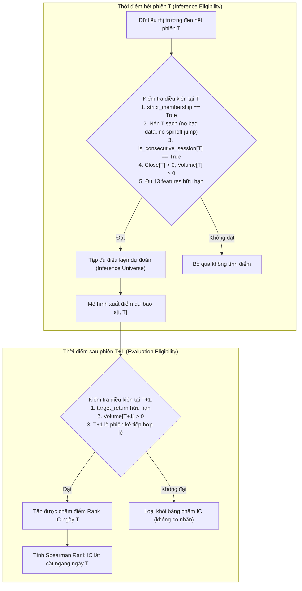

# Đặc Tả Kế Hoạch Đánh Giá Ngoài Mẫu (Out-of-Sample Evaluation Plan v1)

**Ngày ban hành**: 2026-11-07  
**Phiên bản**: v1.0 (Formal Specification)  
**Phạm vi dữ liệu**: 
- **Tập huấn luyện (In-Sample Development)**: `2000-07-03` $\to$ `2023-12-28` (5.514.324 dòng sạch sau khi purge phiên cuối `2023-12-29`)
- **Tập đánh giá ngoài mẫu (Out-of-Sample OOS)**: `2024-01-02` $\to$ `2026-10-30` (711 phiên giao dịch)  
**Trạng thái hiện tại**: **ĐÃ CHỐT ĐẶC TẢ — TIẾN HÀNH REFIT TRÊN DEVELOPMENT — OOS ĐÓNG BĂNG TUYỆT ĐỐI — CHƯA BACKTEST**  

---

## 1. Chốt Cấu Hình Mô Hình & Giao Thức Refit Trên Development

Qua toàn bộ quá trình kiểm định thực nghiệm và khảo sát siêu tham số bằng kỹ thuật Cửa sổ Mở rộng 5 Folds Walk-Forward (2019–2023), hai cấu hình mô hình đại diện cho hai trường phái tuyến tính và phi tuyến đã được chốt chính thức:

### 1.1. Cấu hình hai mô hình đã chọn
1. **Mô hình Tuyến tính Baseline: Ridge Regression ($\alpha = 1.0$)**:
   - **Pipeline**: `StandardScaler(with_mean=True, with_std=True)` $\to$ `Ridge(alpha=1.0, fit_intercept=True)`.
   - **Cơ sở lựa chọn**: Đã duy trì Mean Daily Rank IC dương trong 5/5 năm kiểm định (Mean IC = `+0.016497`, Annualized IR = `+1.1993`). Kết quả grid search $\alpha \in [1, 10^6]$ cho thấy việc tăng regularization chỉ mang lại biến động thứ yếu ($+0.037\%$ IC), do đó mức $\alpha=1.0$ nguyên bản được giữ nguyên làm mốc chuẩn mực đơn giản và bền vững.
2. **Mô hình Phi tuyến Ứng viên: GBDT Regression (`max_leaf_nodes = 7`)**:
   - **Thuật toán**: `sklearn.ensemble.HistGradientBoostingRegressor`.
   - **Siêu tham số chốt**:
     - `max_leaf_nodes = 7` (Cây nông, kiểm soát cấu trúc mạnh).
     - `loss = "squared_error"`
     - `max_iter = 100`
     - `learning_rate = 0.05`
     - `min_samples_leaf = 100`
     - `early_stopping = False`
     - `random_state = 42`
   - **Cơ sở lựa chọn**: Cấu hình 7 lá đạt hiệu năng cao nhất trên toàn bộ 5 năm walk-forward (Mean IC = **`+0.020967`**, Annualized IR = **`+1.7511`**), vượt trội cấu hình 15 lá ở 4/5 năm và khắc phục điểm yếu lớn nhất của cây phức tạp trong thị trường gấu 2022 (tăng **+0.44%** IC so với 15 lá). Cây 7 lá hoạt động như một bộ lọc nhiễu tự nhiên, chỉ học các tương tác 2–3 biến cốt lõi, tránh overfit trong môi trường dữ liệu tài chính có độ ồn cao.

### 1.2. Tập biến đầu vào $X$ và Nhãn học $y$
- **13 Features Close/Volume chuẩn hóa**:
  1. `ret_1d` (Lợi suất 1 ngày)
  2. `ret_5d` (Lợi suất 1 tuần)
  3. `ret_20d` (Lợi suất 1 tháng)
  4. `ret_60d` (Lợi suất 1 quý)
  5. `mom_12m_skip_1m` (Jegadeesh-Titman 12-1 momentum)
  6. `vol_realized_20d` (Biến động thực hiện 20 ngày)
  7. `vol_realized_60d` (Biến động thực hiện 60 ngày)
  8. `downside_deviation_20d` (Độ lệch giảm 20 ngày)
  9. `amihud_illiq_20d` (Tỷ số kém thanh khoản Amihud)
  10. `volume_ratio_5_20` (Tỷ số khối lượng 5d/20d)
  11. `log_dollar_volume_20d` (Log giá trị giao dịch 20 ngày)
  12. `rsi_14d` (Chỉ số RSI 14 ngày)
  13. `bollinger_pct_b_20d` (Vị thế %B dải Bollinger 20 ngày)
- **Nhãn học ($y$)**: `target_rank` $\in [0, 1]$, đã được tính sẵn theo phân phối đều trên tập cổ phiếu hợp lệ của từng phiên $T$ trong [`data/processed/baseline_dataset_v1.parquet`](file:///D:/A_Learning/HK1_2026-2027/CO3101%20-%20%C4%90%E1%BB%93%20%C3%A1n%20t%E1%BB%95ng%20h%E1%BB%A3p%20-%20ttnt/Predict_daily_return_rankings/data/processed/baseline_dataset_v1.parquet).

### 1.3. Giao thức Refit trên toàn bộ Development
- **Dữ liệu huấn luyện**: Toàn bộ tập Development sạch từ `2000-07-03` đến `2023-12-28` (**5.514.324 dòng**). Phiên cuối `2023-12-29` đã được purge để bảo đảm tính nhân quả (nhãn $T+1 = \text{2024-01-02}$ không được rò rỉ vào tập train).
- **Thực thi Refit MỘT LẦN DUY NHẤT**:
  - Đối với Ridge: Fit lại `StandardScaler` trên toàn bộ 5.514.324 dòng Development, sau đó fit `Ridge(alpha=1.0)`. Lưu artifact tại `models/oos_production/ridge_refit_dev.joblib`.
  - Đối với GBDT: Fit `HistGradientBoostingRegressor(max_leaf_nodes=7, ...)` trực tiếp trên 13 features thô của 5.514.324 dòng Development. Lưu artifact tại `models/oos_production/gbdt_refit_dev.joblib`.
- **Đóng băng mô hình tuyệt đối (Model Freezing)**: Cả hai mô hình đã refit sẽ được đóng băng cố định. Trong lượt đánh giá OOS đầu tiên, **tuyệt đối không huấn luyện lại online (no rolling retraining)** nhằm đo lường khả năng tồn tại và suy giảm của alpha theo thời gian thực.

---

## 2. Chốt Cách Đánh Giá OOS (2024–2026)

### 2.1. Phân tách rành mạch: Điều kiện Dự đoán tại $T$ vs Điều kiện Chấm điểm tại $T+1$
Để phản ánh trung thực môi trường sản xuất thực tế (production deployment) và bảo đảm tính nhân quả, quy trình đánh giá OOS phân định rạch ròi hai trạng thái:

1. **Điều kiện Dự đoán tại $T$ (Inference Eligibility)**:
   - Dựa 100% vào thông tin có sẵn tại thời điểm đóng cửa phiên $T$ (đồng nhất với mục 5.1 trong [`baseline_dataset_v1.md`](baseline_dataset_v1.md)):
     - Cổ phiếu thuộc danh sách thành viên chuẩn ngặt tại $T$: `strict_membership_mask[i, T] == True`.
     - Nến ngày $T$ sạch (bar sạch): `is_bad_data_period[i, T] == False` và `is_spinoff_discontinuity[i, T] == False` (không thuộc đoạn dữ liệu lỗi, không bị nhảy giá do spinoff chưa điều chỉnh).
     - Phiên liên tục tại $T$: `is_consecutive_session[i, T] == True` (đảm bảo $T$ và phiên trước đó là hai phiên giao dịch liên tiếp trên lịch thị trường).
     - Giá và khối lượng tại $T$ hữu hạn dương: `Close[i, T] > 0` và `Volume[i, T] > 0`.
     - Đầy đủ 13 biến đầu vào: $\forall k \in [1, 13], \text{np.isfinite}(X_k[i, T])$ (không chứa `NaN` hay `Inf`).
   - Mọi cổ phiếu thỏa mãn đầy đủ các điều kiện trên đều được mô hình gán điểm dự báo $\hat{s}[i, T]$. Đây chính là danh mục cổ phiếu mà trên thực tế nhà quản lý quỹ có thể ra quyết định đầu tư tại hết phiên $T$.
2. **Điều kiện Chấm điểm tại $T+1$ (Evaluation Eligibility)**:
   - Chỉ được xét sau khi phiên $T+1$ đã hoàn tất và kết quả lợi suất thực tế $R_{T+1}$ đã xác định:
     - Lợi suất mục tiêu $R_{T+1}$ hữu hạn (`np.isfinite(target_return)`).
     - Khối lượng giao dịch phiên tiếp theo dương: $Volume[i, T+1] > 0$ (đảm bảo cổ phiếu có giao dịch thực tế, không bị đóng băng/hủy niêm yết không báo trước).
   - Chỉ các cặp $(T, i)$ thỏa mãn đồng thời cả hai điều kiện trên mới được đưa vào rổ tính Rank IC của ngày $T$.

### 2.2. Giao thức So sánh Đối chiếu (Fair Cross-Sectional Comparison)
- Mọi mô hình và benchmark được so sánh trên **cùng một ngày $T$ và cùng một tập cổ phiếu hợp lệ**:
  1. Mô hình Ứng viên: GBDT ($L=7$).
  2. Mô hình Baseline: Ridge ($\alpha=1.0$).
  3. Benchmark đơn lẻ: `ret_20d` (Momentum 1 tháng, giá trị cao hơn $\to$ điểm cao hơn).
- **Thước đo chính**: **Mean Daily Spearman Rank IC** giữa điểm dự báo mô hình và lợi suất thực tế $R_{T+1}$.
- **Xử lý ngày không hợp lệ (Invalid Sessions)**: Nếu một ngày có $N < 2$ cổ phiếu hợp lệ hoặc toàn bộ điểm số/lợi suất là một giá trị hằng số ($\text{ptp} = 0$), Rank IC của ngày đó là `NaN` và không được đưa vào tính trung bình, đồng thời ghi nhận số lượng ngày này riêng.

### 2.3. Các chỉ số thống kê báo cáo bắt buộc
Báo cáo OOS sẽ phân rã chi tiết theo từng năm (2024, 2025, 2026) và tổng thể toàn bộ OOS:
- **Mean Daily Rank IC** và **Độ lệch chuẩn Daily IC**.
- **Tỷ lệ ngày có Rank IC dương** (% Positive Sessions).
- **Hệ số rủi ro-lợi nhuận thông tin hàng năm**: $\text{Annualized IR} = \frac{\text{Mean IC}}{\text{Std IC}} \times \sqrt{252}$.
- **Kiểm định thống kê**: $t$-statistic và $p$-value ($H_0: \text{Mean IC} = 0$).
- **Thống kê độ phủ (Coverage)**: Số mã trung bình được dự đoán tại $T$ vs Số mã trung bình có nhãn tại $T+1$.
- **Chênh lệch hằng ngày**: $\Delta \text{IC} = \text{IC}_{\text{GBDT}} - \text{IC}_{\text{Ridge}}$ và Tỷ lệ ngày GBDT thắng Ridge (Win-rate).

### 2.4. Xử lý phiên cuối cùng của giai đoạn OOS
- Phiên giao dịch cuối cùng có trong tệp OOS sẽ không có nhãn $T+1$ (vì $T+1$ rơi ra ngoài tập dữ liệu).
- **Quy tắc**: Phiên cuối cùng vẫn được đưa vào ma trận suy luận tại $T$ (như một lượt dự báo thực tế cho ngày tiếp theo), nhưng **bắt buộc bị purge (loại bỏ) khỏi bảng chấm điểm Rank IC** do không có giá trị đối chứng thực tế.

### 2.5. Nguyên tắc "One-Shot OOS Evaluation" (Không quay lại chỉnh tham số)
- Đợt kiểm định OOS này là **kiểm định mù một lần (One-shot Blind Test)** nhằm mục đích nghiệm thu đồ án.
- Kết quả OOS được dùng để báo cáo trung thực năng lực tổng quát hóa của mô hình trên môi trường mới chưa từng thấy.
- **TUYỆT ĐỐI không sử dụng kết quả OOS để quay lại sửa đổi features, nới lỏng bộ lọc dữ liệu hay tinh chỉnh lại siêu tham số**. Mọi hành vi điều chỉnh sau khi đã quan sát OOS đều làm mất tính khách quan khoa học (vi phạm nghiêm trọng nguyên tắc Data Snooping).

---

## 3. Tách Kế Hoạch Backtest Khỏi Phần Chấm Rank IC

### 3.1. Vì sao Rank IC Close $\to$ Close khác biệt căn bản với Lợi suất có thể giao dịch?
Một sai lầm kinh điển trong tài chính định lượng là nhầm lẫn giữa **chỉ số đánh giá tín hiệu (Rank IC)** và **lợi nhuận chiến lược giao dịch thực tế (Backtest PnL)**.

| Tiêu Chí | Nhãn Học & Đánh Giá Rank IC ($Close_T \to Close_{T+1}$) | Thực Tế Giao Dịch Khả Thi ($Open_{T+1} \to Close_{T+1}$) |
|---|---|---|
| **Thời điểm chốt thông tin** | Kết thúc phiên $T$ (16:00 EST). | Kết thúc phiên $T$ (16:00 EST). |
| **Thời điểm khớp lệnh giả định** | Đúng tại giá đóng cửa $Close_T$. | Phiên tiếp theo tại giá mở cửa $Open_{T+1}$ (hoặc VWAP). |
| **Tính khả thi thực tế** | **BẤT KHẢ THI**: Điểm dự báo cần dữ liệu $Close_T$ và $Volume_T$. Khi dữ liệu này được công bố thì phiên $T$ đã đóng cửa. | **KHẢ THI**: Có toàn bộ thời gian đêm để tính toán và đặt lệnh trước giờ mở cửa $T+1$. |
| **Khoảng trống giá qua đêm (Overnight Gap)** | Bỏ qua hoàn toàn bước nhảy giá từ $Close_T \to Open_{T+1}$. | Chịu toàn bộ rủi ro biến động và tin tức qua đêm. |
| **Ý nghĩa học thuật** | Thước đo năng lực dự báo thông tin thuần túy (*pure information signal*). | Thước đo tính khả thi kinh tế và lợi nhuận sau ma sát (*economic tradability*). |

Do đó, **Rank IC chỉ trả lời câu hỏi: Mô hình có sắp xếp đúng thứ tự tương đối của các cổ phiếu hay không?**; còn **Backtest trả lời câu hỏi: Tín hiệu xếp hạng đó có thể kiếm được tiền sau khi trừ chi phí thực thi hay không?**. Hai bài toán này bắt buộc phải được tách riêng thành hai giai đoạn độc lập.

### 3.2. Danh mục các quyết định còn cần chốt trước khi Backtest danh mục
Trước khi có thể tiến hành backtest, cần xây dựng một đặc tả chiến lược giao dịch riêng (`portfolio_backtest_spec_v1.md`) để giải quyết 6 nhóm quyết định còn mở:

1. **Quy tắc chọn rổ đầu tư (Portfolio Selection & Universe Filtering)**:
   - Chiến lược Long-only: Mua Top $K$ mã điểm cao nhất (ví dụ: $K = 20, 50$ hoặc Top Decile 10).
   - Chiến lược Long-Short: Mua Top Decile 10 và Bán khống Bottom Decile 1 (Dollar-neutral / Beta-neutral).
   - Bộ lọc thanh khoản khả thi: Loại bỏ các cổ phiếu có giá trị giao dịch bình quân 20 ngày quá thấp (ví dụ: yêu cầu Dollar Volume $> 5$ triệu USD) hoặc giá thị giá quá thấp ($Close < \$5$ - Penny stocks) để tránh việc chọn các mã không thể mua được trên thực tế.
2. **Quy tắc phân bổ tỷ trọng (Position Sizing & Weighting Scheme)**:
   - Trọng số đều ($1/K$ Equal-Weighted).
   - Trọng số theo điểm dự báo chuẩn hóa (Score-Weighted / Softmax).
   - Trọng số cân bằng rủi ro (Inverse-Volatility Weighting) để tránh việc danh mục bị chi phối bởi các mã có biến động cực đoan.
3. **Thời điểm và cơ chế khớp lệnh (Execution Timing & Order Type)**:
   - Lệnh thị trường khi mở cửa (Market-On-Open - MOO) khớp tại giá $Open_{T+1}$.
   - Khớp theo giá bình quân gia quyền theo khối lượng (Volume-Weighted Average Price - VWAP) của toàn bộ phiên $T+1$.
4. **Thời gian nắm giữ & Tần suất tái cân bằng (Holding Period & Turnover)**:
   - Tái cân bằng hàng ngày ($H = 1$ phiên): Vòng quay vốn (turnover) rất cao, đòi hỏi chi phí giao dịch cực nhỏ để không bị ăn mòn lợi nhuận.
   - Tái cân bằng tuần hoặc gối đầu ($H = 5$ phiên, Overlapping Portfolios): Mỗi ngày chỉ tái cân bằng $1/5$ danh mục, giúp giảm mạnh turnover và hạn chế tác động giá.
5. **Mô hình chi phí giao dịch & Trượt giá (Transaction Costs & Friction)**:
   - Phí hoa hồng sàn và môi giới (Broker commission: ví dụ 5 bps / chiều).
   - Thuế và phí pháp lý bắt buộc (SEC fee, FINRA TAF).
   - Mô hình trượt giá (Slippage / Market Impact): Cố định (ví dụ 5–10 bps) hoặc tỷ lệ thuận với quy mô lệnh so với thanh khoản thị trường ($\text{Slippage} \propto \sigma \sqrt{V_{\text{order}} / V_{\text{market}}}$).
6. **Xử lý các tình huống biên thực tế (Operational Edge Cases)**:
   - Cổ phiếu bị đình chỉ giao dịch bất ngờ (Trading Halt / Suspension): Vị thế bị đóng băng, không thể bán tại $T+1$.
   - Cổ phiếu chạm giá trần (Limit-up không mua được) hoặc chạm sàn (Limit-down không bán được) đối với thị trường có biên độ.
   - Cổ phiếu thiếu giá mở cửa hoặc có giá khớp dị thường (outlier ticks, zero volume).

---

## 4. Bảng Tổng Hợp: Quyết Định Đã Chốt vs Quyết Định Còn Mở

| Nhóm Vấn Đề | Hạng Mục Cụ Thể | Trạng Thái | Chi Tiết Chốt / Kế Hoạch Tiếp Theo |
|---|---|:---:|---|
| **Mô hình** | Danh sách mô hình đưa vào OOS | **ĐÃ CHỐT** | 1. Ridge Baseline ($\alpha = 1.0$) 2. GBDT Candidate (`max_leaf_nodes = 7`) |
| **Mô hình** | Danh sách 13 Features | **ĐÃ CHỐT** | Đúng 13 features Close/Volume chuẩn hóa trong `baseline_dataset_v1.parquet`. |
| **Mô hình** | Biến mục tiêu huấn luyện | **ĐÃ CHỐT** | `target_rank` $\in [0, 1]$ (Cross-sectional rank chốt tại từng ngày $T$). |
| **Huấn luyện** | Phạm vi dữ liệu Refit | **ĐÃ CHỐT** | Toàn bộ Development sạch `2000-07-03` $\to$ `2023-12-28` (5.514.324 dòng). |
| **Huấn luyện** | Phương thức Refit | **ĐÃ CHỐT** | Refit đúng **1 lần duy nhất**, fit lại scaler cho Ridge, đóng băng model cho toàn bộ OOS. |
| **Đánh giá OOS** | Phạm vi thời gian OOS | **ĐÃ CHỐT** | `2024-01-02` $\to$ `2026-10-30` (711 phiên giao dịch). |
| **Đánh giá OOS** | Thước đo đánh giá chính | **ĐÃ CHỐT** | Mean Daily Spearman Rank IC giữa điểm dự báo và `target_return`. |
| **Đánh giá OOS** | Benchmark đối chiếu | **ĐÃ CHỐT** | So sánh đồng thời GBDT ($L=7$), Ridge ($\alpha=1.0$) và `ret_20d` trên cùng tập mã và cùng ngày. |
| **Đánh giá OOS** | Điều kiện dự đoán tại $T$ | **ĐÃ CHỐT** | Tách riêng: strict membership, nến T sạch, is_consecutive_session[T], price/vol > 0, 13 features hữu hạn. |
| **Đánh giá OOS** | Xử lý phiên cuối OOS | **ĐÃ CHỐT** | Dự đoán tại $T$, nhưng loại khỏi bảng chấm IC vì không có nhãn $T+1$. |
| **Đánh giá OOS** | Nguyên tắc kiểm định | **ĐÃ CHỐT** | **One-shot evaluation**: Dùng để báo cáo, tuyệt đối không dùng để quay lại chỉnh tham số. |
| **Backtest** | Cấu trúc danh mục đầu tư | **CÒN MỞ** | Chờ chốt: Long-only Top $K$ ($K=20, 50$) hay Long-Short Decile. |
| **Backtest** | Cơ chế trọng số vị thế | **CÒN MỞ** | Chờ chốt: Equal-weighted, Score-weighted, hay Risk-parity. |
| **Backtest** | Thời điểm khớp lệnh thực tế | **CÒN MỞ** | Chờ chốt: Khớp tại $Open_{T+1}$ (MOO) hay VWAP phiên $T+1$. |
| **Backtest** | Chu kỳ nắm giữ & Tái cân bằng | **CÒN MỞ** | Chờ chốt: Tái cân bằng hàng ngày ($H=1$) hay gối đầu 5 ngày ($H=5$). |
| **Backtest** | Mô hình chi phí và trượt giá | **CÒN MỞ** | Chờ chốt: Phí hoa hồng sàn + mô hình trượt giá theo thanh khoản. |
| **Backtest** | Xử lý ca biên thực thi | **CÒN MỞ** | Chờ chốt: Quy tắc xử lý cổ phiếu halt, trần/sàn, thanh khoản đóng băng. |

---

## 5. Giới Hạn & Ranh Giới Dừng

1. **Bản chất tài liệu**: Đây là văn bản đặc tả phương pháp luận và kế hoạch thực thi kỹ thuật.
2. **Ranh giới tuân thủ**:
   - Dừng lại ở việc ban hành tài liệu đặc tả.
   - **Tuyệt đối chưa thực hiện refit mô hình**.
   - **Tuyệt đối chưa nạp hoặc đọc dữ liệu OOS (2024–2026)**.
   - **Tuyệt đối chưa chạy bất kỳ kịch bản backtest danh mục nào**.
